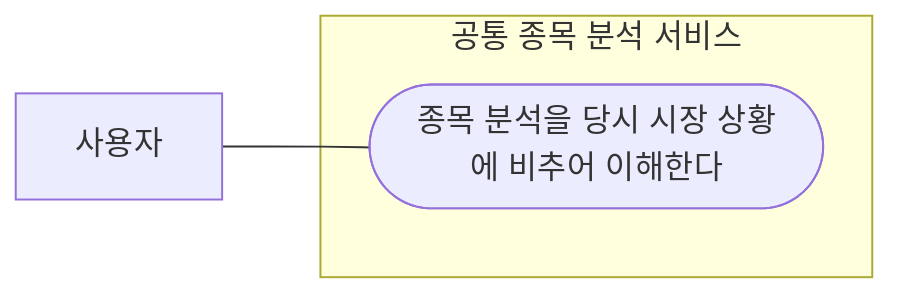
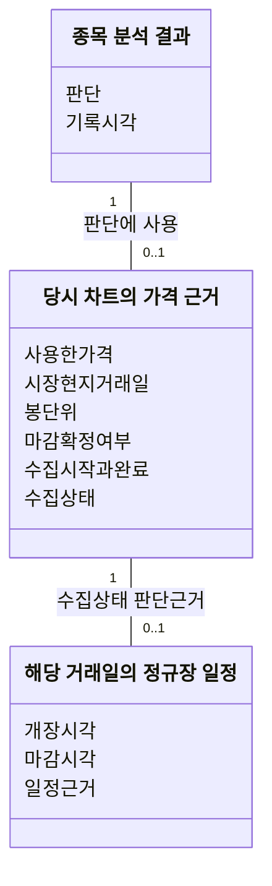
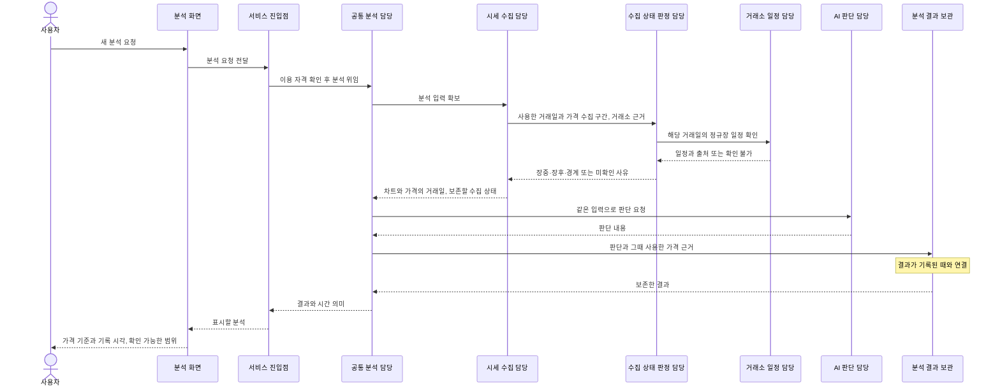
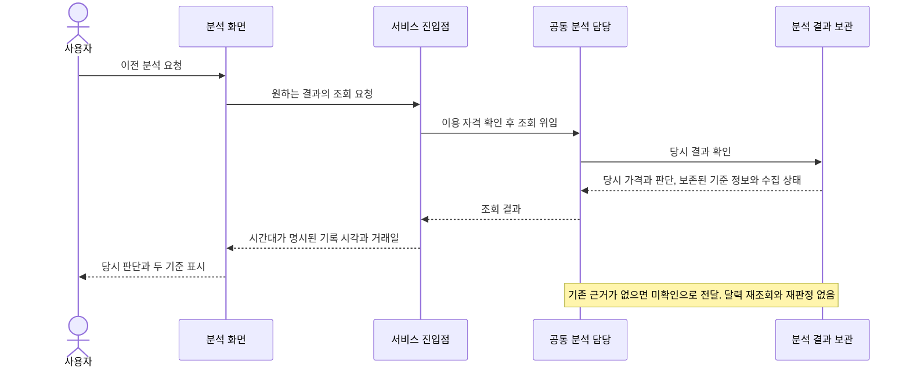
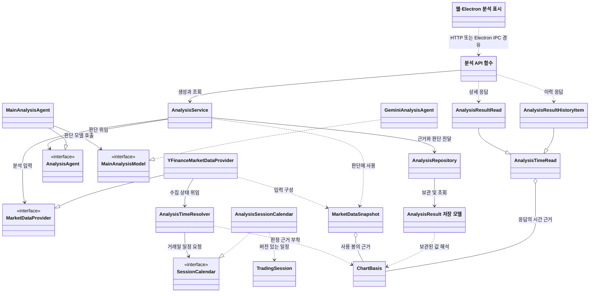
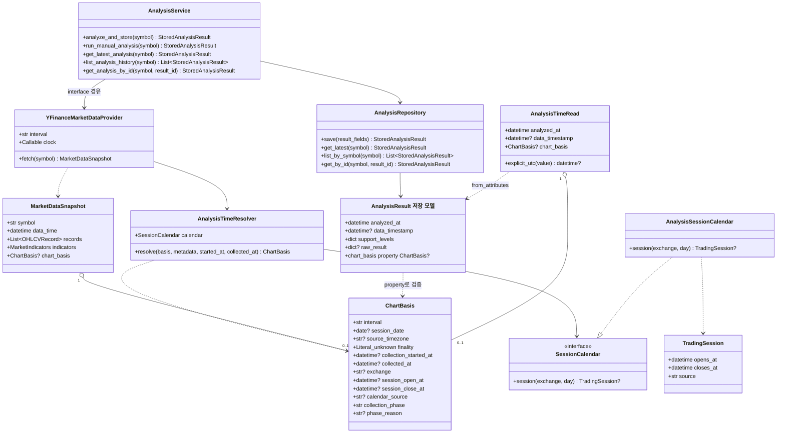
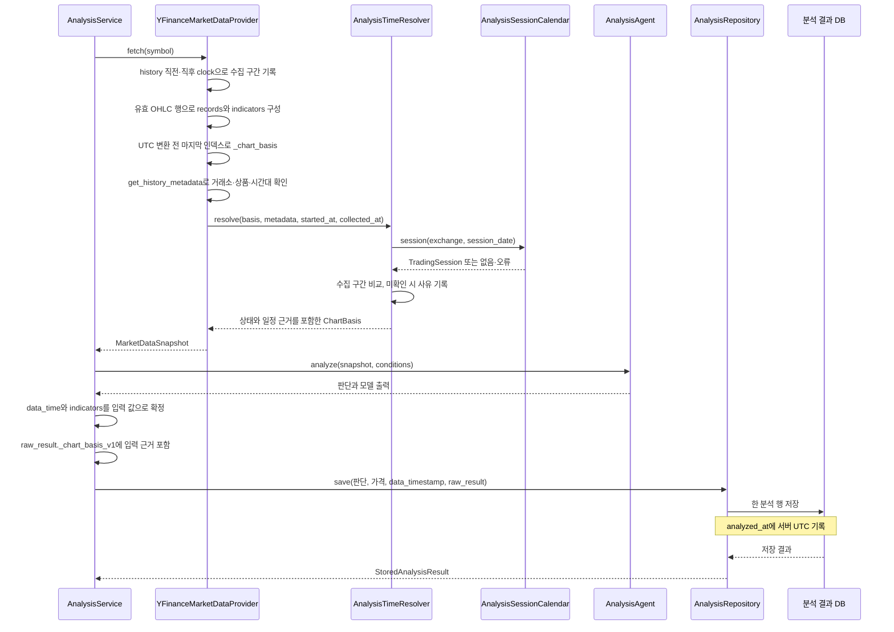
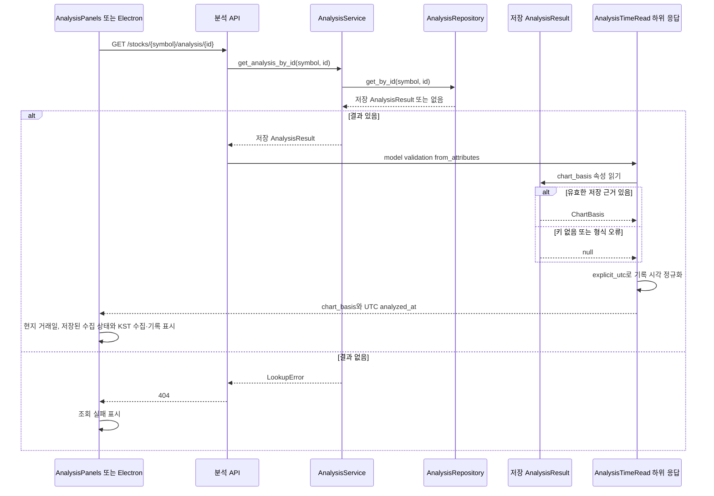

# 공통 종목 분석의 가격 기준일과 분석 기록 시각

2026-11-08 · 구현 설계 · 기준 코드 [main e4b9664](https://github.com/PhilPark-geosr/stock-agent/tree/e4b96646812ea92f27adf9e13afdb71c0e572d11)

2026-11-08 사용자의 시퀀스·클래스 구체화 및 구현 요청, 이어진 한국·미국 장 마감에 따른 상태 판정 보완 요청을 근거로 아래 OOA와 FR-AT-01~08을 구현 기준으로 삼는다. 장중 생성은 유지하며 거래소 일정과 **실제 가격 요청 시작·완료 시각**으로 장중·정규장 종료 후·마감 경계 수집을 구별한다. 공급자의 가격 반영 확정은 별도 의미다. 확정 봉만을 쓰는 생성 제한은 채택하지 않았다.

**사용자에게 답할 질문은 세 가지다. “어느 거래일의 가격인가?”, “그 가격을 해당 정규장 도중에 수집했나, 종료 후 수집했나?”, “분석은 언제 기록됐나?”** 월요일에 금요일 일봉을 분석하면 두 날짜 모두 맞다. 늦게 조회했다고 당시 장중에 수집한 가격이 마감 가격으로 바뀌지는 않는다.

이번 범위는 웹·Electron에서 보는 공통 종목 분석의 최신 결과와 이력이다. 여기서 말하는 기준은 **분석에 실제 사용된 차트의 끝**이다. 브리핑의 뉴스·공시 수집 마감, 스케줄 실행 시각, 모의매매의 현재가·체결 가능 시간은 각각 다른 판단에 쓰인다. 이 문서의 시간으로 대체하지 않는다.

## 출발점 — 현재 코드에서 확인한 사실

- 기본 공급자는 일봉을 요청한다. OHLC 결측을 제외하고 남은 마지막 행의 인덱스를 UTC로 변환해 `data_time`에 넣는다. 시간대가 없는 인덱스는 UTC로 가정한다. 이 값 자체는 일봉의 실제 마감 순간, 공급자의 최종 확정 또는 수신 시각을 증명하지 않는다. [시세 공급자](https://github.com/PhilPark-geosr/stock-agent/blob/e4b9664/app/integrations/yfinance_market_data_provider.py)
- Gemini 응답의 `data_time`은 입력 시세의 값으로 덮어쓴다. `AnalysisService`는 이를 `data_timestamp`로 저장한다. 별도 필드 `analyzed_at`은 저장 모델의 UTC 기본값이며 이력 정렬에 쓰인다. 모델 응답의 `analysis_time`과 의미가 다르다. [모델 응답 정규화](https://github.com/PhilPark-geosr/stock-agent/blob/e4b9664/app/integrations/llm/gemini_analysis_agent.py) · [저장 경로](https://github.com/PhilPark-geosr/stock-agent/blob/e4b9664/app/services/services.py) · [저장 모델](https://github.com/PhilPark-geosr/stock-agent/blob/e4b9664/app/domain/models.py) · [이력 정렬](https://github.com/PhilPark-geosr/stock-agent/blob/e4b9664/app/repositories/repositories.py)
- 웹은 ‘분석 시점 종가’와 ‘시장 데이터 시각’을 떨어뜨려 표시하고 두 시간 값을 한국 시각의 날짜·시분으로 포맷한다. Electron도 기록 시각과 시장 데이터 값을 별도로 읽는다. 값을 하나 더 만드는 것보다 **각 값이 뜻하는 바와 정밀도를 일관되게 보여주는 것**이 먼저다. [웹 표시](https://github.com/PhilPark-geosr/stock-agent/blob/e4b9664/web/src/components/AnalysisPanels.tsx) · [Electron 변환](https://github.com/PhilPark-geosr/stock-agent/blob/e4b9664/desktop-demo/src/state/app-state.js)

## OOA — 사용자 목표와 시스템 경계

시스템 경계는 사용자에게 공통 종목 분석을 제공하는 서비스 전체다. 주 액터는 분석을 보는 사용자다. 시세 제공자는 새 분석의 입력을 제공하는 외부 시스템이지만, 이미 작성된 결과의 의미를 이해하는 아래 유스케이스에 직접 참여하지 않는다.

### 유스케이스 다이어그램

### 유스케이스 명세

| 항목 | UC-AT-01 |
| --- | --- |
| 이름 | 종목 분석을 당시 시장 상황에 비추어 이해한다 |
| 목적 | 분석 판단이 어느 때의 가격을 설명하는지 이해하고 현재 참고할 수 있는 범위를 판단한다. |
| 주 액터 | 사용자 |
| 트리거 | 사용자가 최신 또는 이전 종목 분석의 판단 근거를 알고자 한다. |
| 사전조건 | 사용자가 해당 종목의 공통 분석을 열람할 수 있다. |
| 기본 흐름 | ① 사용자가 원하는 종목의 분석 결과를 요청한다. ② 서비스는 판단과 함께 근거 가격의 거래일, 그 가격을 정규장 도중 또는 종료 후에 확보했는지, 결과를 기록한 때를 알려준다. ③ 사용자는 당시 가격의 잠정성과 분석 시점을 이해한다. |
| 대안 | 이전 결과를 요청하면 그 결과가 작성될 때의 근거를 제공한다. 같은 거래일을 근거로 한 결과가 여럿이면 각각 기록된 때로 구별할 수 있다. |
| 예외 | 장 마감을 걸쳐 가격을 확보했다면 장중·장후로 단정하지 않고 경계에 해당함을 알린다. 거래일·수집 시점·거래 일정의 근거가 부족하면 이유를 알린다. 정규장이 끝났어도 해당 가격에 마감 결과가 반영됐다는 근거가 없다면 이를 구별해 설명한다. 결과 부재와 조회 실패는 구분한다. |
| 성공 보장 | 사용자는 당시 판단의 시간적 근거 또는 확인할 수 없는 부분을 알 수 있다. 나중에 같은 결과를 조회해도 이후 가격이 당시 판단의 근거처럼 제시되지 않는다. |

## 기능 요구사항과 표시 기준

모두 UC-AT-01에 연결한다. 한국시간 표기와 아래 문구를 웹·Electron에 동일하게 적용한다.

| ID | 요구사항 |
| --- | --- |
| FR-AT-01 | 가격 옆에 그 분석에 **실제로 사용된 마지막 유효 일봉의 거래일**을 표시한다. 거래일은 해당 시장의 현지 날짜다. 일봉 라벨에서 마감 시·분을 만들어내지 않는다. 마지막 행이 결측으로 제외됐다면 그 이전의 실제 사용 행을 따른다. |
| FR-AT-02 | 결과에 **분석 기록 시각**을 별도 표시한다. 사용자 표시 기준은 한국시간(KST), 저장된 순간의 교환 표현은 UTC 또는 명시적인 오프셋으로 한다. 미국 시장 거래일을 한국 날짜로 바꾸지 않는다. |
| FR-AT-03 | 분석 내용·근거 가격·기준일·기록 시각은 같은 결과에서 읽는다. ‘최근 기록한 분석’은 기록 순서를 뜻한다. 현재 시세, 조회 시각, 다른 결과에서 값을 보충하지 않는다. |
| FR-AT-04 | 일봉 여부, 거래일, 정확한 시각, 확정 여부는 각각 근거가 있을 때만 표현한다. 장중 일봉 등 확정을 입증할 수 없는 종가는 **‘일봉 기준 가격’**으로 표시한다. 일봉 자체에 확정 근거가 없는 경우 ‘확정 종가’, ‘실시간’, ‘최신 시세’로 승격하지 않는다. |
| FR-AT-05 | 최신 상세·과거 상세·이력 목록에 같은 의미와 시간대 규칙을 적용한다. 이력에서는 두 기준을 비교할 수 있도록 짧게 보여준다. 정보 누락은 결과 부재·조회 실패와 구별한다. |
| FR-AT-06 | 가격 요청의 시작·완료 시각을 UTC로 기록한다. 해당 일봉 거래일의 정규장 일정과 비교해 수집 상태를 한 번 판정한다. 조회 시각이나 AI 판단 완료 시각으로 재판정하지 않는다. |
| FR-AT-07 | 확인된 거래소의 휴장·조기 폐장·시간대·서머타임·특별 거래시간을 반영한다. 미지원 거래소·상품·연도, 일정 장애, 시간대 불일치, 휴장일에 해당하는 일봉은 이유가 있는 미확인으로 처리한다. 종목 문자열만으로 미국 시장을 추정하지 않는다. |
| FR-AT-08 | 일정상 장 종료와 공급자의 마감 가격 반영을 분리한다. 장 마감 직전 시작한 요청이 종료 후 끝나면 ‘장 마감 경계에서 수집’으로 표시한다. 일정 근거와 수집 상태를 가격과 함께 보존하고, 과거 결과의 상태를 시간이 지났다는 이유로 바꾸지 않는다. |

### 화면 예시

가상 예시. 사용자는 월요일에 미국 종목의 금요일 일봉을 근거로 작성된 분석을 읽는다.

> **일봉 기준 가격　152.40 USD**  
> 가격 기준 거래일　2026-10-30 (미국 시장 현지일)  
> 정규장 종료 후 수집 · 가격 수집 완료 2026-11-02 09:09 KST 
> 공급자의 마감 가격 반영은 확인되지 않았습니다. 
> 분석 기록　2026-11-02 09:10 KST

이력에는 **‘11월 2일 09:10 KST 기록 · 10월 30일 일봉 기준 · 정규장 종료 후 수집’**이 표시된다. 나중에 열어도 같다. 금액·통화는 표시 예시이며 신규 요구는 시간 정보다. 한국 15:00에 수집해 16:00에 저장·조회했다면 ‘장중 기준’을 유지한다.

### 수집 상태 정책

- `during_session` — 해당 거래일의 개장 이상에 요청을 시작하고 마감 전에 완료: **장중 기준**.
- `after_session` — 해당 거래일의 마감 이상에 요청을 시작: **정규장 종료 후 수집**. 지난 금요일 일봉을 일요일에 가져오는 경우도 금요일의 마감과 비교한다.
- `boundary` — 장중 시작 후 마감 시각 또는 그 이후에 완료: **장 마감 경계에서 수집**. 임의로 장후로 올리지 않는다.
- `unknown` — 거래일·시간·시장·달력 근거가 없거나 모순됨: **수집 시점 상태 미확인**, 상세에는 이유를 표시한다. 해당 일봉의 개장 전부터 시작한 요청도 여기에 속한다.

어느 상태도 공급자의 **확정 마감 가격**을 뜻하지 않는다. 현재 yfinance 입력에는 그 보장이 없어 `finality=unknown`을 유지하지만, 정상적인 장중·장후 상태까지 미확인으로 표시하지 않는다. 향후 확정 값을 지원하려면 해당 거래일·가격에 연결된 공급자의 확정 근거를 별도로 검증해야 한다. 일정으로 n분이 지났다는 이유만으로 확정하지 않는다. 정규장 일정 판정이며 시간외 시장의 운영 상태나 종목별 거래정지 판정은 아니다.

### 거래소 일정의 근거와 유지

기존 의존성 `exchange_calendars`의 잠금 버전 4.13.2를 재사용한다. 가격 응답 메타데이터의 거래소 코드·상품 종류(EQUITY/ETF)·시간대가 일치할 때만 적용한다. `KSC/KOE → XKRX`, `NMS/NGM/NCM → XNAS`, `NYQ → XNYS`, `ASE → XASE`, `PCX → ARCX`이다. 코드가 없거나 다른 시장이면 미확인으로 남긴다. 프리·애프터마켓 요청은 하지 않는다.

일정 지원 범위는 한국 2025~2026년, 미국 2025~2028년이다. 매년 다음 연도 사용 전에 거래소 공지와 달력을 검토하고 테스트·지원 연도를 함께 갱신한다. 라이브러리 기본 범위가 더 넓어도 자동으로 지원한다고 간주하지 않는다. 일정은 계획된 정규장 일정이며 예고 없이 발생한 거래 중단까지 확인하는 실시간 상태 공급자는 아니다.

검토 중 잠금 버전의 국내 예외 누락을 확인하여 분석용 어댑터에만 다음을 반영했다. 기존 브리핑·카탈로그 정책은 이 변경의 범위가 아니다.

- 2025-11-13 및 2026-11-19: 10:00~16:30 KST. [한국투자증권의 2025 거래시간 안내](https://securities.koreainvestment.com/main/customer/notice/Notice.jsp?cmd=TF04ga000002&num=45644), [2026 KRX 시장안내 원문 재게시](https://stock.mk.co.kr/news/disclosure/template/1183583).
- 2026-06-03 및 2026-07-17: 휴장. [삼성선물 시장 휴장 안내](https://ssfutures.com/ssf/customer/notice/CUS_01102.cmd?ND_PATH=/biz/customer/notice/Ad202_4589.shtm&categoryID=M158746897264671332).
- 미국 조기 폐장과 휴장일은 [NYSE 일정](https://www.nyse.com/trade/hours-calendars)·[Nasdaq 일정](https://nasdaqtrader.com/Trader.aspx?id=Calendar)을 대조했다. 회귀 검증은 미국 DST 전후와 2026-11-27 13:00 ET 조기 폐장을 포함한다.

일정 변경은 이 어댑터·출처·테스트를 함께 수정해 배포한다. 저장 결과에는 라이브러리 버전과 지역 예외 버전, 당시 적용한 개장·마감 시각을 남긴다. 이후 달력 수정이 과거 결과를 자동 갱신하지 않는다.

## OOD — 도메인 → 관계 중심 시퀀스 → 클래스 → 상세 상호작용

### 1. 도메인 관계

가격 근거는 분석에 딸린 값이다. 과거 기록에서는 일부 또는 전부가 비어 있을 수 있다. 시장 현지 거래일은 날짜, 기록 시각은 하나의 순간이다. 수집 상태는 그때의 가격 요청과 정규장 일정의 관계다. FR-AT-01~04·06~08.

### 2. 관계 중심 시퀀스 — 생성 시점의 협력

FR-AT-01~04·06~08. 예약 분석도 같은 공통 분석 담당과 수집·보관 경로를 사용한다. 위 그림의 사용자 요청 부분은 수동 분석에 해당한다.

### 3. 관계 중심 시퀀스 — 과거 결과의 협력

FR-AT-03~05. 결과 조회에 외부 시세 수집이나 AI 판단을 추가하지 않는다. ‘최신’도 가장 최근 기록의 순서이며 실시간 시세 보장을 뜻하지 않는다.

### 4. 주변 클래스와의 관계

Routes와 AnalysisView는 함수·컴포넌트를 묶어 표시한 기존 경계다. 그림 때문에 새 컨트롤러 클래스를 만들지 않는다. 웹은 API를 직접 이용하고 Electron은 기존 preload·백엔드 서비스를 경유한다. 저장 모델과 AI 출력 스키마에는 같은 AnalysisResult 이름이 있으므로 그림에서 ‘저장 모델’을 명시했다.

수집 상태 판정은 `app/services/analysis_time.py`, 일정 계약과 불변 값은 `app/domain/analysis_time.py`, 달력 구현은 `app/integrations/analysis_calendar.py`에 둔다. 판정 담당은 SessionCalendar 계약만 참조하며 실제 어댑터는 공급자를 구성할 때 주입한다. 달력 교체가 판정 규칙을 바꾸지 않는다.

### 5. 상세 클래스 — 실제 필드와 오퍼레이션

| 구현 책임 | 연결 요구사항 | 적용 내용 |
| --- | --- | --- |
| YFinanceMarketDataProvider.fetch 및 _chart_basis | FR-AT-01·04 | OHLC 결측 제거 후 실제 사용한 마지막 행을 고른다. 1d이고 원천 인덱스에 시간대가 있을 때 UTC 변환 전 날짜를 거래일로 잡는다. 무시간대·비일봉은 거래일을 미확인으로 보존한다. 모든 입력의 finality는 unknown이다. |
| YFinanceMarketDataProvider.fetch의 clock | FR-AT-06 | history 요청 직전·응답 직후 서버 UTC를 읽는다. 메타데이터 추가 요청과 AI 처리는 이 구간 밖이다. 기록 시각이나 봉 인덱스를 수집 시각으로 대체하지 않는다. |
| AnalysisTimeResolver.resolve | FR-AT-06~08 | 시장·상품·시간대 근거를 확인하고 마지막 사용 거래일의 일정과 수집 구간을 비교한다. 상태와 사유·적용 일정을 ChartBasis에 담는다. |
| SessionCalendar, AnalysisSessionCalendar, TradingSession | FR-AT-07·08 | 기존 달력 라이브러리와 검토한 예외를 읽는다. 휴장일이면 없음, 지원 연도 밖이면 명시적 오류를 전달한다. 달력 실패는 판정 담당이 미확인으로 변환해 분석은 유지한다. |
| AnalysisService.analyze_and_store | FR-AT-01·03 | 입력의 data_time과 계산 지표를 사용한다. 모델이 반환한 가격·시간으로 해당 값이 바뀌지 않게 하고, 원천 ChartBasis를 결과에 부착한다. |
| GeminiAnalysisAgent의 시스템 지침 | FR-AT-04·08 | 입력에 포함된 수집 상태의 의미와 마감 반영 여부의 차이를 명시한다. 시간 경과나 장후 수집만으로 확정 종가·현재가라고 표현하지 않도록 지시한다. 모델의 문구 준수는 별도 실호출 검증 대상이며 UI 판정은 모델 출력을 사용하지 않는다. |
| AnalysisRepository 및 저장 모델 | FR-AT-02·03 | 기존 save 한 번으로 판단·가격·시간 근거를 같은 분석 행에 저장한다. analyzed_at은 UTC 저장 시각이다. ChartBasis는 raw_result의 예약 키 _chart_basis_v1에 JSON 값으로 보관한다. 별도 migration은 필요 없다. |
| 저장 모델의 chart_basis 속성 | FR-AT-03·04 | 예약 키를 ChartBasis로 검증한다. 키가 없거나 형식이 잘못된 이전 기록은 null을 반환해 열람을 유지한다. 원본을 갱신하지 않는다. |
| AnalysisTimeRead 및 두 하위 응답 | FR-AT-02·05 | 기록 시각을 명시적인 UTC로 직렬화한다. SQLite가 UTC 필드에서 제거한 tzinfo만 복원한다. 상세와 이력에 같은 chart_basis를 노출한다. 기존 data_timestamp도 UTC로 제공하되 UI의 거래일 추정에 쓰지 않는다. |
| 웹 AnalysisPanels 및 Electron app-state/분석 컴포넌트 | FR-AT-01~08 | 거래일은 날짜 그대로, 수집·기록 시각은 KST로 표시한다. 상세와 이력의 상태는 저장값을 읽고, 상세에서는 공급자 반영 여부 또는 미확인 사유를 설명한다. 조회 실패와 정상 조회 0건을 구별한다. |

ChartBasis와 TradingSession은 불변 값이다. finality는 unknown이며 collection_phase와 분리된다. 구버전의 data_timestamp 또는 analyzed_at으로 거래일·수집 시각·수집 상태를 역산하는 backfill은 하지 않는다. 거래소 메타데이터는 공개 [get_history_metadata API](https://ranaroussi.github.io/yfinance/reference/api/yfinance.Ticker.get_history_metadata.html)를 사용한다. 설치된 yfinance는 필요하면 추가 요청을 수행하므로 추가 원격 요청이 없다고 보장하지 않는다. 메타데이터 실패는 미확인 사유로 처리하며 이미 받은 가격은 분석에 사용할 수 있다.

### 6. 상세 시퀀스 — 입력과 저장의 결합

FR-AT-01~04·06~08. 가격 수집이나 모델 실패 시 save에 도달하지 않는다. 메타데이터·달력만 실패하면 상태 미확인으로 분석을 이어간다. 수동 재실행은 새 행을 만든다. 여러 요청도 각 요청의 스냅샷을 해당 행에 붙이며 다른 요청의 최신 값과 섞지 않는다.

### 7. 상세 시퀀스 — 구버전 결과까지 조회

이력 API는 같은 과정을 각 행에 적용하는 AnalysisResultHistoryItem을 사용한다. DB 조회는 기존 shared_safe·종목 필터와 접근 권한을 유지한다. 웹과 Electron은 늦게 도착한 다른 결과가 선택 중인 분석을 덮지 않도록 조회 순서를 확인한다.

### 8. 설명할 때 사용할 예

“시세 수집기가 가격을 요청한 때와 받은 때를 남깁니다. 수집 상태 판정 담당은 그 가격의 거래일에 해당하는 거래소 일정을 받아 장중인지, 장 종료 후인지 확인합니다. 요청이 장 마감을 걸쳤다면 경계라고 표시합니다. 분석 서비스는 가격·상태·판단을 같이 저장합니다. 금요일 오후 3시에 받은 한국 가격을 오후 4시에 분석 완료해도 장중 기준이고, 월요일에 다시 열어도 같습니다. 장 종료 후 받았다는 사실과 공급자가 마감 가격을 반영했다는 사실은 달라서 화면에서도 구별합니다.”

### 9. API 호환성과 적용

기존 생성·최신·상세·이력 엔드포인트를 재사용한다. 선택적 chart_basis 안에 수집 구간·상태·일정 근거 필드를 추가한다. 기존 필드를 제거하지 않는다. chart_basis 자체가 없는 기록은 null, 최초 버전의 거래일만 있는 기록은 수집 상태 unknown과 비어 있는 수집 시각을 받는다. DB 열 변경과 과거 데이터 재작성은 없다. session_date는 JS Date로 변환하지 않는다.

웹 또는 Electron을 갱신한 뒤 예전 서버를 사용해 chart_basis가 없으면 거래일 미확인으로 표시한다. 오프셋 없는 분석 시각 응답도 브라우저 시간대로 해석하지 않고 기록 시각 미확인으로 표시한다. 새 서버는 저장소가 UTC로 기록한 analyzed_at에 오프셋을 보장한다.

## 인수 시나리오

| 상황 | 사용자가 확인할 결과 | 근거 |
| --- | --- | --- |
| 금요일 국내 일봉으로 월요일에 분석 | 금요일은 가격 옆 거래일, 월요일은 기록 시각. 휴장일을 이유로 임의의 가격 지연 경고를 만들지 않는다. | FR-AT-01·02 |
| 미국 주식의 거래일과 한국 기준 기록 날짜가 다름 | 미국 일봉에는 현지 날짜가 유지되고 기록에만 KST가 붙는다. 서머타임 전후에도 고정 시차를 더해 거래일을 구하지 않는다. | FR-AT-01·02 |
| 당일 일봉이 들어왔지만 마감 확정 근거가 없음 | 일봉 기준 가격과 거래일은 제공한다. 확정 종가·실시간 체결가나 정확한 마감 시각은 표시하지 않는다. | FR-AT-04 |
| 새 분석을 만든 뒤 예전 분석을 다시 열거나 같은 날 여러 번 분석 | 각 결과의 가격·거래일·기록 시각이 한 쌍의 근거로 유지된다. 이력 목록과 상세의 표시가 일치한다. | FR-AT-03·05 |
| 최근 행의 가격이 결측이어서 이전 거래일 행을 사용 | 사용한 이전 행의 가격과 거래일을 함께 표시한다. | FR-AT-01·03 |
| 구버전 분석에 데이터 시각이 없거나 거래일 의미가 불명 | 판단과 기록 시각은 열 수 있고 ‘가격 기준 거래일 미확인’이 보인다. 정상 조회 0건과 통신 실패는 각각 별도 안내다. | FR-AT-04·05 |
| 한국 15:00 수집·16:00 분석 완료 후 다음날 조회 | 장중 기준을 유지한다. 조회 시각·기록 시각으로 상태를 바꾸지 않는다. | FR-AT-06·08 |
| 한국 마감 15:30 직전 요청·직후 완료 | 장 마감 경계에서 수집으로 표시한다. 15:30 이상에 시작한 별도 새 요청부터 장후다. | FR-AT-06·08 |
| 미국 DST 전후 및 조기 폐장 | 현지 정규장 일정으로 판정한다. 2026-11-27은 13:00 ET 종료로 처리한다. | FR-AT-07 |
| 한국 수능일·첫 거래일 | 검토한 수능일은 10:00~16:30, 2026-01-02는 10:00 개장으로 판단한다. | FR-AT-07 |
| 일요일에 금요일 차트를 수집 | 일요일이 아니라 해당 금요일의 마감과 비교해 정규장 종료 후 수집으로 표시한다. | FR-AT-06 |
| 달력 장애·미지원 연도·메타데이터 실패 | 가격 분석은 유지하면서 상태 미확인과 이유를 제공한다. 휴장일로 표기된 일봉도 장후로 단정하지 않는다. | FR-AT-07·08 |

## 설계 자체 검토

UC-AT-01은 화면을 음성 안내로 바꿔도 성립한다. 기본·대안 흐름에는 사용자의 요청과 관찰 가능한 응답만 있다. 유스케이스 그림은 사용자와 목표의 관계 하나만 나타내며 내부 저장소·처리 순서·include가 없다. 데이터 출처와 내부 협력은 요구사항 뒤의 OOD로 분리했고 각 책임과 인수 시나리오에 FR을 연결했다. 생성과 조회의 최초 시퀀스는 책임 전달만 설명하며 메서드·DB 처리는 별도의 상세 시퀀스에서 다룬다. 추가된 수집 판정·거래소 일정 담당은 FR-AT-06~08의 책임이며 내부 객체를 외부 액터로 표현하지 않는다.

**구현 범위의 한계**는 일정이 공급자의 마감 가격 반영이나 실시간 거래 중단을 보장하지 않는다는 점이다. 정상 입력은 장중·장후·경계 상태를 제공하고, 달력·메타데이터 등의 근거가 부족한 경우만 수집 상태 미확인으로 표시한다. 공급자의 최종 반영은 별도로 설명한다. 실시간 시세 지연 측정이나 확정 일봉 전용 분석 정책은 별도 범위다.

## 구현 검증 기록 — 2026-11-08

- 서버 전체 테스트 247개 통과. 국내 거래일의 UTC 날짜 이동, 미국 서머타임·조기 폐장, 한국 특별 거래시간, 휴장일·미지원 시장·달력 실패, 수집 경계, 생성→저장→상세·최신·이력 응답과 기존 기록 호환성을 확인한다.
- 웹 테스트 51개, 타입 검사·배포 빌드 통과. Electron 테스트 34개와 구문 검사 통과. 저장된 수집 상태의 상세·이력 표시 및 늦게 도착한 응답 방어를 확인했다.
- 격리된 서버와 가상 공급자를 사용하는 브라우저 시나리오 6개 통과(36.6초). 모바일 상세·이력의 장후 상태·수집 시각·기존 기록 미확인 표시와 가로 넘침을 확인했고 러너가 정상 종료했다.
- 문서의 Mermaid 다이어그램 8개를 렌더링해 문법과 배치를 확인했다.
- 실제 외부 시세·Gemini·카카오 호출 검증은 수행하지 않았다. 기존 운영 데이터와 자격 증명은 변경하지 않았다.
