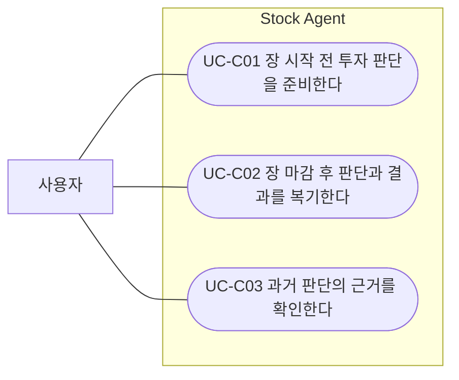
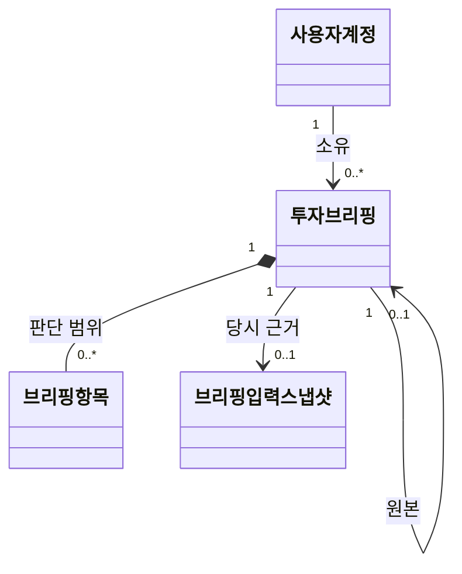
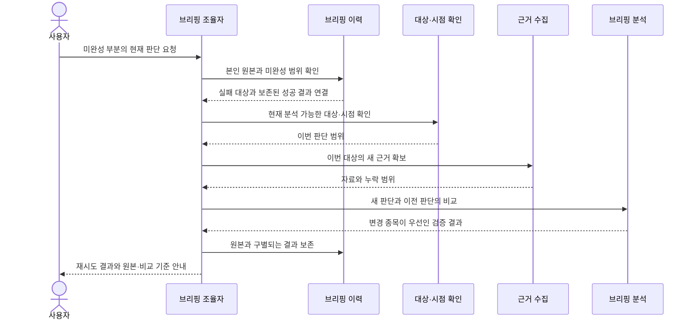
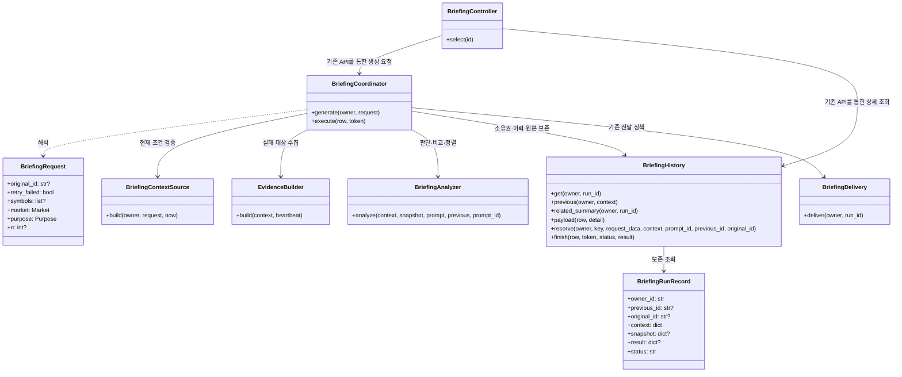

# PR #36 기준 브리핑 누락 기능 보완

2026-10-12 · 구현 기준: main `491ae37` (PR #36) · 근거: 사용자의 “#36을 기준으로 #30의 누락 기능만 보완” 요청.

[기존 확정 설계](continuous_briefing_design.md)의 사용자 목표·소유권·과거 결과 보존 정책을 유지한다. PR #30의 별도 브리핑 모델과 마이그레이션을 합치지 않고 기존 연속 브리핑에 필요한 책임만 보완한다. 본 문서는 [설계 절대규칙](../AGENTS.md)에 따라 OOA → 도메인 → 관계 중심 시퀀스 → 상세 클래스 순서로 작성한다.

## 1. 요구사항 대조

| PR #30 근거 | #36 기준 처리 |
| --- | --- |
| FR-B01 현재 사용자의 관심종목 | 기존 사용자·시장·활성 구독 검증 유지 |
| FR-B02 공유 종목 분석 | 기존 공유 분석은 유지. 개인의 이전 브리핑을 해석하는 연속 브리핑을 공유 분석으로 교체하지 않음 |
| FR-B03 소유권 | 기존 소유자 제한 유지, 비교·원본 연결에도 적용 |
| FR-B04 대상·현재·이전 근거 | 기존 스냅샷 보존 유지. 비교 날짜·종류·자료 기준·관찰기간·이전 판단 및 상세 이동 보완 |
| OOA의 변경 종목 우선 제공 | 검증된 판단 변경 → 변화 폭 → 인용 자료 시각 → 종목 코드 순으로 보완 |
| FR-B05 거래소 일정 | 기존 거래소 달력과 장전·장후 시간 조건 유지 |
| FR-B06 실패 종목만 재시도 | 성공 종목을 제외한 수동 재시도 보완. 원본을 보존하고 실패 대상만 새 브리핑 생성 |
| FR-B07 중복 방지 | 기존 요청 고유키·실행 소유권 유지, 재시도에도 적용 |
| FR-B08 장후 당일 일봉 확인 | 기존 자료 부족 판정 유지, 해당 종목을 재시도 대상으로 제공 |
| FR-B09 알림 연결 | 기존 사용자별 연결·동의·전달 상태 분리 유지. 연결 없이는 외부 전송하지 않음 |
| FR-B10 운영자 강제 실행 | #36에 해당 HTTP 경로가 없으므로 별도 내부 실행 API·토큰을 신설하지 않음 |
| FR-B11 시작 시 일정 확인 | 기존 시작 시 확인 및 생성 허용 시간 유지 |
| FR-B12 최신 버전으로 교체 | #36의 FR-C09를 우선: 과거 결과를 덮어쓰지 않고 원본 연결 유지 |

#36은 매수·보류·매도 세 판단을 사용하고 신뢰도 점수를 출력하지 않는다. 정렬을 위해 점수를 만들어 넣거나 #30의 다섯 단계 판단 계약을 복원하지 않는다. 비교 불가는 변경으로 집계하지 않는다. 종목명 공급·정식 종목 식별 연결은 이번 범위에 추가하지 않는다.

## 2. OOA: 사용자 목표와 외부 관찰

시스템 경계는 Stock Agent다. 사용자는 자신의 투자 판단을 준비·복기하고 과거 근거를 확인하는 사람이다. 거래자료·공개자료·AI 분석 제공 시스템 및 카카오는 기존 외부 시스템이다. 이번 보완은 액터나 사용자 목표를 추가하지 않는다. 내부 이력 관리·분석기·저장소는 액터가 아니다.

ID·이름·목적·주 액터·트리거·사전조건·기본 흐름·예외·성공 보장의 전체 명세는 [기존 UC-C01~03](continuous_briefing_design.md#uc-c01-장-시작-전-투자-판단을-준비한다)를 유지하며 아래 관찰 가능한 흐름을 보완한다. ‘재시도 버튼 누르기’를 별도 유스케이스로 만들지 않는다.

- **UC-C01/C02 기본 흐름 보완:** 시스템은 이전과 판단이 달라진 종목을 먼저 제공한다. 사용자는 어떤 시점의 판단과 비교했는지와 이전·현재 결론을 구분한다.
- **UC-C01/C02 실패 대안 흐름:** 일부 종목의 판단을 제공하지 못하면 시스템이 그 범위를 알린다. 사용자가 미완성 부분의 판단을 다시 요청하면 시스템은 해당 종목만 현재 시점에서 판단하고 앞선 성공 결과도 확인할 수 있게 한다. 자료가 여전히 부족하면 그 한계를 알린다.
- **UC-C01/C02 추가 예외:** 현재 관찰 대상이 아니거나 요청 시점에 해당 목적의 브리핑을 제공할 수 없으면 이유를 알리고 원본을 유지한다.
- **UC-C03 기본 흐름 보완:** 시스템은 당시 비교 대상으로 삼은 브리핑의 날짜·종류·자료 기준과 당시 판단을 제공한다. 사용자는 비교 기준과 원본의 보존된 근거를 확인한다.
- **공통 성공 보장:** 성공한 판단을 미완성 부분의 재요청 때문에 바꾸지 않는다. 과거 기준과 현재 자료를 한 시점의 결과처럼 표시하지 않으며 타인의 판단은 제공하지 않는다.

## 3. 기능 요구와 구체화 정책

| ID | 요구사항 | 추적 |
| --- | --- | --- |
| FR-G01 | 검증된 변경 여부, 판단 변화 폭, 인용한 근거 중 최신 공개 시각 내림차순, 종목 코드 오름차순으로 결과를 정렬한다. 변화 폭은 매도=-1, 보류=0, 매수=1의 절대 차이이며 투자 점수로 표시하지 않는다. | UC-C01/C02, 기존 FR-C06, #30 변경 우선 제공 |
| FR-G02 | 상세 결과에 실제 비교 날짜·장전/장후·자료 기준 시각·n과 유효한 이전 판단, 비교 대상 상세 이동을 제공한다. 비교 불가 항목에 판단 변화 표시를 하지 않는다. 관련 기록도 소유자 범위를 확인한다. | UC-C01~03, FR-C03/C09/C10, FR-B04 |
| FR-G03 | 원본의 실패·자료 부족 종목만 새 실행으로 재시도한다. 성공 항목은 새 분석에서 제외하며 새 실행에서 원본으로 이동할 수 있다. 원본은 변경하지 않는다. | UC-C01~03, FR-C09/C14/C17, FR-B06/B08 |

재시도 정책:

- 유효한 분석 결과가 있는 ‘보류’는 성공이다. 필수 자료가 부족해 판단하지 못한 항목과 구별한다. 뉴스·공시 일부 누락만 있고 유효한 판단을 얻은 종목은 실패 재시도 대상이 아니다.
- 전체 모델 실패는 모든 원본 종목이 대상이다. 생성 중·전부 성공 결과에는 재시도 대상을 제공하지 않는다.
- 사용자의 명시적 수동 요청으로 실행하며 자동 재시도 주기·횟수를 신설하지 않는다. 기존 정기 실행 정책을 유지한다.
- 원본 시장·목적·관찰기간은 유지하고 **현재 시점·현재 적용 지침**으로 실행한다. 과거 거래일 자료를 뒤늦게 생성한 것처럼 표시하지 않는다. 현재 관심종목과 기존 장전/장후 생성 가능 시간을 다시 검증한다.
- 화면의 재시도는 표시된 실패 종목 전체를 대상으로 한다. 관심종목에서 삭제된 대상이 있으면 거절한다. 기존 ‘새 브리핑 준비’에서 현재 대상을 선택해 별도 분석할 수 있으며, API는 실패 대상의 부분집합도 허용한다.
- 새 결과에는 재시도한 종목만 들어간다. 원본 성공 항목은 원본 연결에서 확인한다. 예: 삼성전자 성공·SK하이닉스 자료 부족 → SK하이닉스만 새 결과, 삼성전자 결과는 원본 보존.
- 같은 요청 번호를 재전송하면 같은 실행을 반환한다. 새 요청 번호로 원본을 다시 재시도하는 것은 명시적인 새 분석이다.
- 완성된 새 브리핑의 카카오 전달은 기존 수신 설정을 따른다. 재전달은 저장 메시지만 보내므로 실패 종목 재시도와 다르다.

## 4. 도메인 관계

비교 기준은 새 판단을 비교할 과거 브리핑이고, 원본은 새 분석을 요청하게 된 출발점이다. 두 역할은 같을 수도 다를 수도 있다. 용어는 [CONTEXT.md](../CONTEXT.md)의 실패 종목 재시도·브리핑 재분석을 따른다.

## 5. 관계 중심 시퀀스

최초 협력도에는 메서드·인자·HTTP·저장 순서를 넣지 않는다. 다음은 UC-C01/C02 실패 대안 및 UC-C03과 FR-G01~03의 협력 관계다.

## 6. 상세 클래스와 계약

아래는 최초 협력도와 분리한 구현 수준 OOD다. 새 서비스 계층·저장 테이블 없이 기존 책임에 추가한다.

| 책임 | FR 추적 |
| --- | --- |
| `BriefingAnalyzer`가 실제 이전 판단으로 변경 여부를 검증하고 확정 결과를 정렬 | FR-G01 |
| `BriefingHistory.related_summary`가 소유자 범위 안에서 비교·원본 정보를 제공 | FR-G02/G03 |
| `BriefingCoordinator.generate`가 원본 실패 대상·시장·목적·n을 검증하고 기존 생성 경로에 전달 | FR-G03 |
| 도메인 함수 `retryable_symbols`가 유효한 성공 판단과 자료 부족을 구분 | FR-G03 |
| `BriefingContextSource`가 현재 관심종목·시장·시간 조건을 재검증 | FR-G03, 기존 FR-C01/C17 |
| 화면 컨트롤러·렌더러가 이전 판단/상세 이동/실패 범위·재시도 동작을 제공 | FR-G01~03 |
| 기존 실행 기록·입력 스냅샷·원본 참조·요청 고유키와 전달 흐름 재사용 | FR-G03, FR-C09/C12~14 |

인터페이스: 기존 `POST /briefings`에 `retry_failed`(기본 false)를 추가한다. true이면 `original_id`가 필수다. `symbols` 생략 시 원본 실패 대상 전체, 지정 시 실패 대상의 부분집합이어야 한다. `n` 생략 시 원본 n을 사용한다. 상세 응답은 `previous`, `original`, `retryable_symbols`를 추가하며 목록 응답은 그대로 유지한다. 타인/없는 원본 404, 실패 대상 없음·성공 종목 포함·조건 변경 409, 원본 미지정·현재 관심종목/시간 위반 422. 기존 요청의 중복 검사와 DB 스키마는 유지한다.

## 7. 자체 검토와 검증

- OOA 문장은 화면·API·DB를 바꾸어도 사용자 목표로 성립하며, 기본·대안 흐름은 사용자가 관찰 가능한 행동과 결과다.
- 유스케이스 도식에는 내부 저장소·식별자·실행 순서가 없고 `include`를 사용하지 않는다. 내부 클래스는 OOD에만 배치했다.
- 모든 추가 책임을 FR-G01~03과 기존 UC/FR로 추적했다. 전체 유스케이스 명세는 기존 확정 문서에 유지한다.
- 테스트는 변경 판단의 정렬·비교 근거·타인 참조 차단·성공 종목 재호출 방지·원본 불변·동일 요청 재사용·삭제된 관심종목 거절·전체 실패/자료 부족·부분 출처 누락·화면 재시도 중복 클릭/응답 유실을 확인한다.
- 실제 외부 분석·카카오 전송은 이 보완 검증에 사용하지 않는다. 운영 API 키·공급자 정책은 기존 별도 작업 범위다.
