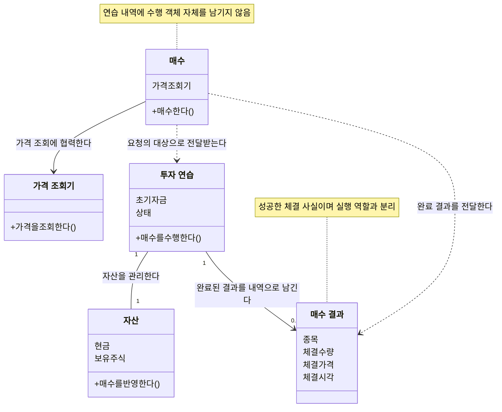

# 가상 매수 — 클래스 설계 초안

- 작성일: 2026-11-12
- 상태: UC-PT-02 성공 시나리오의 책임·협력 후보. 구현 클래스·시그니처·저장 구조의 확정이 아니다.
- 이슈: [#44](https://github.com/PhilPark-geosr/stock-agent/issues/44)
- 근거: [가상 매수 시퀀스](paper_trading_buy_sequence.md), [초기 분석 모델](paper_trading_domain_model.md), [용어집](../CONTEXT.md)

## 1. 선택한 책임 분리

‘매수’는 요청 수행을 조율하는 역할로, ‘매수 결과’는 성공한 체결 사실로 구분한다. 투자 연습의 내역에는 수행 객체 자체가 아니라 완료된 매수 결과를 남긴다. 매수 결과는 종목·체결 수량·체결 가격·체결 시각을 나타내며 가격 조회기나 수행 객체를 참조하지 않는다.

아래 클래스명과 연산명은 후보이며 언어·인자·반환 타입·공개 인터페이스의 상세는 미정이다. 가격 조회기는 협력 역할이고, 별도의 인터페이스와 구현체로 나눌지는 아직 정하지 않는다.

## 2. 클래스 다이어그램

## 3. 클래스별 책임과 근거

### 매수

- 가격 조회·최신성 확인과 투자 연습에 대한 매수 요청을 조율하고 완료 결과를 사용자에게 제공한다.
- 가격 조회기 참조는 협력을 표현하는 후보이며, 투자 연습은 요청 처리 시 전달받는 후보로 둔다. 투자 연습에 대한 장기 참조를 필드로 보유한다고 확정하지 않는다.
- 체결 수량·체결 가격·체결 시각의 과거 사실을 보존하는 책임은 매수 결과에 둔다. 요청 입력을 일시적으로 다루는 것과 완료 사실의 장기 보존을 구분한다.
- 관련: UC-PT-02, FR-PT-022·025.

### 가격 조회기

- 종목의 가격과 그 가격의 기준 시각을 제공한다. AI 분석 실행이나 자산 변경을 수행하지 않는다.
- 관련: FR-PT-022·025. 가격 공급자·허용 지연·실패 응답은 후속 상세화한다.

### 투자 연습

- 진행 중인지 확인하고 자신의 자산에 매수 반영을 요청한다.
- 성공한 체결의 매수 결과를 해당 연습의 내역에 연결한다. 결과 구성도 투자 연습이 담당하는 후보이며 상세 생성 협력은 후속 검토한다.
- 종료된 연습의 결과는 새 매수로 변경하지 않는다. 초기 자금은 유지한다.
- 관련: FR-PT-017·020·021 및 UC-PT-02·06.

### 자산

- 자신이 관리하는 현금이 충분한지 판단하고 현금 감소·보유 주식 증가를 반영한다.
- 외부가 현금을 꺼내 직접 계산하고 설정하는 대신, 자산에 의도 중심의 매수 반영 요청을 보낸다.
- 관련: FR-PT-011·018·019. 비용·평균 매수가·부분 매도 계산은 아직 정하지 않는다.

### 매수 결과

- 완료된 가상 매수의 종목·체결 수량·체결 가격·체결 시각을 나타내는 사실이다.
- 실패·미완료 요청을 성공한 매수 결과로 내역에 남기지 않는다. 이후 시장 가격으로 과거 체결 사실을 다시 계산하지 않는다.
- 수행 객체와 가격 조회기를 참조하지 않아 과거 내역이 실행 협력의 수명에 의존하지 않는다.
- 관련: UC-PT-02·06, FR-PT-017·020·021, 매매 이력 초안 FR-PT-007.

## 4. 생명주기와 의존성

매수 수행 객체가 요청 단위인지 재사용되는 객체인지는 미정이다. 어느 쪽이든 투자 연습에 보존하는 것은 매수 결과다. 매수는 투자 연습에 협력을 요청할 수 있지만, 투자 연습은 그 매수 수행 객체 자체를 내역으로 보유할 필요가 없다.

매수 결과는 과거 사실이므로 변경하지 않는 값으로 취급하는 방향이다. 이것이 별도 DB 테이블이나 특정 저장 방식을 요구하지는 않는다. 저장·복원 방법, 시계·체결 가격의 확정 시점, 식별 필요성은 후속 설계에서 정한다. 매도도 같은 책임 분리를 적용할지는 별도 시나리오에서 검토한다.

## 5. 검토할 부분

- 자산 변경과 매수 결과 보존의 일관성 및 중간 실패 처리
- 관심 종목·국내 주식·수량의 검증 책임, 가격 최신성의 판단 책임과 허용 기준
- 투자 연습이 단순 전달 역할로 남지 않는지와 생성 책임의 적절성
- 필요한 정보를 가진 객체에 규칙을 배분했는지, 공개 연산이 내부 상태를 노출하지 않는지
- 가격 조회기 참조와 구현 교체 범위, 요청·결과의 인자와 반환 형태

책임의 응집도, 실행 협력과 과거 사실의 결합도, 종료 후 기록 보존의 의미를 근거로 분리한 초안이다. 전체 설계가 확정됐다는 뜻은 아니며 다음 시나리오·예외를 적용하면서 보완한다.
