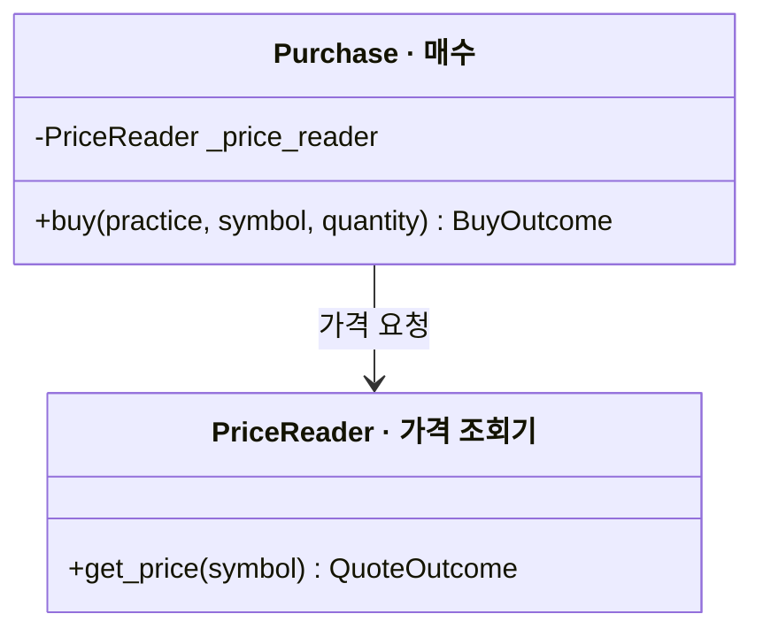
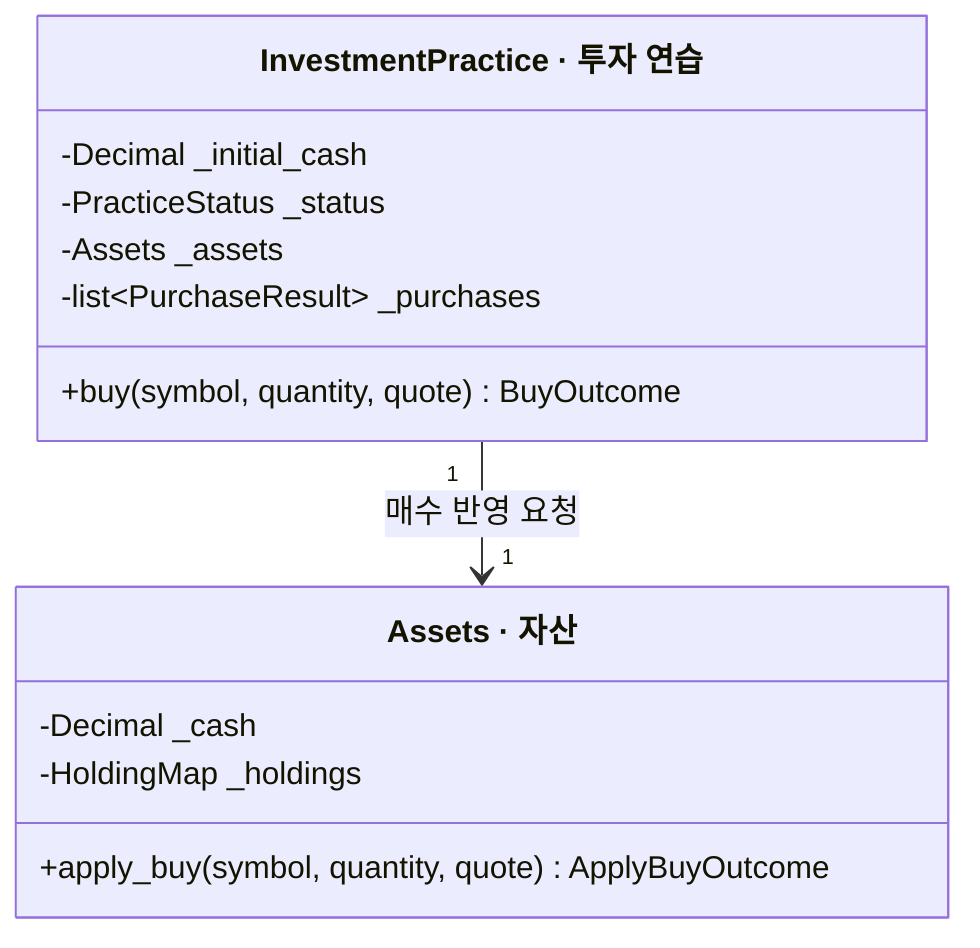
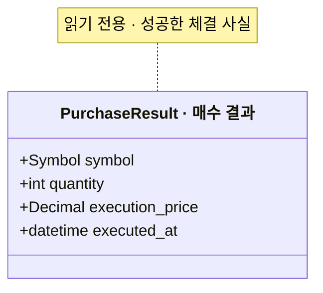
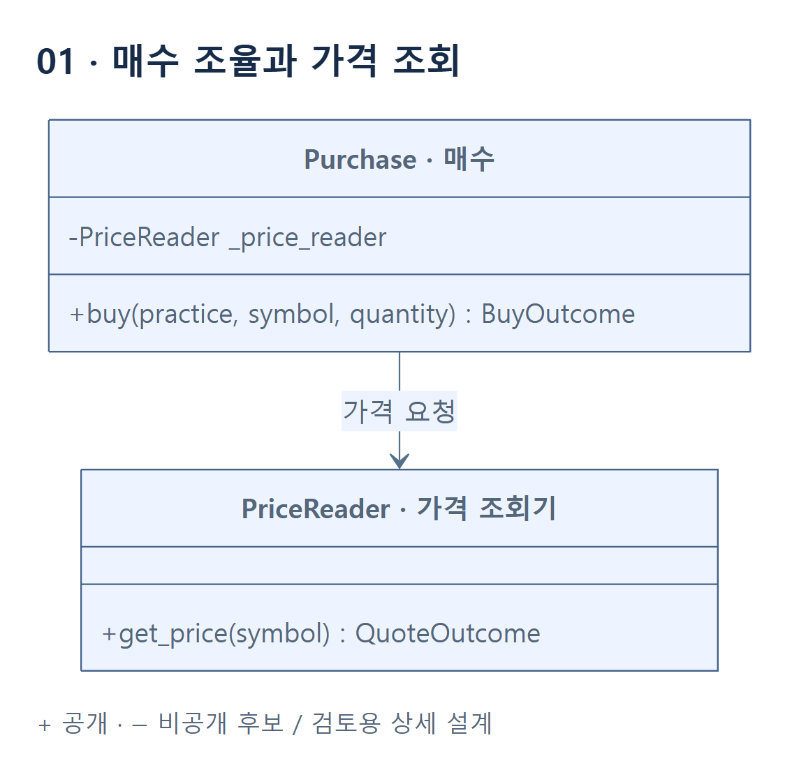
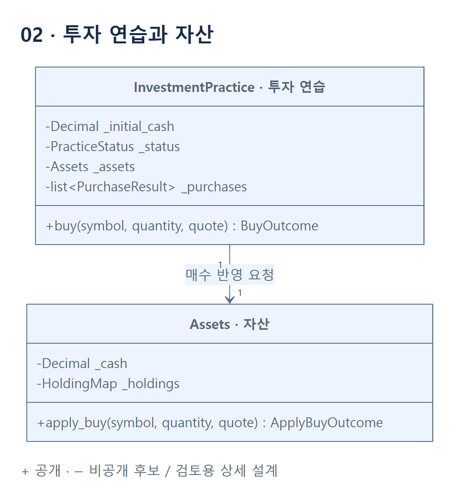
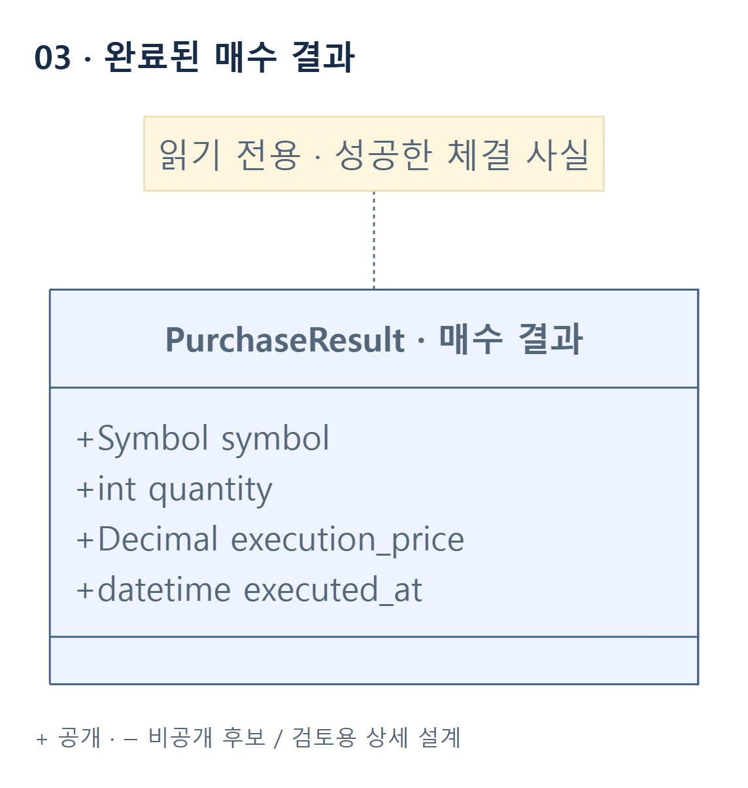

# 가상 매수 — 코드 매핑을 위한 클래스 상세 초안

- 작성일: 2026-11-16
- 대상: UC-PT-02 정상·현금 부족·가격 실패 시나리오
- 근거: [매수 시퀀스](paper_trading_buy_sequence.md), [책임 중심 클래스 초안](paper_trading_buy_class_design.md)
- 상태: 검토용 제안. 코드 구현·최종 타입·미결정 정책의 확정이 아니다.

## 1. 매수 조율과 가격 조회

`Purchase`는 요청마다 `InvestmentPractice`를 전달받고 필드에 보관하지 않는다. 가격 조회 실패는 그대로 매수 실패로 변환해 반환하며, 성공했을 때만 투자 연습에 요청한다. 최신성은 가격 조회기의 책임이고 매수 객체에서 중복 검사하지 않는다.

`PriceReader`는 우선 협력 역할의 이름이다. 추상 클래스·Protocol·구체 클래스 중 무엇으로 구현할지, 공급자를 어떻게 연결할지는 후속 결정한다. 상속 계층이나 공급자 어댑터를 이번 그림에서 추가하지 않는다.

## 2. 투자 연습과 자산

`InvestmentPractice.buy()`는 진행 중인지 판단하고 자산에 매수를 요청한다. 성공 시에만 완료된 매수 결과를 구성해 `_purchases`에 남기고 반환하는 후보다. 종료·현금 부족이면 실패를 반환한다. 초기 자금은 매수로 바꾸지 않는다.

`Assets.apply_buy()`는 현금 한도를 판단하고 현금·보유 수량·취득 원가를 함께 반영한다. 부족하면 어떤 상태도 바꾸지 않는다. 외부에 현금·보유 목록 설정 메서드를 제공하지 않는다.

`Holding`은 기존 도메인 모델의 보유 주식이다. 이 그림에서는 해당 종목의 수량·취득 원가를 관리할 대상이라는 수준으로만 참조한다. `HoldingMap`은 `dict[Symbol, Holding]`을 짧게 표기한 타입 별칭 후보다. 사전은 종목별 보유를 찾는 구조 후보이며 DB 구조가 아니다. `_purchases`도 해당 연습의 완료 내역을 표현하는 후보로서 전체 이력의 메모리 적재나 저장 방식을 확정하지 않는다.

자산의 전체 책임은 매수·매도 반영과 현황·누적 실현손익 제공이다. 이번 그림은 매수에 필요한 공개 연산만 표시하며 매도·현황 연산을 제거한다는 뜻이 아니다. 누적 실현손익의 별도 필드 여부는 정하지 않는다.

## 3. 완료된 체결 사실

매수 수행 객체·가격 조회기를 보유하지 않는 읽기 전용 값으로 제안한다. `+`는 읽기 접근을 뜻하며 외부 수정이나 setter를 허용하지 않는다. 필드별 getter를 기계적으로 추가하지 않는다. 체결 시각은 가격 기준 시각과 구분하며, 어떤 시계에서 언제 확정할지는 아직 결정하지 않았다.

## 4. 공개 메서드 계약 후보

그림 사이의 연결은 `Purchase.buy()` → `InvestmentPractice.buy()` → `Assets.apply_buy()`다. 투자 연습은 성공 시에만 `PurchaseResult`를 구성·보존하고 같은 결과를 매수에 반환한다. 세 장은 같은 협력을 부분별로 보여주며 독립적인 설계가 아니다.

| 메서드 | 인자 후보 | 반환 계약 | 근거 |
| --- | --- | --- | --- |
| `Purchase.buy` | `practice: InvestmentPractice`, `symbol: Symbol`, `quantity: int` | `BuyOutcome`: 성공 시 PurchaseResult, 실패 시 이유 | UC-PT-02, FR-PT-025 |
| `PriceReader.get_price` | `symbol: Symbol` | `QuoteOutcome`: 성공 시 가격·가격 기준 시각, 실패 시 조회 실패·오래된 가격 | FR-PT-022·025 |
| `InvestmentPractice.buy` | `symbol: Symbol`, `quantity: int`, `quote: Quote` | `BuyOutcome`: 성공 시 보존한 PurchaseResult, 실패 시 종료·현금 부족 등 이유 | UC-PT-02·06, FR-PT-020·021 |
| `Assets.apply_buy` | `symbol: Symbol`, `quantity: int`, `quote: Quote` | `ApplyBuyOutcome`: 성공 여부, 실패 시 현금 부족 등 이유. 성공한 경우에만 자산 변경 | FR-PT-011·018·019 |

`Outcome` 이름들은 성공·실패를 표현할 반환 타입의 가칭이며 별도의 도메인 엔티티가 아니다. 구체적인 tagged union·데이터 클래스·기존 응답 타입의 선택은 후속 결정한다. 사용자용 실패 문구·재시도 안내를 자산의 책임에 넣지 않고 호출 경계에서 실패 이유에 맞게 표현한다.

`Quote`는 가격·가격 기준 시각을 함께 전달하기 위한 값 묶음의 가칭이다. 기존에 제외한 독립적인 ‘가격 정보’ 도메인 모델·저장 테이블을 도입하지 않는다. `Symbol`은 대상 종목을 명확히 지정하는 값 타입의 가칭이며 기존 상장종목·종목 코드 표현과 매핑할 때 결정한다.

`Decimal`은 금액·가격에 대한 타입 제안으로 사용한다. `int`는 정수 수량을 가정한 후보이며 거래 단위·소수점 지원 정책은 확정하지 않는다. `PracticeStatus`는 진행·종료 상태를 나타낼 타입 후보다. Python의 단일 밑줄 필드는 비공개 사용 의도를 나타내며 언어 차원의 접근 차단을 뜻하지 않는다.

## 5. 구현 전 남은 결정

- 관심 종목·국내 주식 자격과 수량 유효성 검증의 책임 및 호출 위치. 정상 시나리오는 조건 충족을 전제로 하며 실제 진입에서 검증을 생략할 수 있다는 뜻이 아니다.
- 거래 비용·취득 원가 산정 방식. 단순 가격 × 수량을 최종 차감 금액으로 고정하지 않는다.
- 체결 시각·매수 결과 생성에 필요한 값의 확정 및 생성 협력. 아직 실행 가능한 전체 시그니처가 완성됐다고 보지 않는다.
- 자산 반영과 완료 내역 보존의 일관성, 동시·중복 요청 처리와 저장·복원.
- 가격 공급자·허용 최신성 기준, 필드 주입과 객체 생명주기.

기존 Python 코드에는 application·domain 등의 구분이 있으며, 이 초안은 해당 명명 관례에 맞춰 영문 이름과 snake_case 연산을 제안한다. 실제 모듈 배치·기존 시세 코드 재사용·저장 기술과는 아직 매핑하지 않았다. 위 미결정 사항이 필요한 시점에 협력과 계약을 보완하며, 모든 비공개 보조 메서드를 미리 설계하지 않는다.

## 모바일용 PNG

