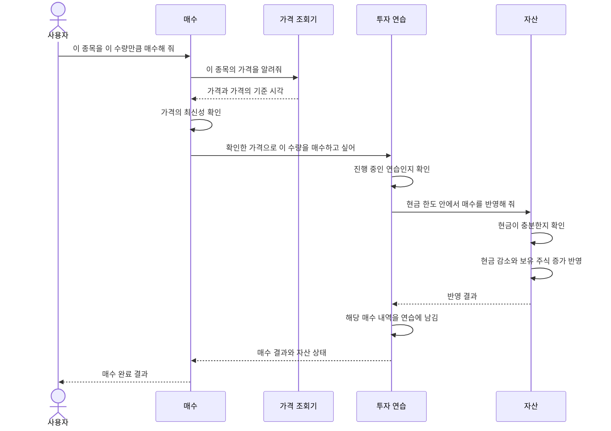

# 가상 매수 — 관계 중심 시퀀스 초안

- 작성일: 2026-11-12
- 상태: 대화에서 검토한 성공 시나리오의 협력 초안. 책임 배분·인터페이스·구현의 최종 확정이 아니다.
- 대상: UC-PT-02 — 주식을 가상 매수한다
- 이슈: [#44](https://github.com/PhilPark-geosr/stock-agent/issues/44)
- 근거: [유스케이스 개요](paper_trading_requirements.md), [초기 도메인 모델](paper_trading_domain_model.md)

## 1. 범위와 전제

사용자가 종목과 수량을 제시하고, 가격 확인과 자금 검증이 성공하여 가상 매수가 완료되는 기본 시나리오다. 사용자 계정과 대상 투자 연습은 식별되어 있으며, 대상은 사용자의 관심 종목에 등록한 국내 주식이다. 매수 대상 조건을 어떤 객체가 검증할지는 후속 논의한다.

여기서 ‘매수’는 사용자가 제안한 매수 과정을 수행하는 객체 후보다. 단순히 체결 정보를 담는 수동적인 기록 객체로 제한하지 않는다. 성공 후 종목·체결 수량·가격·시각을 나타내는 역할과 요청 수행 역할을 같은 객체가 맡는 후보로 검토하며, 생명주기와 의존 관계는 아직 정하지 않는다.

가격 조회기는 협력 역할 후보이며 독립적인 ‘가격 정보’ 도메인 모델을 추가하지 않는다. 이 그림은 시스템 내부의 책임 전달을 검토하는 설계 시퀀스다. 사용자 접점·인증·저장소 등은 이번 범위에서 생략하고, 메서드 시그니처·SQL·트랜잭션 경계를 확정하지 않는다.

## 2. 시퀀스 다이어그램

## 3. 책임 배분 후보와 근거

- **매수:** 가격 확인부터 완료 결과 제공까지 매수 과정을 조율한다. 필요한 정보를 협력 객체에 요청하며 다른 객체의 현금을 직접 꺼내 수정하지 않는다.
- **가격 조회기:** 종목의 가격과 그 가격의 기준 시각을 제공한다. AI 분석 실행을 전제로 하지 않는다.
- **투자 연습:** 종료된 연습에서 매수가 수행되지 않도록 진행 상태를 확인하고, 자산에 매수 반영을 요청하며 성공한 매수를 해당 연습에 연결한다.
- **자산:** 자신이 아는 현금과 보유 주식을 바탕으로 자금 조건을 확인하고 두 상태의 변화를 함께 관리한다.

투자 연습을 거치는 이유는 자산의 소유 관계만이 아니라 진행·종료 규칙과 연습 내역을 관리하는 책임 때문이다. 후속 검토에서 단순 전달만 하는 것으로 드러난다면 매수가 자산에 직접 요청하는 대안도 비교한다.

메시지는 우선 요청의 의도를 표현한다. 객체의 내부 상태를 외부에서 조작하는 방식 대신, 상태와 규칙을 아는 객체가 책임을 수행하도록 배분한 후보이며 정보 은닉·객체의 자율성·응집도를 검토 기준으로 삼는다.

## 4. 요구사항 연결

- FR-PT-014: 관심 종목에 등록한 국내 주식이라는 대상 조건. 이번 성공 시나리오에서는 충족을 전제로 두며 검증 책임은 미정이다.
- FR-PT-011·019: 연습의 현금 범위에서 종목을 매수하고 자산에 반영한다.
- FR-PT-020·021: 진행 중인 연습에서만 매수하며 종료된 연습의 자산·결과는 바꾸지 않는다.
- FR-PT-022·025: AI 분석과 독립적으로 매매 시 가격을 다시 확인한다. 조회 시각과 시세 기준 시각을 구분한다.
- FR-PT-018: 추가 매수에도 적용할 후보이며, 기존 보유분과 합치는 상세 계산은 후속 검토한다.

초기 가상 자금은 변경하지 않는다. 매수 결과로 감소하는 것은 현재 자산의 현금이다. 체결 가격·수량에 따른 금액과 수수료 등 비용을 반영하는 상세 규칙은 미정이다.

## 5. 후속 검토 항목

- 관심 종목 등록·국내 주식 조건의 검증 책임과 시점
- 가격 최신성의 허용 기준과 조회 실패·오래된 가격의 예외 흐름. 실패 시 매매 차단·재시도 안내라는 기존 합의는 유지한다.
- 현금 부족·종료된 연습 등 실패 시 응답과 상태 보장
- 자산 변경과 성공한 매수 내역 보존의 일관성. 성공 결과로 둘이 일치해야 하며 중간 실패 처리는 아직 설계하지 않았다.
- 매수 객체가 요청 수행과 완료 정보를 함께 갖는 경우의 생명주기, 투자 연습과의 의존 관계
- 체결 수량·가격·시각을 언제 확정하고 어떤 객체가 완료 결과를 구성할지
- 가격 조회기 구현의 교체 필요성, 협력 객체를 필드로 둘지 인자로 전달할지와 공개 인터페이스

별도로 대화에서 제안한 클래스 다이어그램은 이번 문서에 확정 설계로 추가하지 않는다. 위 시나리오의 협력을 검토하며 클래스 책임과 관계를 보완한다.
