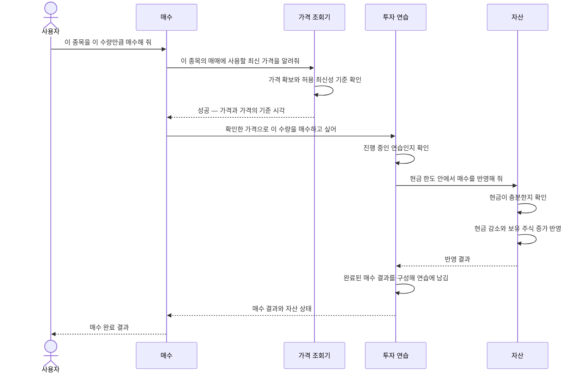
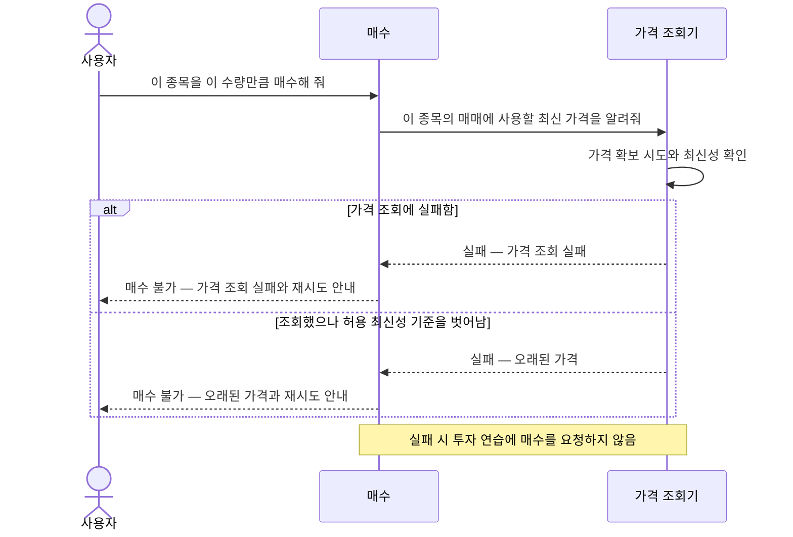
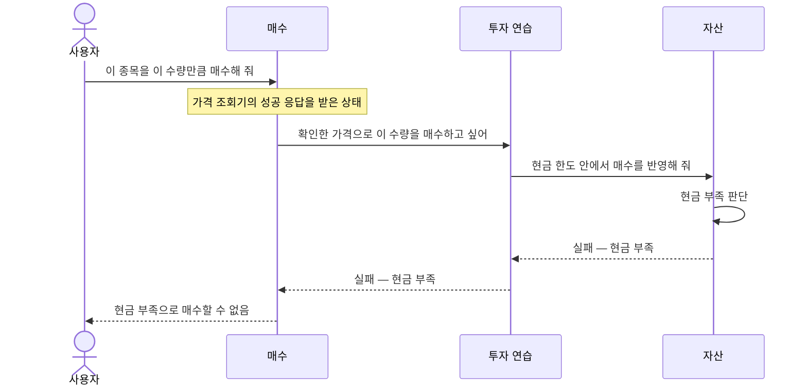

# 가상 매수 — 관계 중심 시퀀스 초안

- 작성일: 2026-11-12
- 상태: 성공·현금 부족·가격 예외 시나리오의 협력 방향 합의. 상세 인터페이스·구현은 미정이다.
- 대상: UC-PT-02 — 주식을 가상 매수한다
- 이슈: [#44](https://github.com/PhilPark-geosr/stock-agent/issues/44)
- 근거: [유스케이스 개요](paper_trading_requirements.md), [초기 도메인 모델](paper_trading_domain_model.md)

## 1. 범위와 전제

사용자가 종목과 수량을 제시하고, 가격 확인과 자금 검증이 성공하여 가상 매수가 완료되는 기본 시나리오다. 사용자 계정과 대상 투자 연습은 식별되어 있으며, 대상은 사용자의 관심 종목에 등록한 국내 주식이다. 매수 대상 조건을 어떤 객체가 검증할지는 후속 논의한다.

여기서 ‘매수’는 매수 과정을 수행하는 객체 후보이며 완료된 체결 사실은 ‘매수 결과’로 분리한다. 투자 연습의 내역에는 수행 객체 자체 대신 매수 결과를 남긴다. 책임·연산·의존성 후보는 [클래스 설계 초안](paper_trading_buy_class_design.md)에 정리한다. 수행 객체의 요청 단위·재사용 여부와 구체적인 생성 협력은 미정이다.

가격 조회기는 협력 역할 후보이며 독립적인 ‘가격 정보’ 도메인 모델을 추가하지 않는다. 이 그림은 시스템 내부의 책임 전달을 검토하는 설계 시퀀스다. 사용자 접점·인증·저장소 등은 이번 범위에서 생략하고, 메서드 시그니처·SQL·트랜잭션 경계를 확정하지 않는다.

## 2. 시퀀스 다이어그램

### 가격 조회 실패·오래된 가격 예외 — 합의된 협력

가격 조회기는 매매에 사용할 수 있는 최신 가격을 제공할 책임을 가진다. 공급자가 가진 가장 최근 값이라도 허용 최신성 기준을 충족하지 못하면 실패로 응답한다. 매수는 성공·실패 응답을 받아 흐름을 조율하며 최신성을 중복 판단하지 않는다. 구체적인 허용 지연은 미정이다.

두 분기는 실패 사례만 보여준다. 성공 응답 이후의 협력은 위 기본 시나리오를 따른다. 실패하면 투자 연습·자산에 매수 요청을 전달하지 않고, 현금·보유 주식을 변경하거나 성공한 매수 결과를 생성하지 않는다. 근거는 UC-PT-02, FR-PT-022·025 및 FR-PT-025의 합의된 예외 조건이다. 그림의 자기 메시지는 책임을 요약하며 별도의 공개 메서드를 추가한다는 뜻은 아니다.

### 현금 부족 예외 — 합의된 협력

자산이 현금 부족을 판단하면 상태를 변경하기 전에 실패를 반환한다. 투자 연습과 매수는 각 요청의 응답으로 실패를 전달한다. 이미 반영한 매수를 취소하는 흐름이 아니며, 자산이 매수 객체에 별도 취소 메시지를 보내지 않는다.

위 그림은 가격 조회와 진행 상태 확인을 생략하고 현금 부족의 응답 경로를 강조한다. 해당 요청으로 현금·보유 주식을 변경하지 않고 성공한 매수 결과도 생성·보존하지 않는다. 근거는 UC-PT-02와 FR-PT-011·019다.

### 요청의 반환 결과와 매수 결과의 구분

- **요청의 반환 결과:** 요청의 성공 여부와 실패 이유를 알려주는 응답이다. 매수의 공개 연산은 투자 연습에 요청한 결과를 받아 호출자에게 전달한다. 투자 연습도 자산의 응답을 받아 성공·실패를 처리한다.
- **매수 결과:** 성공한 체결의 종목·체결 수량·체결 가격·체결 시각을 나타내는 객체다. 실패 응답이 있다고 해서 연습 내역에 남길 매수 결과를 만드는 것은 아니다.
- 요청·응답 방식의 협력으로 정하며 응답을 받기 위해 매수 객체 자신을 투자 연습이나 자산에 인자로 넘기지 않는다. 투자 연습·자산에 요청자 참조나 역방향 의존성을 추가하지 않는다.
- 반환 결과의 구체적인 타입·필드·표현 방식은 상세 설계에서 정한다. 위 구분만으로 별도의 응답 클래스를 확정하지 않는다.

## 3. 책임 배분 후보와 근거

- **매수:** 가격 확인부터 완료 결과 제공까지 매수 과정을 조율한다. 필요한 정보를 협력 객체에 요청하며 다른 객체의 현금을 직접 꺼내 수정하지 않는다.
- **가격 조회기:** 매매에 사용할 허용 최신성 기준을 충족하는 가격과 그 가격의 기준 시각을 제공한다. 조회 실패·오래된 가격이면 실패를 반환한다. 매수는 최신성을 다시 판단하지 않는다. AI 분석 실행을 전제로 하지 않는다.
- **투자 연습:** 종료된 연습에서 매수가 수행되지 않도록 진행 상태를 확인하고, 자산에 매수 반영을 요청하며 성공한 매수를 해당 연습에 연결한다.
- **자산:** 자신이 아는 현금과 보유 주식을 바탕으로 자금 조건을 확인하고 두 상태의 변화를 함께 관리한다.
- **매수 결과:** 완료된 종목·체결 수량·체결 가격·체결 시각을 나타내며 수행 객체와 분리하여 연습 내역에 남긴다. 그림의 자기 메시지는 결과 구성·연결을 요약하며 상세 생성 협력은 클래스 설계와 함께 검토한다.

투자 연습을 거치는 이유는 자산의 소유 관계만이 아니라 진행·종료 규칙과 연습 내역을 관리하는 책임 때문이다. 후속 검토에서 단순 전달만 하는 것으로 드러난다면 매수가 자산에 직접 요청하는 대안도 비교한다.

메시지는 우선 요청의 의도를 표현한다. 객체의 내부 상태를 외부에서 조작하는 방식 대신, 상태와 규칙을 아는 객체가 책임을 수행하도록 배분한 후보이며 정보 은닉·객체의 자율성·응집도를 검토 기준으로 삼는다.

## 4. 요구사항 연결

- FR-PT-014: 관심 종목에 등록한 국내 주식이라는 대상 조건. 이번 성공 시나리오에서는 충족을 전제로 두며 검증 책임은 미정이다.
- FR-PT-011·019: 연습의 현금 범위에서 종목을 매수하고 자산에 반영한다.
- FR-PT-020·021: 진행 중인 연습에서만 매수하며 종료된 연습의 자산·결과는 바꾸지 않는다.
- FR-PT-022·025: AI 분석과 독립적으로 매매 시 가격을 다시 확인한다. 조회 시각과 시세 기준 시각을 구분한다.
- FR-PT-018: 추가 매수에도 적용할 후보이며, 기존 보유분과 합치는 상세 계산은 후속 검토한다.

초기 가상 자금은 변경하지 않는다. 매수 결과로 감소하는 것은 현재 자산의 현금이다. 체결 가격·수량에 따른 금액과 수수료 등 비용을 반영하는 상세 규칙은 미정이다.

## 5. 후속 검토 항목

- 관심 종목 등록·국내 주식 조건의 검증 책임과 시점
- 가격 최신성의 구체적인 허용 기준과 가격 공급자. 판단 책임은 가격 조회기에 두며 실패·오래된 가격의 응답 경로는 위에서 합의했다.
- 종료된 연습 등 나머지 실패 시 응답과 상태 보장. 현금 부족의 응답 경로와 변경 없음 보장은 위에서 합의했다.
- 자산 변경과 성공한 매수 내역 보존의 일관성. 성공 결과로 둘이 일치해야 하며 중간 실패 처리는 아직 설계하지 않았다.
- 매수 수행 객체의 요청 단위·재사용 여부와 매수 결과의 생성·연결에 필요한 상세 협력
- 체결 수량·가격·시각을 언제 확정하고 어떤 객체가 완료 결과를 구성할지
- 가격 조회기 구현의 교체 필요성, 협력 객체를 필드로 둘지 인자로 전달할지와 공개 인터페이스

클래스 다이어그램은 별도 초안으로 관리하며 확정 설계로 취급하지 않는다. 위 시나리오와 예외의 협력을 검토하며 클래스 책임과 관계를 보완한다.

## 6. 다음 설계 순서

2026-11-12 논의 기준으로 모든 필드·메서드 시그니처를 먼저 확정하지 않고 협력 검토를 이어간다.

1. 같은 매수 유스케이스의 가격 조회 실패·오래된 가격 예외 협력은 위에 반영했다. 가격 조회기가 최신성을 판단하고 매수는 실패를 전달한다. 구체적인 허용 기준은 미정이다.
2. UC-PT-03 가상 매도의 정상·보유 수량 부족·가격 예외 협력은 [매도 시퀀스](paper_trading_sell_sequence.md)에 반영했다. 나머지 예외는 후속 검토한다.
3. 매수·매도 협력에서 드러난 공통점과 차이로 클래스 책임·이름·관계를 다듬는다.
4. 구현할 범위의 비공개 필드와 공개 메서드의 인자·반환 타입을 구체화한다.

현재는 주요 책임과 공개 메시지, 필요한 상태·참조 후보 및 캡슐화 경계를 다룬다. 현금·보유 주식을 외부가 직접 변경하지 않는 방향을 유지하며, 전체 필드 목록·비공개 보조 메서드·저장 구조는 후속 상세 설계에서 정한다. 매도에 따른 실현손익 반영·누적값 제공 책임은 자산에 두기로 후속 합의했다. 아직 검토하지 않은 예외와 상세 계산 규칙은 확정하지 않는다.
