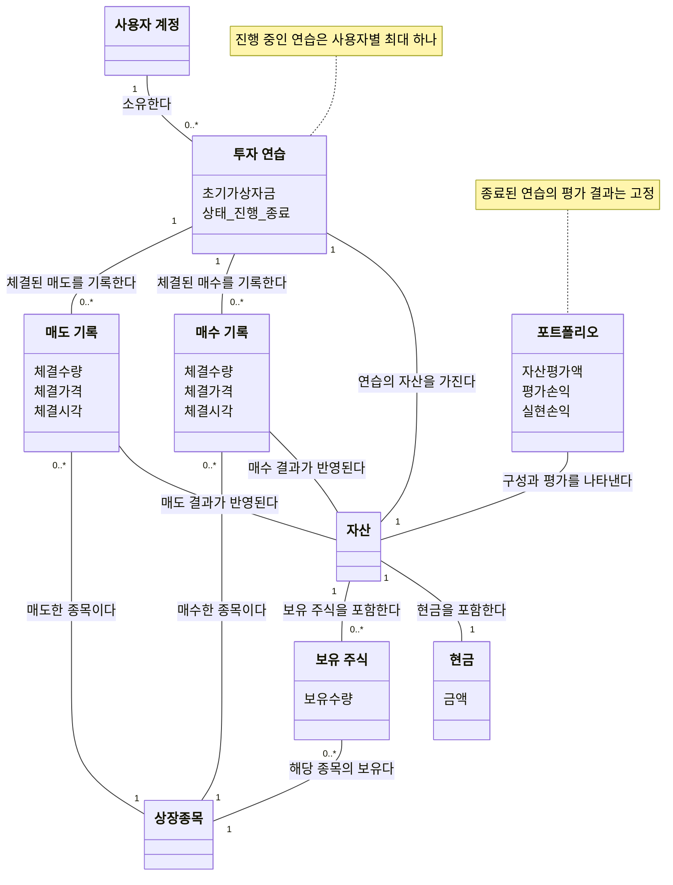

# 모의투자 도메인 모델 — 초기 분석 모델

- 상태: UC-PT-01~06을 검토한 초기 개념·관계 모델. 상세 흐름·계산 규칙·협력 책임은 후속 구체화 대상이다.
- 이슈: [#44](https://github.com/PhilPark-geosr/stock-agent/issues/44)
- 근거: [유스케이스 개요](paper_trading_requirements.md), [도메인 검토 내용](paper_trading_elaboration_notes.md), [용어집](../CONTEXT.md)

업무 개념과 관계를 표현한 그림이다. 메서드·내부 식별자·서비스·저장소·DB 구조를 정하는 상세 클래스 설계가 아니다. 가격 조회기와 거래 처리 같은 협력 역할은 이 그림에 두지 않는다.

## 다이어그램

[정적 이미지로 보기](paper_trading_domain_model.png)

## 개념과 관계의 의미

- **투자 연습:** 사용자 계정에 속하는 하나의 연습 단위로 진행·종료 상태를 가진다. 종료된 연습도 자신의 기록과 당시 결과를 유지하며 진행 중인 연습은 하나다.
- **자산:** 해당 연습의 현금과 보유 주식을 함께 나타낸다. 진행 중에는 현재 상태, 종료 후에는 종료 당시 상태이며 과거 거래 목록 자체를 뜻하지 않는다.
- **매수 기록:** 이미 체결된 매수 사실이다. 매수한 종목·체결 수량·체결 가격·체결 시각을 나타낸다.
- **매도 기록:** 이미 체결된 매도 사실이다. 매도한 종목·체결 수량·체결 가격·체결 시각을 나타낸다. 매수·매도의 정보를 공통 상위 ‘거래’ 개념으로 올리지 않는다.
- **매수·매도 결과와 자산:** 매수하면 현금이 줄고 보유 수량이 늘며, 매도하면 그 반대가 자산에 반영된다. 그림의 연결은 업무상 관계이며 기록이 직접 자산 갱신 메서드를 가져야 한다는 뜻은 아니다. 비용·손익 산정 규칙은 아직 미정이다.
- **보유 주식:** 현재 특정 종목을 얼마나 보유하는지를 나타낸다. 거래 기록으로부터 계산할지 별도로 유지할지는 정하지 않는다.
- **상장종목:** 거래·보유가 어느 종목에 대한 것인지 나타낸다. 종목 정체성은 기존 용어집의 상장종목 정의를 따른다.
- **포트폴리오:** 동일한 자산의 구성과 평가 결과를 나타낸다. 자산과 별도로 현금·보유 주식을 중복 소유하지 않는다. 그림의 평가 항목은 관찰할 업무 정보이며 저장 필드로 확정한 것이 아니다.

## 평가와 가격 조회의 구분

포트폴리오를 확인하는 시점에 종목별 가격을 조회하여 자산을 평가하는 방향으로 정리한다. 조회한 값을 사용한다고 해서 독립적인 ‘가격 정보’ 도메인 모델을 반드시 만들 필요는 없으므로 이번 그림에서는 제외한다. 가격을 어디서 어떻게 조회할지, 가격 조회기와 평가 역할을 누가 조율할지는 후속 협력 설계에서 구체화한다.

보유 주식의 평가에 사용한 가격과 해당 가격의 기준 시각을 확인하는 UC-PT-05의 요구는 유지한다. 조회 시각과 시세 자체의 기준 시각은 다를 수 있다. 종목별 평가 가격·기준 시각의 표현 형태와 보관 방식은 아직 정하지 않는다. 종료된 연습은 새로 조회한 가격으로 재평가하지 않고 종료 당시 결과를 유지한다.

## 유스케이스·요구사항 추적

| 대상 | 관련 개념·관계 |
| --- | --- |
| UC-PT-01, FR-PT-016·017·020 | 사용자 계정·투자 연습·초기 자금·자산, 동시에 진행하는 연습의 제한 |
| UC-PT-02·03, FR-PT-011·014·015·018·019·025 | 매수 기록·매도 기록·상장종목·현금·보유 주식, 현금과 보유 수량 범위의 매매 및 가격 재확인 |
| UC-PT-04, FR-PT-022·023·024 | 가격 조회는 사용자 기능이며 AI 실행과 독립적이다. 가격 조회기의 협력은 후속 설계에서 구체화하며 별도 가격 정보 모델은 두지 않음 |
| UC-PT-05, FR-PT-015·023·024 및 초안 FR-PT-005·006·008 | 자산·포트폴리오·보유 주식. 조회한 종목별 가격으로 평가하며 사용한 가격·기준 시각 확인 요구 유지 |
| UC-PT-06, FR-PT-009·017·020·021 및 초안 FR-PT-007 | 기존 투자 연습·매수 기록·매도 기록과 보존된 자산·포트폴리오 결과를 확인. 별도 이력 모델은 추가하지 않음 |
| FR-PT-021 | 종료 시 자동 매도하지 않고 현금·보유 주식·손익을 당시 상태로 보존 |

관심 종목 등록은 매수 허용 조건이며, 보유 주식의 존재 조건이 아니다. 등록을 해제해도 기존 보유분·거래 기록과 가격 조회 대상은 유지한다. 이 그림에서 기존 관심 종목 구독 모델을 새로 정의하지 않는다.

## 종료된 연습과 기록 확인

UC-PT-06은 기존 투자 연습의 기록을 확인하는 목표이며 ‘회고’나 ‘투자 연습 기록’을 별도 도메인 개념으로 추가하지 않는다. 종료된 연습은 매수·매도 내역과 종료 당시 현금·보유 주식·평가손익·실현손익을 유지한다. 종료 후의 새 매매나 시장 가격 변화로 해당 결과를 갱신하지 않는다.

종료 당시 결과를 어떤 방식으로 보관하고 다시 읽을지, 종료 처리와 보관·조회 책임을 어떻게 나눌지는 협력·상세 설계에서 정한다. 그림의 연결은 논리적인 연습·기록·자산의 관계이며 저장 구조를 확정한 것이 아니다.

## 아직 확정하지 않은 부분

- 가격 조회기와 평가 역할의 협력, 평가에 사용한 종목별 가격·기준 시각의 표현·보관 방식
- 체결 가격과 평가 가격의 선택 기준·허용 지연, 가격 조회 실패 시 평가 표시
- 포트폴리오의 구현 형태, 매수·매도 결과의 반영 책임, 자산 상태의 저장·계산 방식
- 평균 매수가·부분 매도 실현손익의 계산 규칙, 수수료·세금 등 비용

‘거래’라는 별도 개념과 공통 상위 개념은 이 그림에 두지 않는다. 사용자가 말한 현금·보유 수량을 갱신하는 ‘거래 처리’ 역할은 후속 관계 중심 시퀀스에서 검토한다. 현재는 체결 사실을 매수·매도 기록으로, 현재 상태를 자산으로, 그 구성과 평가 결과를 포트폴리오로 구분한다.
