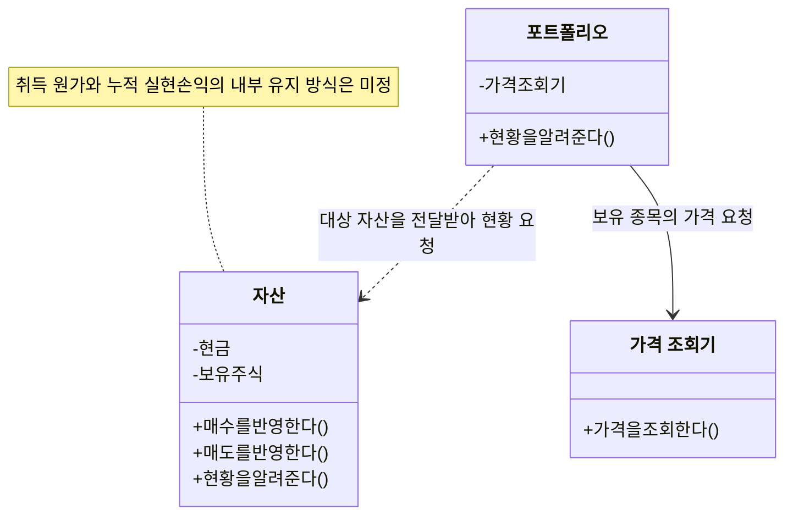

# 포트폴리오 조회 — 클래스 설계 초안

- 작성일: 2026-11-16
- 상태: UC-PT-05의 정상·일부 가격 조회 실패 협력에서 도출한 공개 메시지·반환 정보 후보. 구현과 상세 타입의 확정이 아니다.
- 근거: [포트폴리오 조회 시퀀스](paper_trading_portfolio_sequence.md), [매수 클래스 초안](paper_trading_buy_class_design.md), [매도 협력](paper_trading_sell_sequence.md)
- 이슈: [#44](https://github.com/PhilPark-geosr/stock-agent/issues/44)

## 1. 클래스와 관계

기존 자산과 가격 조회기 역할을 재사용한다. 포트폴리오는 해당 연습의 자산을 요청 시 전달받고 가격 조회기와 협력하는 후보로 둔다. 자산을 별도로 소유하거나 투자 연습을 직접 검색하지 않는다.

`+`는 공개 메시지, `-`는 내부에서 관리할 상태·참조 후보를 뜻한다. 언어별 클래스명·인자·반환 타입·생성자·주입 방식은 미정이다. 가격 조회기를 필드로 가진다는 것은 협력 참조 후보이며 별도 인터페이스·구현체 분리를 강제하지 않는다. 내부 자산 상태는 외부에서 직접 변경할 수 없고 의도 중심의 매수·매도 연산으로만 반영한다.

## 2. 공개 메시지와 반환 계약 후보

| 수신 객체·메시지 | 필요한 입력 | 반환할 정보·보장 | 근거 |
| --- | --- | --- | --- |
| 포트폴리오 — 현황을 알려준다 | 접근 권한·대상이 확인된 연습의 자산 | 현금·보유 현황·종목별 평가 결과·전체 평가 가능 여부·평가액·평가손익·누적 실현손익·가격 기준 시각·실패 이유와 재시도 안내 | UC-PT-05, 초안 FR-PT-005·006·008 |
| 자산 — 현황을 알려준다 | 추가적인 사용자·연습 검색 정보는 불필요 | 자신의 현금·보유 종목·수량·취득 원가 정보·누적 실현손익. 내부 보유 목록의 외부 수정을 허용하지 않음 | UC-PT-05, FR-PT-015·023 |
| 가격 조회기 — 가격을 조회한다 | 대상 종목 | 성공 시 가격·가격 기준 시각, 실패 시 실패 이유. 평가용 허용 최신성과 오래된 가격 정책은 미정 | FR-PT-022·023, UC-PT-05 |
| 자산 — 매수를 반영한다 | 종목·수량·확인한 가격 등 매수 반영에 필요한 정보 | 현금 한도 검증과 현금·보유 수량·취득 원가 반영. 실패 시 상태 변경 없음 | UC-PT-02, FR-PT-011·018·019 |
| 자산 — 매도를 반영한다 | 종목·수량·확인한 가격 등 매도 반영에 필요한 정보 | 보유 수량 검증과 현금·보유 수량·남은 취득 원가·실현손익의 일관된 반영. 실패 시 상태 변경 없음 | UC-PT-03, FR-PT-011·018·019 |

위 입력·반환은 필요한 의미를 표현하며 상세 시그니처를 확정하지 않는다. 반환 정보 때문에 별도 ‘포트폴리오 결과’ 도메인 모델이나 응답 클래스·저장 테이블을 추가하지 않는다. 전체 평가 불가 상태는 0이나 누락 종목을 제외한 합계와 구분해 표현해야 하며 구체적인 타입은 후속 설계 대상이다. 기존 요구사항 초안의 합의 상태를 바꾸지 않는다.

## 3. 계산과 응답 조합의 책임

- 자산은 매수·매도로 인한 현금·보유 주식의 변화를 일관되게 반영하고 자신의 현황과 해당 연습의 누적 실현손익을 제공한다.
- 포트폴리오는 자산의 현황과 종목별 가격 응답을 조합해 평가액·평가손익을 계산한다. 자산에서 받은 누적 실현손익을 다시 계산하거나 자산 평가액에 더하지 않는다.
- 일부 종목의 가격 조회가 실패하면 포트폴리오는 확인 가능한 현황과 성공 종목의 평가를 제공하고, 실패 종목과 전체 평가 불가를 구분한다. 자산 상태를 변경하지 않는다.
- 가격 조회기는 AI 분석과 독립적으로 가격과 기준 시각을 제공한다. 매매용 최신성 계약과 평가용 가격 정책의 차이는 아직 정하지 않으며 별도 조회기·구현체를 미리 추가하지 않는다.

현재는 평가 계산을 포트폴리오에 두는 초안이다. 보유 주식과 계산 책임을 더 나눌 근거가 발견되면 협력부터 수정한다. 취득 원가 산정·비용·누적 실현손익의 필드 유지 또는 내역 합산 방식은 확정하지 않는다.

## 4. 다음 검토 범위

현재 수준이면 최초 OOD 초안으로 클래스의 책임과 공개 메시지를 검토할 수 있다. 모든 경계 조건마다 독립 시퀀스나 클래스를 만들지 않고 협력·인터페이스에 영향을 주는 차이를 우선 검토한다.

- 보유 종목 없음·전체 가격 조회 실패: 기존 협력으로 처리 가능한지 확인하고 필요한 조건과 응답 차이만 기록한다. 표시 정책은 아직 합의하지 않았다.
- 오래된 평가 가격: 허용 여부·기준을 정책으로 결정한 뒤 설계에 반영한다.
- 자동 갱신·재시도: FR-PT-024의 기존 합의를 유지하며 시작·중단·재요청의 책임을 별도 협력으로 검토한다.
- 상세 타입·상태 일관성·취득 원가·비용·내부 저장 방식은 구현할 범위를 구체화할 때 다룬다.

UC-PT-05 전체 정책이나 상세 설계가 완료됐다는 뜻은 아니다. 위 미결정 항목은 목록으로 유지하고 공개 계약을 구체화하는 데 실제로 필요한 결정부터 논의한다.
