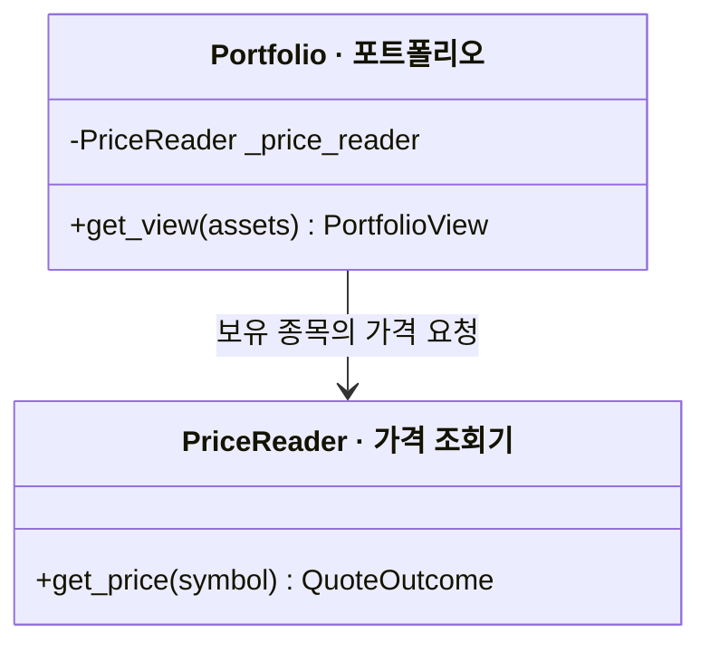
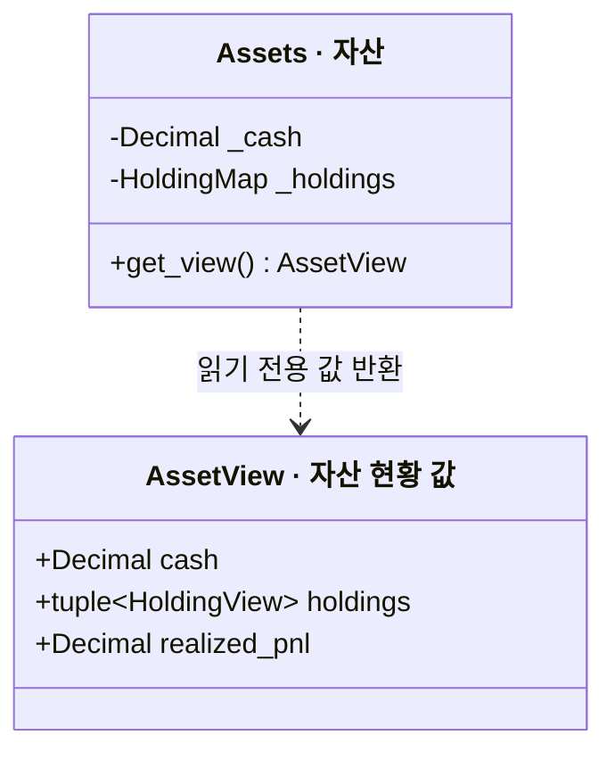
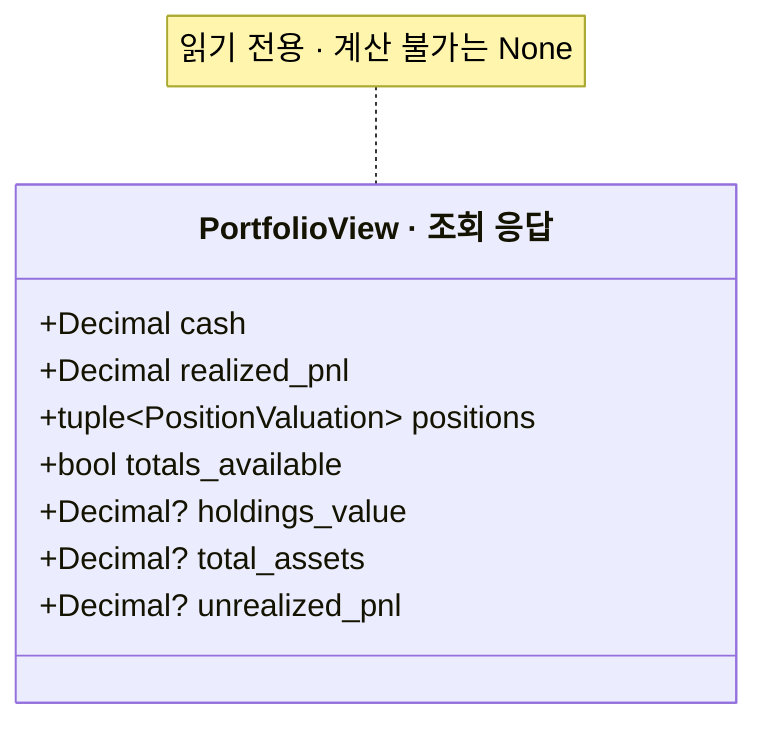
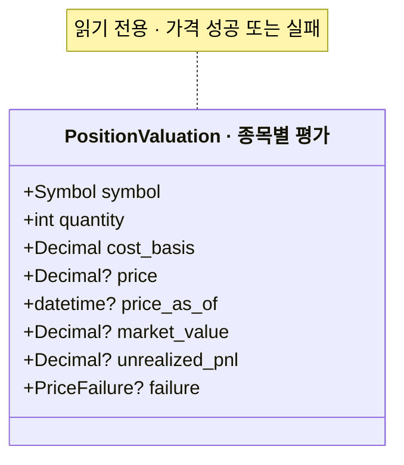
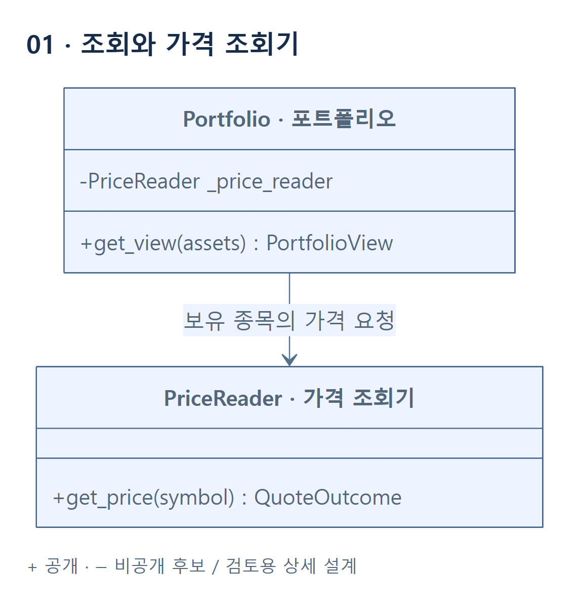
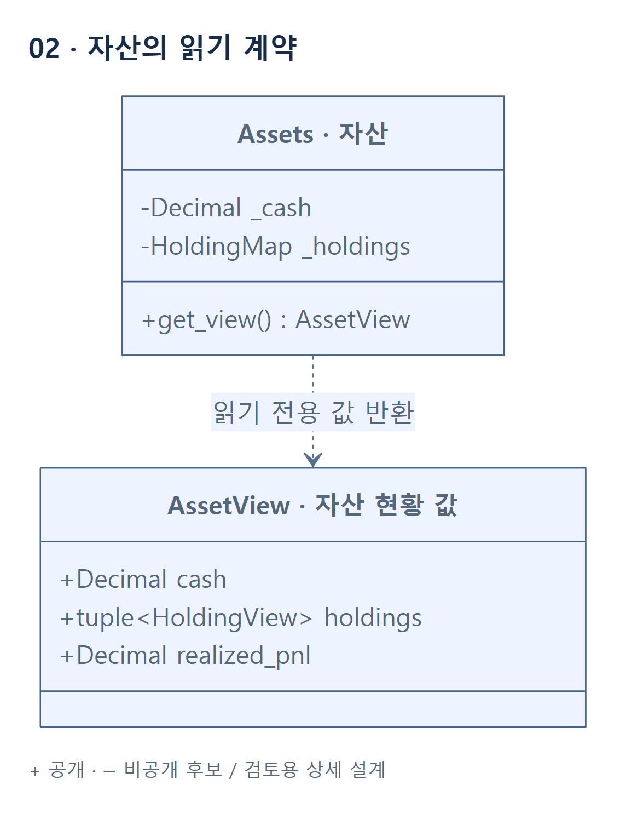
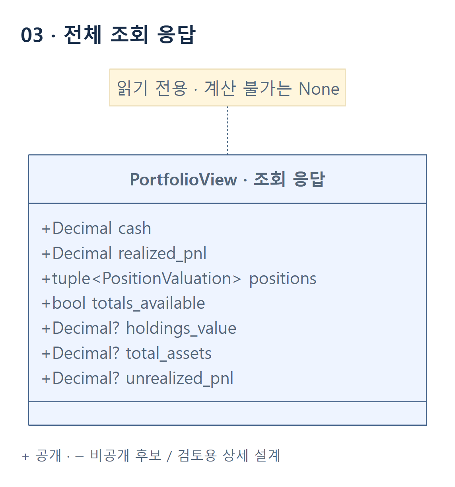
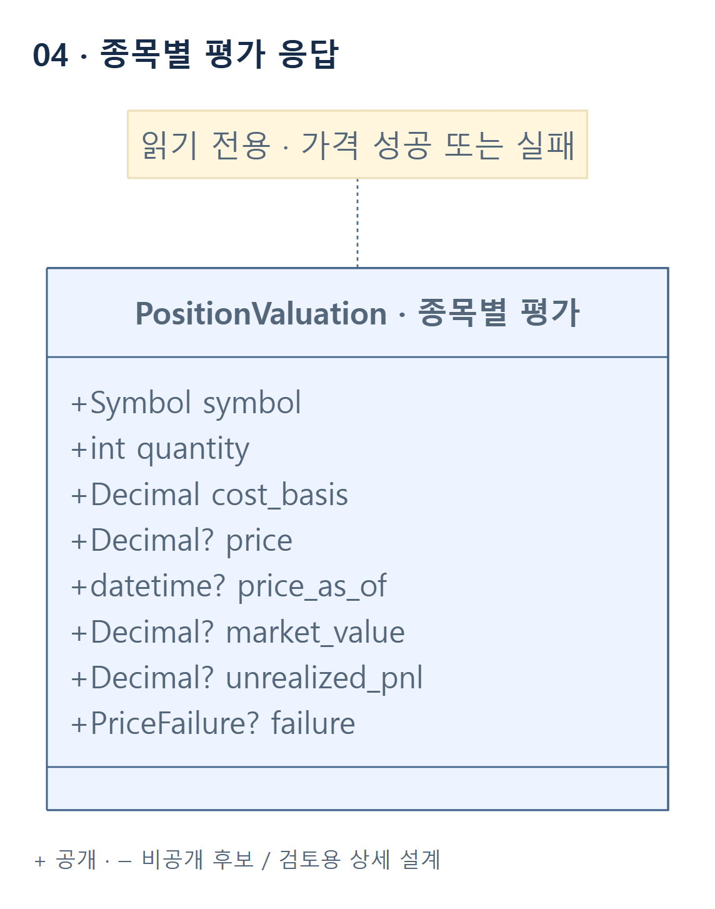

# 포트폴리오 조회 — 코드 매핑을 위한 클래스 상세 초안

- 작성일: 2026-11-16
- 대상: UC-PT-05 정상·일부 종목 가격 조회 실패
- 상태: 정상・일부 가격 조회 실패에 대한 클래스·공개 메서드·읽기 전용 반환 타입의 설계 방향 합의. 아래에 명시한 미결정 정책과 구현 세부 사항은 확정하지 않는다.
- 근거: [포트폴리오 협력](paper_trading_portfolio_sequence.md), [클래스 책임 초안](paper_trading_portfolio_class_design.md)

## 1. 조회와 가격 조회기

Portfolio는 요청마다 대상 Assets를 전달받는다. 대상 연습·사용자 식별과 권한 확인은 진입부에서 완료됐다고 전제한다. 자산을 별도로 소유하거나 연습을 직접 검색하지 않는다. 자산의 현황을 조회하고 종목별 가격을 조합해 평가액·평가손익을 계산하며 누적 실현손익은 자산이 제공한 값을 전달한다.

PriceReader는 기존 매매 협력의 가격 조회기 역할을 재사용한다. 성공 시 가격·가격 기준 시각, 실패 시 이유를 반환한다. 평가용 최신성 기준과 오래된 가격의 취급은 미정이며 매매 차단 정책을 그대로 적용하지 않는다.

## 2. 자산의 읽기 계약

Assets는 기존 매수·매도 연산을 그대로 유지한다. get_view()는 현금·보유 구성·취득 원가·누적 실현손익을 외부 수정이 불가능한 값으로 제공하는 후보다. 원본 Holdings나 변경 가능한 내부 목록을 그대로 노출하지 않는다. 누적 실현손익을 필드로 유지할지 내역에서 합산할지는 여전히 미정이다.

HoldingView는 symbol: Symbol, quantity: int, cost_basis: Decimal을 담는 읽기 전용 값 후보다. cost_basis는 남은 보유분의 총 취득 원가로, 주당 평균 취득 가격과 구분한다. 취득 원가 산정·비용 정책은 확정하지 않는다. tuple과 읽기 전용 항목을 함께 사용해 내부 상태의 우회 수정을 막는다.

## 3. 전체 조회 응답

전체 보유 평가액 holdings_value, 전체 자산 평가액 total_assets, 총 평가손익 unrealized_pnl은 전체 평가 가능 시에만 값이 있다. 일부 종목의 가격을 확보하지 못하면 totals_available은 false이고 세 값은 모두 None이다. 0이나 성공 종목만 합산한 값으로 대체하지 않는다. 세 값 중 일부만 None인 응답을 만들지 않는 불변조건을 둔다.

cash와 realized_pnl은 자산에서 받은 값을 제공한다. 누적 실현손익을 total_assets에 다시 더하지 않는다. None은 UML 그림에서 ?로 축약한 타입 후보이며 Python에서는 Decimal | None 등으로 표현할 수 있다.

## 4. 종목별 평가 응답

가격 조회 성공 시 price·price_as_of·market_value·unrealized_pnl이 존재하고 failure는 None이다. 실패 시 해당 네 값은 None이고 failure에 실패 이유를 둔다. symbol·quantity·cost_basis는 자산에서 받은 현황으로 유지한다. price_as_of는 가격 자체의 기준 시각이며 조회 시각과 다르다. 종목별 기준 시각은 다를 수 있다.

PriceFailure는 실패 이유를 표현할 타입의 가칭이다. 사용자용 문구·재시도 안내는 호출 경계에서 실패 이유에 따라 표현하며 이번 초안으로 문구를 도메인 객체에 저장하지 않는다.

## 5. 반환 타입 제안의 의미와 협력

Portfolio.get_view(assets), Assets.get_view() 및 AssetView·HoldingView·PortfolioView·PositionValuation의 읽기 전용 반환 구조를 사용자와 검토하고 채택했다. 전체 평가 불가를 false와 None으로 구분하고 종목별 성공·실패를 표현한다. 이번 합의는 아래에 남겨둔 자동 갱신·오래된 가격·취득 원가 등 정책의 확정을 포함하지 않는다.

AssetView·HoldingView·PortfolioView·PositionValuation은 이번 상세화에서 제안하는 읽기 전용 전달 값이다. 독립적인 도메인 엔티티·과거 기록·저장 테이블이 아니며, 시퀀스에서 이미 주고받기로 한 정보를 명시한다. 결과 형식의 복잡도가 필요하지 않으면 기존 응답 타입으로 통합할 수 있으며 별도 클래스를 반드시 각각 구현해야 하는 것은 아니다.

Portfolio.get_view(assets)는 Assets.get_view()로 읽기 정보를 받고, 종목별 PriceReader.get_price(symbol)의 응답으로 평가 결과를 구성한다. 성공 종목의 market_value = price × quantity, unrealized_pnl = market_value − cost_basis다. 모든 종목의 가격을 확보한 정상 시나리오에서는 종목별 평가를 합산하고 현금을 더해 전체 평가액을 구성한다. 일부 실패 시 종목별 응답은 유지하되 전체 평가는 불가로 반환한다. 구체적인 비공개 계산 메서드·생성자·결과 조립 알고리즘은 아직 정하지 않는다.

## 6. 추적 및 남은 결정

- UC-PT-05, 초안 FR-PT-005·006·008: 현금·보유·평가·손익·가격 기준 시각. 타입 구체화가 초안 요구사항 전체의 승인을 뜻하지 않는다.
- FR-PT-015·023: 관심 종목에서 삭제한 보유분도 Assets의 구성에 따라 조회·평가한다.
- FR-PT-022: AI 분석 실행과 독립적으로 가격을 조회한다.
- FR-PT-024: 자동 갱신·다시 열었을 때 재조회는 유지하되 이번 메서드는 한 번의 조회다. 갱신 시작·중단·재시도 협력은 후속 설계한다.
- FR-PT-021: 종료된 연습을 현재 가격으로 재평가하는 경로에 사용하지 않는다.

보유 종목 없음·모든 가격 조회 실패·오래된 평가 가격의 정책, 조회 중 자산 변화에 대한 일관성, 이전 평가 결과 보관, 취득 원가·비용 계산은 여전히 후속 결정이다. 응답 값의 제안만으로 남은 정책을 승인한 것으로 보지 않는다. Decimal·정수 수량·Symbol 등은 매수·매도 상세 초안과 같은 타입 후보이며 저장·모듈 배치와 구현을 이번에 확정하지 않는다.

## 모바일용 PNG

