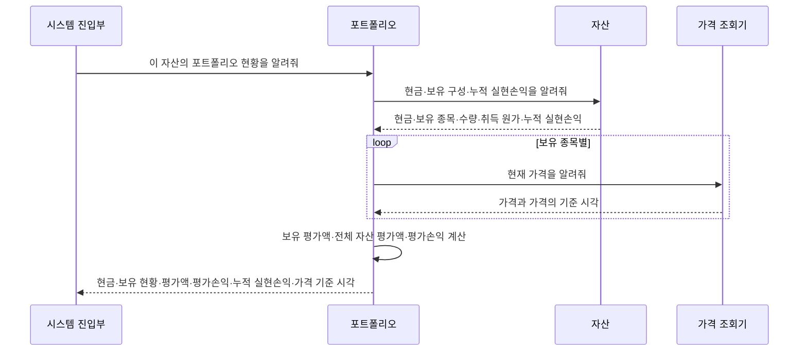
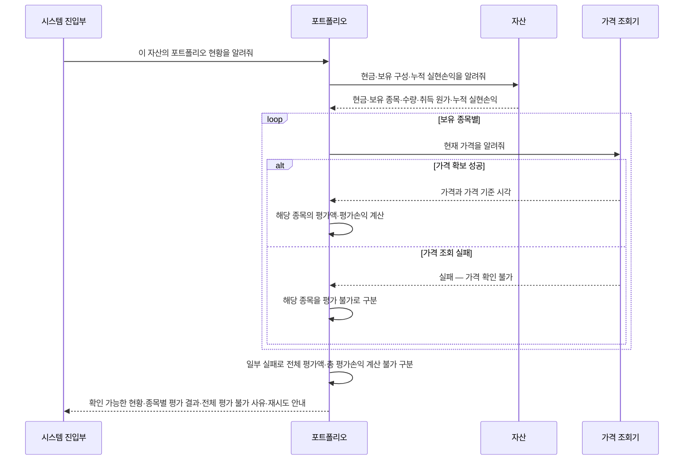

# 포트폴리오 현황 조회 — 관계 중심 시퀀스 초안

- 작성일: 2026-11-16
- 상태: 정상 및 일부 종목 가격 조회 실패 시나리오의 주요 책임과 협력을 정리한 초안. 자산의 누적 실현손익 제공 책임을 합의했으며 오래된 가격 정책·상세 인터페이스는 미정이다.
- 대상: UC-PT-05 — 가상 포트폴리오 현황을 확인한다
- 이슈: [#44](https://github.com/PhilPark-geosr/stock-agent/issues/44)
- 근거: [유스케이스 개요](paper_trading_requirements.md), [초기 도메인 모델](paper_trading_domain_model.md), [상세 정책](paper_trading_elaboration_notes.md)

## 1. 범위와 전제

사용자가 자신의 진행 중인 투자 연습의 포트폴리오 현황을 요청하는 정상 시나리오다. 시스템 진입부에서 로그인 신원·대상 연습·접근 권한을 확인했고, 포트폴리오가 해당 연습의 자산을 전달받았다고 전제한다. 구체적인 진입 클래스와 대상 검색 방식은 이번 설계에서 정하지 않는다.

포트폴리오가 사용자·연습 번호로 대상을 직접 검색하거나 권한을 판단하지 않는다. 이미 대상 자산이 정해졌으므로 자산에 사용자별 조회를 다시 요청하는 것이 아니라 해당 자산의 현금과 보유 구성을 요청한다. 자산을 소유한다는 이유만으로 투자 연습을 중간 전달자로 두지 않는다.

이번 범위는 현금·보유 구성·평가액·평가손익·누적 실현손익·가격 기준 시각이다. 자산은 매수·매도로 인한 현금·보유 주식의 변화를 일관되게 반영하고, 자신의 현황과 해당 투자 연습의 누적 실현손익을 제공한다. 포트폴리오는 이를 받아 반환하며 현재 가격으로 실현손익을 다시 계산하지 않는다. 종료된 연습은 현재 가격으로 재평가하지 않으며 이번 흐름의 대상이 아니다.

## 2. 정상 시나리오

시스템 내부의 OOD 협력 그림이며 시스템 진입부는 외부 액터가 아니다. 종목별 반복은 필요한 정보의 범위를 나타내며 순차 호출·병렬 조회·일괄 조회 같은 구현 방식을 확정하지 않는다.

### 일부 보유 종목의 가격 조회 실패 — 합의된 예외

한 번의 포트폴리오 조회에서 일부 보유 종목의 가격을 확보하지 못하더라도 확인 가능한 자산 현황은 제공한다. 가격이 누락된 종목을 제외한 합계를 전체 평가값으로 표시하지 않는다.

| 항목 | 제공 결과 |
| --- | --- |
| 현금·보유 종목·수량·누적 실현손익 | 자산에서 받은 현황 제공 |
| 가격을 확보한 종목 | 해당 종목의 평가액·평가손익·가격 기준 시각 제공 |
| 가격 조회에 실패한 종목 | 가격 확인 불가와 재시도 안내 제공. 현재 평가액·평가손익은 계산 불가 |
| 전체 보유 평가액·전체 자산 평가액·총 평가손익 | 일부 종목의 가격 확인 실패로 계산 불가임을 명시 |

위 그림은 하나 이상 성공하고 하나 이상 실패한 경우다. 포트폴리오가 종목별 응답을 구분하고, 일부 실패를 전체 조회의 무응답으로 취급하지 않는다. 자산을 변경하거나 실현손익을 다시 계산하지 않는다. 반복은 책임 전달을 나타내며 실제 호출 순서나 동시성을 확정하지 않는다.

UC-PT-05의 평가 조회 예외로 기록하며 별도 요구사항 ID를 추가하지 않는다. 관련 초안 FR-PT-005·006·008의 전체 승인으로 해석하지 않는다. 이전 평가 결과 보관·표시와 오래된 가격의 취급, 실제 재시도 호출 협력은 이번 합의에 포함하지 않는다.

## 3. 책임과 반환 정보

| 역할 | 이번 초안의 책임 |
| --- | --- |
| 시스템 진입부 | 조회할 연습과 접근 권한을 확인하고 해당 자산으로 포트폴리오 조회를 요청한다. 대상 식별의 상세 협력은 생략한다. |
| 포트폴리오 | 자산의 구성 정보와 누적 실현손익을 요청하고 종목별 현재 가격 조회를 조율한다. 평가액·평가손익을 계산하고 자산에서 받은 누적 실현손익과 함께 반환한다. 자산을 직접 변경하지 않는다. |
| 자산 | 매수·매도로 인한 현금·보유 주식의 변화를 일관되게 반영하며, 매도 시 실현손익도 함께 반영한다. 현금·보유 구성·취득 원가 정보와 해당 연습의 누적 실현손익을 제공한다. 외부가 내부 보유 목록을 직접 수정하도록 노출하지 않는다. |
| 가격 조회기 | 평가에 사용할 현재 가격과 종목별 가격 기준 시각을 제공한다. AI 분석 실행을 전제로 하지 않는다. |

포트폴리오 현황을 반환한다는 것이 독립적인 ‘포트폴리오 결과’ 도메인 모델이나 저장 테이블을 추가한다는 뜻은 아니다. 반환값의 타입·구조와 보유 구성의 조회 표현은 후속 설계에서 정한다.

계산의 의미는 다음과 같다. 취득 원가의 구체적인 계산 방식이나 비용 정책을 확정한 것은 아니다.

- 보유 평가액: 종목별 현재 가격 × 보유 수량의 합
- 전체 자산 평가액: 현금 + 보유 평가액
- 평가손익: 보유 평가액 − 남은 보유분의 취득 원가
- 실현손익: 완료된 매도에서 발생한 손익이다. 자산이 매도 시 반영하고 누적값을 제공하며 포트폴리오는 현재 가격으로 다시 계산하지 않는다.

누적 실현손익은 이미 현금에 반영된 매매 성과를 설명하는 값이다. 전체 자산 평가액에 다시 더하지 않는다. 자산이 이를 비공개 필드로 유지할지 매도 내역으로부터 합산할지는 아직 정하지 않는다. 책임의 합의가 저장 필드나 외부 설정 메서드의 확정을 뜻하지 않는다.

포트폴리오와 자산이 별도의 현금·보유 주식을 중복 소유하지 않는다. 가격의 기준 시각은 가격 자체의 시각이며 조회 시각과 구분한다. 종목별 기준 시각이 다를 수 있다.

## 4. 요구사항 추적과 남은 설계

현재 협력에서 도출한 공개 메시지와 반환 정보는 [포트폴리오 클래스 설계 초안](paper_trading_portfolio_class_design.md)에 정리한다. 모든 예외를 독립 시퀀스로 그리기보다 책임·협력·공개 계약에 영향을 주는 차이를 우선 검토한다. 정상·일부 실패 협력을 최초 OOD 초안으로 삼되 아래 미결정 사항은 유지한다.

- UC-PT-05 및 초안 FR-PT-005·006·008: 현금·보유 현황·평가액·손익과 평가 가격 기준 시각 확인. 초안 요구사항 전체의 승인이나 UC-PT-05 설계 완료를 뜻하지 않는다.
- FR-PT-015·023: 관심 종목에서 삭제한 보유분도 구성·가격 조회·평가 대상에 포함한다.
- FR-PT-022: AI 분석과 독립적으로 현재 가격을 조회한다.
- FR-PT-024: 조회 중 자동 갱신·다시 열었을 때 재조회는 이미 합의된 정책이다. 이번 그림은 한 번의 정상 조회이며 갱신 협력은 아직 표현하지 않는다.
- FR-PT-021: 종료된 연습의 보존된 평가 결과는 이번 현재 가격 조회 흐름으로 갱신하지 않는다.

다음 사항은 미결정이다.

- 보유분·매도분의 취득 원가 산정 방식, 평균 매수가 및 비용 반영, 누적 실현손익의 유지·산출 방식
- 평가 계산을 자산·보유 주식과 더 나눌 필요가 있는지, 조회 시점의 구성과 가격을 일관되게 다루는 방법
- 평가에 사용할 가격의 허용 최신성 기준과 오래된 가격의 취급. 일부 종목 조회 실패 시 제공 범위는 위 예외에서 합의했다.
- 이전 평가 결과의 보관·표시 여부 및 모든 보유 종목의 가격 조회에 실패한 경우의 상세 흐름
- 보유 종목이 없을 때의 흐름, 자동 갱신 및 조회 실패 후 재시도 협력
- 반환 형태, 협력 객체 전달 방식, 공개 연산·필드의 상세

매매에서 합의한 가격 조회 실패 시 매매 차단 정책을 포트폴리오 조회에 그대로 적용하지 않는다. 가격 조회기의 매매용 최신성 계약을 평가 조회에 어떻게 재사용할지는 평가 가격 정책과 함께 후속 검토한다. 이번 정상 시나리오만으로 새 조회기나 별도 구현체를 추가하지 않는다.

UC-PT-04는 가격 조회기 역할을 이미 발견했지만 사용자의 현재 가격 확인 전체 협력을 완료한 상태는 아니다. UC-PT-05 협력 이후 관심·보유 종목 조회와 갱신·결과 제공 등 남은 범위를 확인한다.
