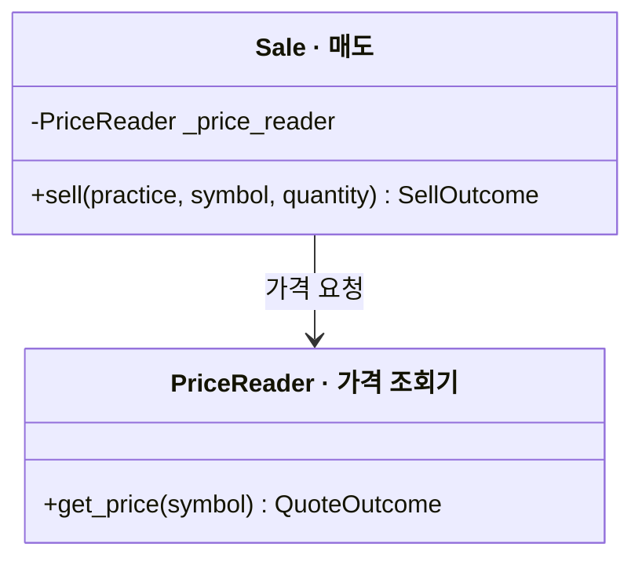
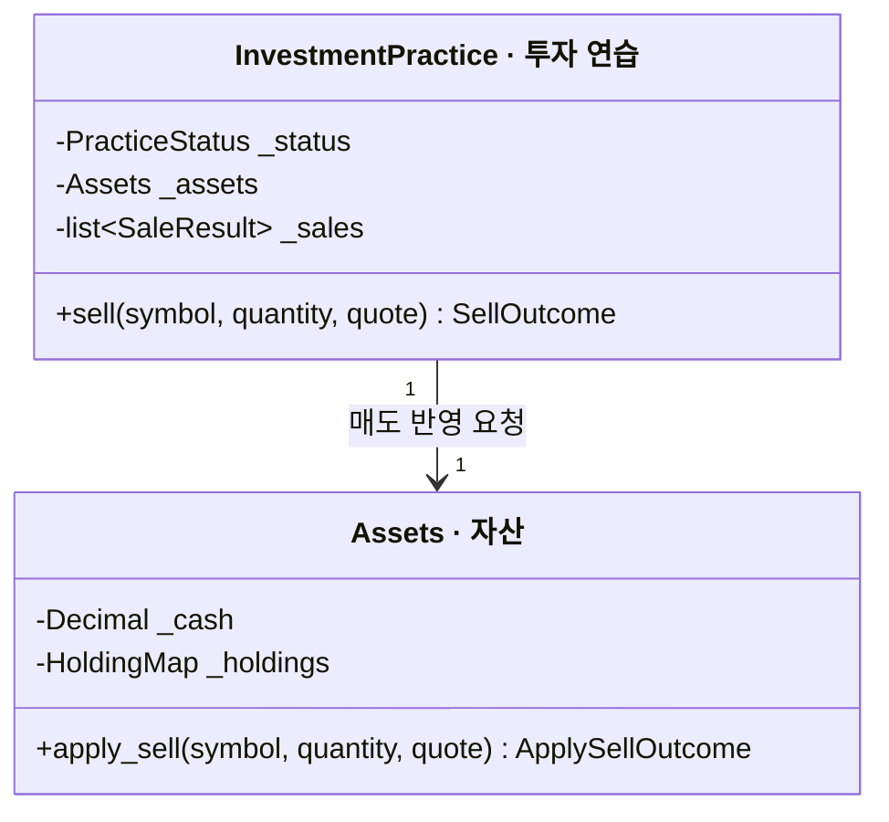
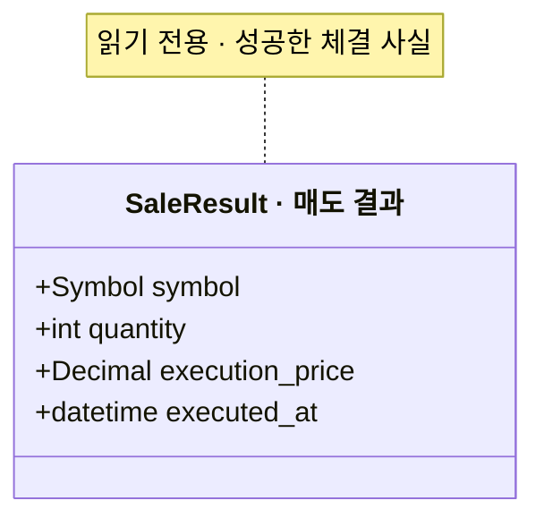
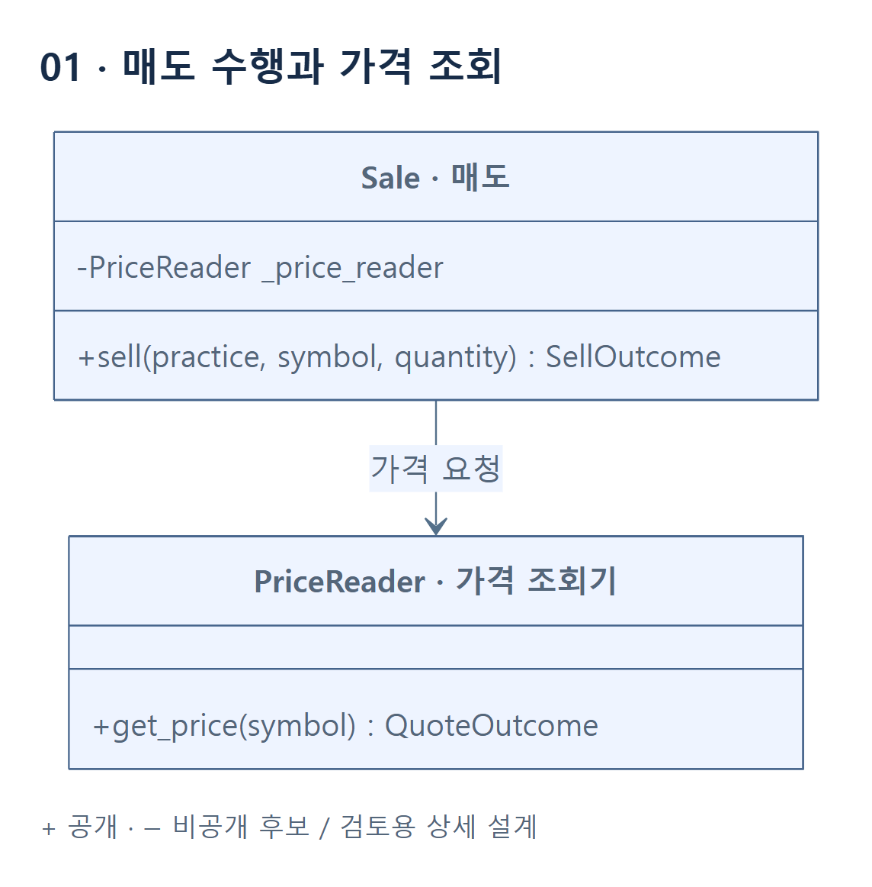
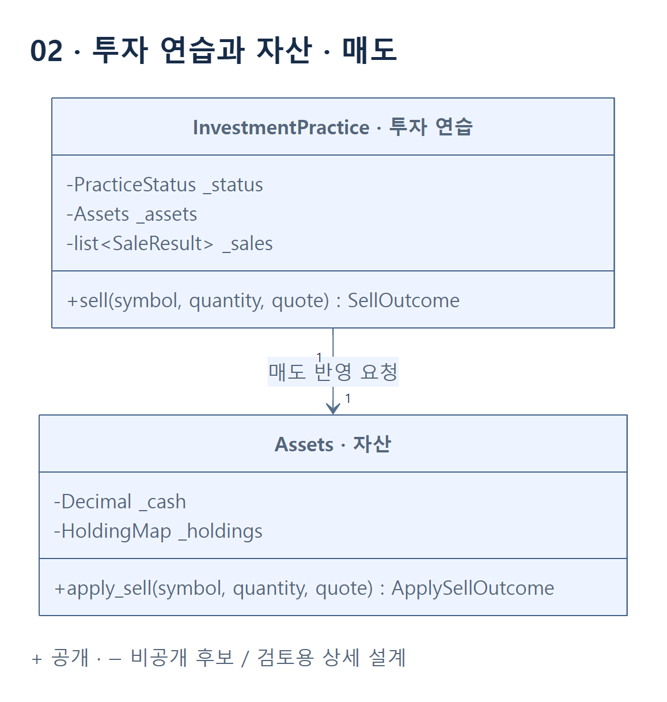
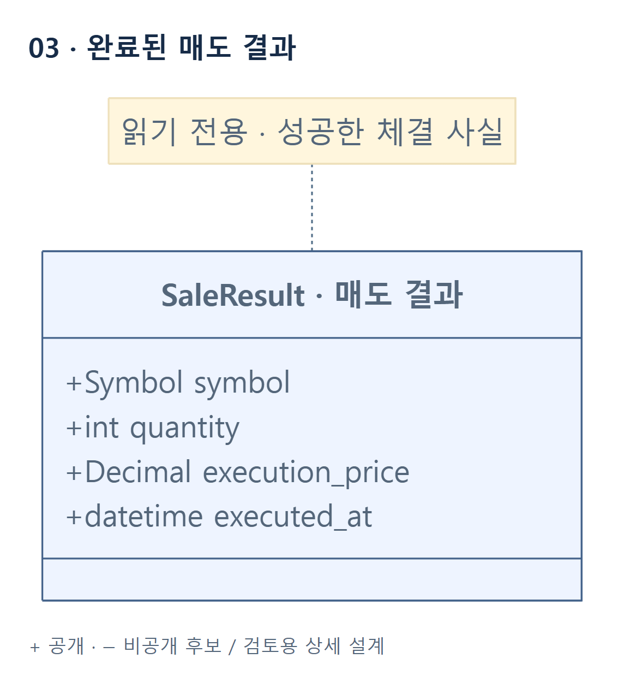

# 가상 매도 — 코드 매핑을 위한 클래스 상세 초안

- 작성일: 2026-11-16
- 대상: UC-PT-03 정상·보유 수량 부족·가격 실패
- 상태: 검토용 제안. 상세 타입・계산 규칙・저장 구조는 확정하지 않는다.
- 근거: [매도 협력](paper_trading_sell_sequence.md), [매수 상세 클래스](paper_trading_buy_detailed_classes.md)

## 1. 매도 수행과 가격 조회

Sale은 요청마다 대상 투자 연습을 전달받는다. 가격 조회 실패·오래된 가격이면 투자 연습에 요청하지 않고 실패 이유와 재시도 안내를 반환한다. 가격 조회기는 매수와 공유하는 역할이며 최신성 판단을 담당한다. 상속 구조와 별도 구현체를 추가하지 않는다.

## 2. 투자 연습과 자산 — 매도에 필요한 부분

기존 매수·현황 조회 연산과 초기 자금·매수 내역은 유지한다. 투자 연습은 진행 상태를 확인하고 자산에 매도를 요청한다. 성공한 경우에만 SaleResult를 구성·보존하고 반환한다. 종료된 연습이나 보유 수량 부족이면 실패한다.

자산은 처리 시점의 보유 수량을 검증하고 매도분의 취득 원가로 실현손익을 계산한다. 현금 증가·보유 수량 감소·남은 취득 원가·누적 실현손익을 일관되게 반영한다. 부족하면 상태를 변경하지 않는다. 관심 종목 등록 여부는 매도 조건이 아니다.

HoldingMap은 dict[Symbol, Holding]을 짧게 표현한 후보이며 내부 보유 목록을 외부가 직접 수정하지 못하게 한다. _sales는 완료 내역을 표현하는 후보로서 메모리 적재·DB 구조를 확정하지 않는다. 누적 실현손익의 별도 필드 유지 여부도 미정이다.

## 3. 완료된 매도 결과

완료된 체결 사실을 담는 읽기 전용 값이다. 공개 필드는 읽기 접근을 의미하며 setter를 제공하지 않는다. 매도 수행 객체·가격 조회기를 보존하지 않는다. 실패 시 성공한 매도 결과를 생성하지 않는다.

SaleResult는 매도 직후의 완료 응답과 UC-PT-06의 투자 연습 기록 조회에 사용한다. 자산이 매도 이후의 현재 현금·보유 상태라면 SaleResult는 그 상태를 만든 과거 체결 사실이다. 해당 연습의 완료 내역에 종목·수량·가격·시각을 보존하며 실패한 요청은 성공 내역에 넣지 않는다.

매도별 실현손익을 결과에 포함할지와 선택적으로 입력한 매도 이유의 연결·보존 방식은 후속 설계 대상이다. 선택적 이유 기록은 이미 합의한 FR-PT-009이므로 생략할 수 있는 요구사항이 아니라 이번 상세 초안에서 아직 연결하지 않은 항목이다. 매수 이유에도 같은 미완료 항목이 적용된다.

## 4. 호출과 반환 계약 후보

Sale.sell → PriceReader.get_price → InvestmentPractice.sell → Assets.apply_sell 순으로 협력한다. 가격 조회 실패 시 이후 매도 요청은 수행하지 않는다. 자산의 응답은 투자 연습을 거쳐 매도에 반환된다.

| 메시지 | 필요한 입력 | 반환 계약 후보 |
| --- | --- | --- |
| Sale.sell | practice: InvestmentPractice, symbol: Symbol, quantity: int | SellOutcome: 성공 시 SaleResult, 실패 시 이유 |
| PriceReader.get_price | symbol: Symbol | QuoteOutcome: 가격·가격 기준 시각 또는 실패 이유 |
| InvestmentPractice.sell | symbol: Symbol, quantity: int, quote: Quote | SellOutcome: 성공 시 보존한 SaleResult, 실패 시 이유 |
| Assets.apply_sell | symbol: Symbol, quantity: int, quote: Quote | ApplySellOutcome: 반영 성공 또는 보유 수량 부족 등의 실패 이유 |

Outcome·Quote·Symbol·정수 수량·Decimal은 매수 상세 초안과 같은 전달 계약·타입 후보다. 별도 도메인 엔티티나 새 거래 단위 정책을 확정하지 않는다. 사용자용 문구·재시도 안내는 호출 경계에서 표현한다.

UC-PT-03, FR-PT-011·015·018·019·025와 연결되며 실현손익 제공은 UC-PT-05와 관련된다. 취득 원가 산정·수수료·세금·체결 시각 확정·자산 변경과 내역 보존의 일관성은 후속 결정이다.

## 모바일용 PNG

