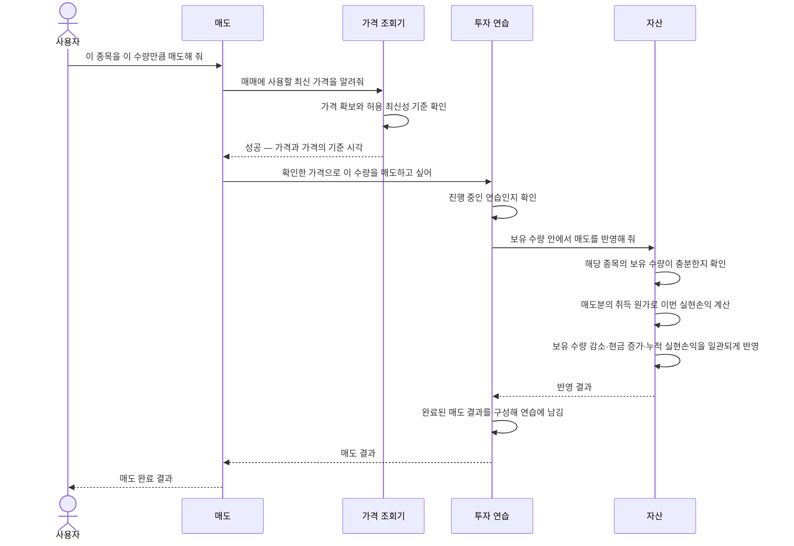
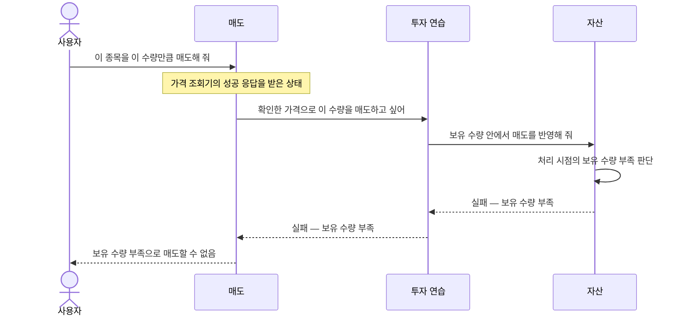
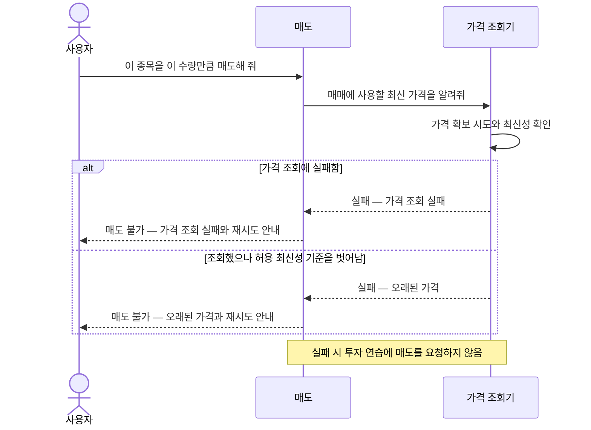

# 가상 매도 — 관계 중심 시퀀스 초안

- 작성일: 2026-11-16
- 상태: 정상·보유 수량 부족·가격 예외 시나리오의 협력 방향 및 매도 수행 역할·매도 결과 분리 합의. 상세 인터페이스·계산·저장 구조는 미정이다.
- 대상: UC-PT-03 — 주식을 가상 매도한다
- 이슈: [#44](https://github.com/PhilPark-geosr/stock-agent/issues/44)
- 근거: [유스케이스 개요](paper_trading_requirements.md), [매수 협력](paper_trading_buy_sequence.md), [용어집](../CONTEXT.md)

## 1. 범위와 전제

사용자가 보유한 국내 주식의 종목과 매도 수량을 제시한다. 필요한 최신 가격을 확보하고 진행 중인 투자 연습에서 보유 수량 범위 안의 매도를 완료하는 정상 시나리오다. 사용자와 대상 투자 연습은 식별되어 있다고 전제한다.

일부 수량만 매도할 수 있으며 관심 종목에서 삭제한 기존 보유분도 매도할 수 있다. 관심 종목 재등록을 매도 조건으로 요구하지 않는다. 보유 수량을 넘는 매도와 공매도는 허용하지 않는다.

‘매도’는 수행을 조율하는 역할이고 ‘매도 결과’는 성공한 체결 사실이다. 투자 연습에는 수행 객체 자체 대신 매도 결과를 남긴다. 객체의 생명주기, 결과의 상세 생성 협력, 인자·반환 타입은 확정하지 않는다.

## 2. 정상 시나리오

자기 메시지는 책임을 요약하며 독립 메서드나 저장 순서를 확정하지 않는다. 체결과 자산 변경·내역 보존이 일치해야 하지만 중간 실패의 일관성 처리는 별도 상세 설계 대상이다.

## 3. 책임과 요구사항 연결

### 보유 수량 부족 예외 — 합의된 협력

화면에서는 표시된 보유 수량까지만 매도 수량을 입력하도록 제한한다. 이 입력 제한과 별개로 자산은 요청을 처리하는 시점의 실제 보유 수량을 기준으로 최종 판단한다. 화면을 확인한 뒤 다른 매도로 보유 수량이 바뀔 수 있으므로 화면의 제한만으로 도메인 규칙을 보장하지 않는다. 화면 제한은 UI 설계 조건이며 독립 유스케이스로 만들지 않는다.

가격 조회·진행 상태 확인은 생략하고 실패 응답 경로를 강조한 그림이다. 자산은 상태 변경 전에 수량 부족을 판단하며 현금·보유 주식을 변경하지 않는다. 투자 연습은 성공한 매도 결과를 생성·보존하지 않고 실패를 반환한다. 매도는 그 실패를 호출자에게 전달한다. 별도 취소 메시지나 매도 수행 객체에 대한 역방향 참조는 필요하지 않다.

이 협력의 근거는 UC-PT-03, FR-PT-011·018이다. 동시 요청에서 검증과 변경의 일관성을 보장하는 구체적인 방법은 상세 설계에서 정한다.

### 가격 조회 실패·오래된 가격 예외 — 합의된 협력

매수와 마찬가지로 가격 조회기는 허용 최신성 기준을 충족하는 가격을 제공하고, 조회 실패 또는 오래된 가격이면 실패를 반환한다. 매도는 최신성을 중복 판단하지 않는다.

위 그림은 두 실패 사례만 보여준다. 성공 시에는 정상 시나리오를 따른다. 실패 시 매도는 투자 연습에 요청하지 않고 실패 이유와 재시도 안내를 반환한다. 현금·보유 주식은 변경하지 않고 성공한 매도 결과도 생성·보존하지 않는다. 근거는 UC-PT-03, FR-PT-025 및 해당 요구사항의 예외 조건이다. 허용 최신성 기준의 구체적인 값은 미정이다.

### 객체별 책임

| 객체 | 책임 | 근거 |
| --- | --- | --- |
| 매도 | 가격 조회와 투자 연습에 대한 매도 요청을 조율하고 성공·실패를 전달한다. 자산의 현금·보유 수량을 직접 수정하지 않는다. | UC-PT-03, FR-PT-025 |
| 가격 조회기 | 허용 최신성 기준을 충족하는 가격과 기준 시각을 제공한다. 조회 실패·오래된 가격이면 실패를 반환한다. | FR-PT-022·025 |
| 투자 연습 | 진행 상태를 확인하고 자산에 매도를 요청하며 성공한 매도 결과를 보존한다. 초기 자금은 변경하지 않는다. | FR-PT-017·020·021, UC-PT-03·06 |
| 자산 | 처리 시점의 보유 수량이 충분한지 판단한다. 매도로 인한 현금·보유 수량 변화와 실현손익을 일관되게 반영하고 해당 연습의 누적 실현손익을 제공한다. 부족하면 상태 변경 없이 실패를 반환한다. | FR-PT-011·018·019, UC-PT-03·05 및 손익 확인 초안 FR-PT-006 |
| 매도 결과 | 성공한 체결의 종목·수량·가격·시각을 보존한다. 수행 객체 및 이후 시장 가격과 구분한다. | UC-PT-03·06, 매매 이력 초안 FR-PT-007 |

FR-PT-015에 따라 관심 종목 삭제 후에도 매도를 허용한다. 매수의 관심 종목 제한 FR-PT-014를 매도에 적용하지 않는다. 상세 요구사항의 합의 상태는 기존 문서를 따르며 위 연결로 미합의 초안 전체를 승인하지 않는다.

## 4. 다음 검토 항목

- 종료된 연습 등 나머지 실패 응답 및 상태 보장. 보유 수량 부족의 응답 경로와 변경 없음 보장은 위에서 합의했다.
- 가격 최신성의 구체적인 허용 기준과 가격 공급자. 가격 예외의 응답 경로는 위에서 합의했다.
- 실현손익의 구체적인 계산 규칙, 매도분의 취득 원가·평균 매수가 및 수수료·세금 등 비용 반영. 계산·반영·누적값 제공 책임은 자산에 둔다.
- 전량 매도 이후 보유 상태의 표현, 입력 수량의 유효성 검증 책임
- 체결 가격·수량·시각 확정과 매도 결과의 생성 책임, 자산 변경·내역 보존의 일관성
- 매수·매도 협력을 비교한 클래스 초안 보완. 유사성만으로 공통 상위 클래스나 별도 처리 서비스를 추가하지 않는다.

이 문서는 정상·보유 수량 부족·가격 예외 시나리오의 협력을 기록한다. 실현손익 반영과 누적값 제공 책임은 자산에 두며 구체적인 계산·보존 방법은 미정이다. 실패 시 누적 실현손익도 변경하지 않는다. 나머지 예외의 상세 흐름은 아직 확정하지 않는다.
