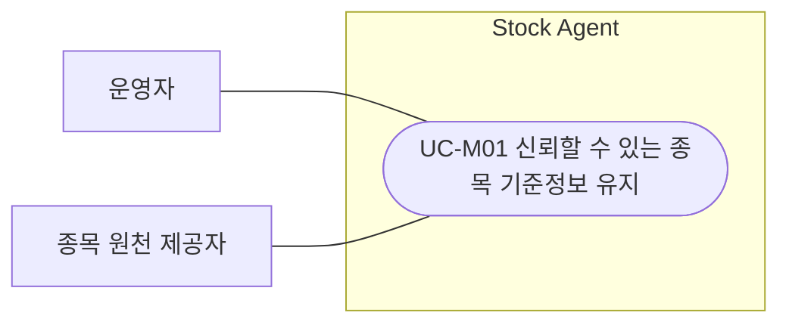
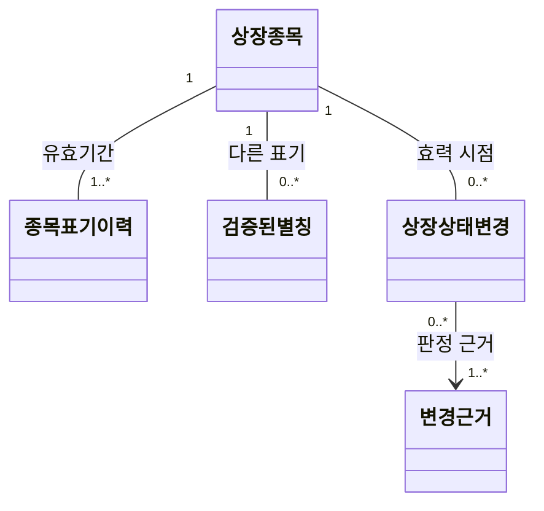
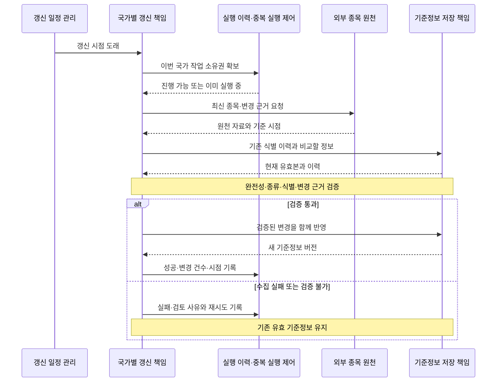
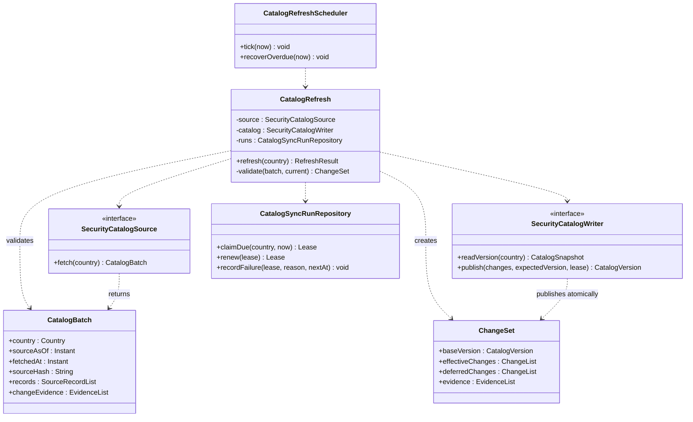
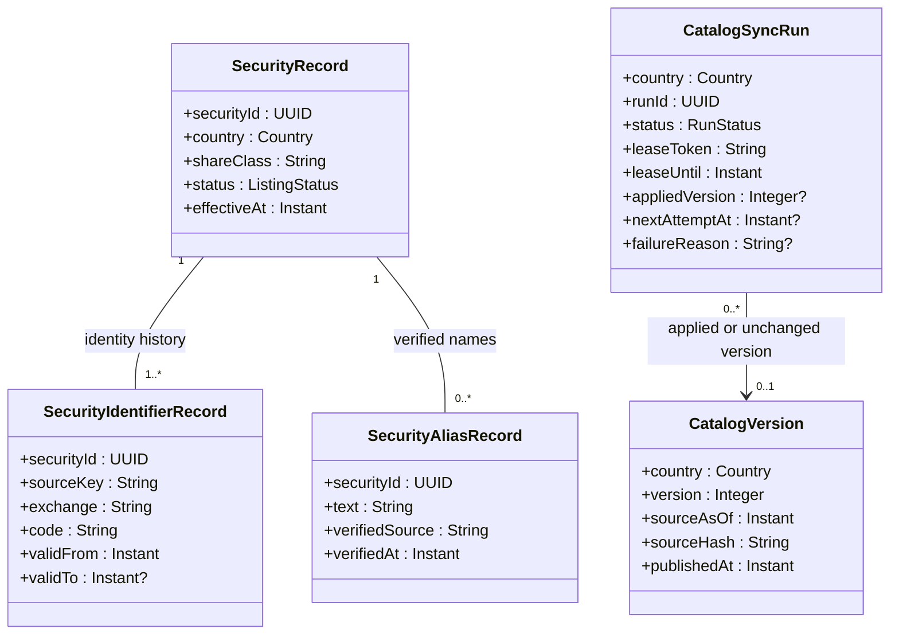
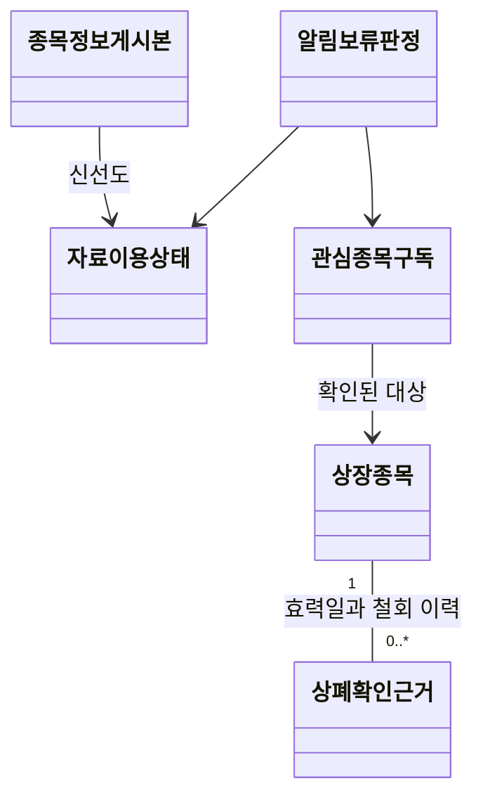
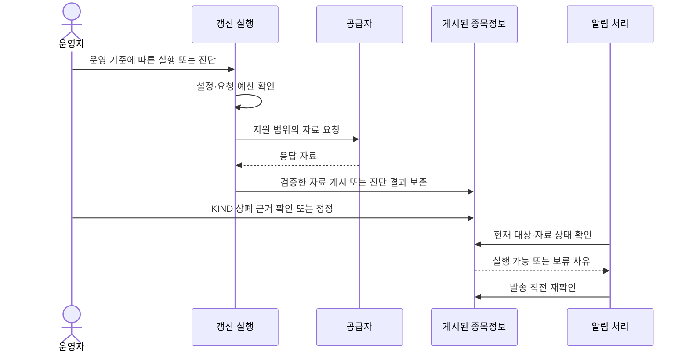
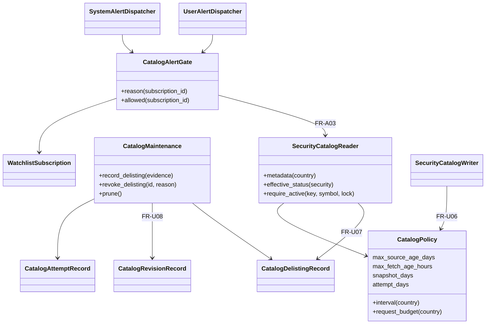

# 종목 기준정보 주기적 갱신 설계

> 2026-10-19: 운영 정책을 확정했다. 이 문서 마지막의 “운영 정책 확정 및 구현 보완”이 이전 초안의 주기·상태 제한·보존·공급자 제안을 대체한다. 실계정 검증은 별도 미완료다.

2026-10-12 · v1.1 · [갱신 기능 쉬운 설명서](security_catalog_refresh_explainer.html) · [종목 검색 설계](stock_search_usage_design.md)

## 1. 목적과 시스템 경계

**신규상장·상장폐지·이름/코드 변경을 검증해 신뢰할 수 있는 종목 기준정보를 유지한다.** 종목 검색과 독립적인 유지관리 기능이다. 갱신은 기준정보를 쓰고, 검색은 게시된 유효 정보를 읽는다. 같은 DB·백엔드를 사용해도 기능 책임은 분리한다.

이 기능의 범위는 한국·미국 주식 원천 수집, 식별·상태·검증된 별칭 유지, 변경 검증과 게시, 주기 실행·재시도·운영 결과 기록이다. 관심종목 등록·알림 조건 저장·브리핑 검색용 색인 이관은 각각의 기능이 소유한다. 갱신 기능은 사용자의 구독·알림 조건·과거 브리핑을 삭제하거나 새로 만들지 않는다.

코드 근거는 기존 조사 기준 main `12ba6a4`의 `app/core/scheduler_runtime.py`다. 현재는 주기적 분석 실행 기반이며, 아래 책임 모델을 구현 브랜치 codex/stock-search-implementation에서 구체화했다. 물리 클래스·함수 대응과 실제 API 계약은 [구현·운영 문서](https://github.com/PhilPark-geosr/stock-agent/blob/codex/stock-search-implementation/docs/stock_search_operations.md)를 따른다. 실계정 공급자 연결과 운영 정책은 검증 대기다. 기존 실행 기반을 재사용할 수 있다는 것과 같은 작업으로 운영한다는 것은 다르다.

## 2. OOA — 신뢰할 수 있는 종목 기준정보 유지

운영자는 서비스를 운영하는 사람이다. 별도 관리자 화면·승인 절차를 추가한다는 뜻은 아니다. 운영자가 정한 제공 범위와 주기에 따라 시스템이 자동으로 유지관리한다. 종목 원천 제공자는 실제 외부 시스템이고, 스케줄러·DB·갱신기는 시스템 내부 책임이다. 시간 도래는 트리거이지 액터가 아니다.

| 항목 | 명세 |
| --- | --- |
| ID | UC-M01 |
| 이름 | 신뢰할 수 있는 종목 기준정보 유지 |
| 목적 | 이용자가 종목을 정확히 구별할 수 있도록 상장·상태·표기의 변화를 신뢰할 수 있게 반영한다. |
| 주 액터 | 운영자 |
| 보조 액터 | 종목 원천 제공자 |
| 트리거 | 운영자가 정한 갱신 시점이 도래한다. |
| 사전조건 | 지원 대상과 정보 제공 범위·이용 조건·운영 기준이 정해져 있다. 첫 갱신은 기존 기준정보 없이도 시작할 수 있다. |
| 기본 흐름 | ① 시스템이 제공자에게 최신 종목 정보와 변경 근거를 요청한다. ② 제공자가 정보와 기준 시점을 제공한다. ③ 시스템이 확인된 변경을 사용 가능한 종목 정보에 반영한다. ④ 운영자는 적용 여부·기준 시점·변경 요약을 확인할 수 있다. |
| 대안·예외 | 변경 없음은 정상 완료로 알린다. 제공 불가·불완전 자료·변경 근거 부족은 반영 보류 사유를 알리고, 마지막 유효 정보가 있으면 유지한다. 유효 정보가 전혀 없으면 이용 불가 상태를 알린다. |
| 성공 보장 | 검증된 변화가 효력 시점에 맞게 반영되고 상태·시점이 확인 가능하다. 코드가 같다는 이유로 다른 종목을 합치거나 과거 기록의 대상을 바꾸지 않는다. |

기본 흐름은 외부에서 관찰 가능한 정보 교환과 제공 결과다. 원천 호출 방식·DB 키·잠금·스케줄러 메서드는 아래 OOD로 분리한다. 기존에 요청한 정기 갱신 목표를 별도 유스케이스로 정리한 것이며, 공급자와 운영 수치는 아직 제안이다.

## 3. 요구사항과 도메인

| ID | 요구사항·추적 |
| --- | --- |
| FR-U01 | 한국·미국 정보를 독립적으로 정기 수집하고 신규상장·상태·이름·코드 변경을 반영한다. UC-M01 |
| FR-U02 | 원천 누락만으로 상폐 처리하지 않는다. 검증 후 원자 게시하고 장애 시 마지막 유효본을 보존한다. UC-M01 |
| FR-U03 | 안정적 종목 식별과 코드 유효기간·별칭 검증 근거를 보존한다. 코드 재사용은 별개 종목으로 처리한다. UC-M01 |
| FR-U04 | 재시도·중복 실행·재기동·감사 이력을 지원하고 오래된 작업의 덮어쓰기를 방지한다. UC-M01 |
| FR-U05 | 조회 기능에 완결된 버전, 종목 상태, 원천 시점, 자료 이용 상태를 제공한다. UC-M01, 검색 기능과의 경계 |

상장종목은 이름·코드와 별개의 정체성을 가진다. 코드 표기는 유효기간을 가지며, 변경은 근거와 효력 시점으로 판정한다. 별칭도 검증된 다른 표기로 관리하며 생성형 모델의 추정 결과를 자동 게시하지 않는다.

## 4. 관계 중심 시퀀스

최초 시퀀스는 내부 책임과 외부 제공자의 협력만 보여준다. 상세 오퍼레이션·매개변수·트랜잭션 구현은 클래스·저장 계약에 둔다.

## 5. 상세 클래스와 게시 계약

주기적 갱신과 검색의 기능 분리는 사용자 요청이다. 운영자의 자동 유지관리 목표를 OOA로 기록했으며, 아래 OOD는 그 목표를 구체화한다. 공급자별 간격, 자료 지연 한도와 재시도 수치는 7·9절의 제안이며 이를 사용하는 세부 분기는 정책 확정에 따라 바뀔 수 있다.

`publish()`는 같은 트랜잭션에서 lease와 기준 버전을 확인하고, 변경 사항·현재 버전·성공 기록을 함께 반영한다. lease가 만료된 옛 작업은 새 버전을 덮어쓸 수 없다.

중복 처리 방지 키는 국가·원천 식별·원천 시점·내용 해시로 구성한다. 같은 배치를 다시 실행해도 종목을 중복 생성하지 않는다. 동일한 정상 파일은 NO_CHANGE로 기록하되 원천 시점을 새로 만들지 않는다. 여러 파일을 모아 받는 경우 각 파일의 지문과 완전성을 검증한다.

이미 실행 중이면 수집·게시를 수행하지 않고 종료한다. 실행 이력과 실제 게시 버전의 완료 표시는 같은 커밋에 묶어, 성공한 게시를 실패한 작업으로 다시 처리하지 않도록 한다.

### 검색 기능에 제공하는 읽기 계약

`SecurityCatalogWriter`는 갱신용 저장 계약이고, `SecurityCatalogReader`는 검색·지정에 필요한 조회 계약이다. 저장 구현은 공유할 수 있지만 읽기 소비자는 수집·재시도·lease를 호출하지 않는다.

| 게시 결과 | 의미 |
| --- | --- |
| `securityId`, 현재 표기·검증된 별칭·시장·종류·상장 상태와 효력 시점 | 종목을 구별하는 공통 사실. 실제 등록·알림·열람 허용 여부는 소비 기능이 판단 |
| 국가별 `catalogVersion`, `sourceAsOf`, `dataState` | 완료된 버전 및 원천 기준 시점. 수집 시각으로 신선도를 가장하지 않음 |
| `READY / STALE / UNAVAILABLE` | READY: 정상, STALE: 마지막 유효본이 있으나 갱신 지연, UNAVAILABLE: 유효본 없음 또는 운영상 이용 한도 초과. 상태 산정 정책은 이 기능에서 관리 |
| 코드·종목 동일성 이력 | 과거 symbol을 해석할 근거. 불확실하면 미해석으로 전달하고 새 종목과 자동 병합하지 않음 |

게시 중에도 소비자는 직전 완결 버전을 읽는다. 새 버전 게시 이후 캐시와 페이지 기준은 버전으로 구분한다. 원천 장애를 정상 검색 0건으로 바꾸지 않는다. 데이터가 UNAVAILABLE이어도 저장 브리핑 자체의 접근 권한이나 내용은 변경하지 않는다.

## 6. 신규상장·상폐·변경 판정 규칙

| 상황 | 반영 |
| --- | --- |
| 신규상장 확인 | 새 안정 식별값 발급, 원천 식별 근거·시장·종류·효력 시점 저장. 효력 전이면 PENDING, 상장 확인 후 ACTIVE |
| 상장폐지 공식 근거 확인 | 효력 시점에 DELISTED. 소비 기능에 폐지 상태 제공. 신규 작업 허용 여부는 소비 기능이 판단하며, 갱신은 관심종목·조건·브리핑 이력을 삭제하지 않음 |
| 이번 목록에서만 사라짐 | 상폐로 단정하지 않고 검토 대상으로 기록. 부분 수집 의심이면 국가 배치 게시 중지. 후속 재조회·공식 변경 근거로 판정 |
| 이름·티커 변경 | 동일성을 입증하면 같은 종목에 새 유효기간 표기 연결. 이전 표기·별칭과 과거 브리핑 원문 보존 |
| 과거 코드 재사용 | 새 종목 ID. 이전 코드 대응 유효기간 종료. 과거 브리핑을 새 종목으로 옮기지 않음 |
| 거래정지·상태 불명 | 상폐와 구분. 정지·상태 불명의 사실과 사유를 소비 기능에 제공. 기존 이력에는 쓰지 않음 |
| 빈 파일·급격한 건수 변화·페이지 누락·원천 시점 역행 | 자동 게시 보류, 마지막 유효본 유지. 단순 비율 기준만으로 정상 상폐를 승인하지 않음 |

정상적으로 확인된 변경과 판정 불가 행이 섞이면 **초기 구현은 국가 배치 전체를 보류**한다. 일부만 게시하는 최적화는 별도 검증 규칙이 생겼을 때 도입한다. 효력 시간이 미래인 변경은 `effectiveAt`으로 저장하고 해당 시점에 적용할 기한 작업을 만든다. 시간 없이 날짜만 제공되는 경우 원천의 시장별 적용 기준을 확인하며 임의 UTC 자정으로 해석하지 않는다.

상폐 후 기존 알림의 자동 종료·평가 중단·복원 정책은 이 갱신 설계에서 확정하지 않는다. 기준정보 갱신이 기존 조건을 조용히 삭제하지 않게 하고, 실제 평가 시 종목 상태 처리 정책은 알림 구현에 연결해야 할 후속 항목으로 남긴다.

## 7. 주기·복구·운영 정책 — 사용자 확인 대기

2026-10-12 공식 API를 조사하고 동작 가능한 초안에 반영했다. 사용자 답변은 아직 없으므로 운영 확정이 아니며 자동 갱신은 기본 비활성이다.

| 항목 | 구현 제안 |
| --- | --- |
| 정기 실행 | KR 최소 60분, US 최소 360분. 검색 요청은 외부 수집을 유발하지 않음 |
| 수집 | KR은 KRX 두 시장 전체 목록, US는 Alpha Vantage active/delisted 목록. 빈 시장·불완전 배치는 게시하지 않음 |
| 상폐 판단 | KR 목록 누락은 unknown. 별도 상폐 효력 근거 필요. US는 제공자의 상폐일 사용. 효력일 전에는 적용하지 않음 |
| 서버 시작 | due인 국가 작업만 보충. 국가별 lease로 중복 및 만료된 작업의 덮어쓰기 방지 |
| 재시도 | 5/15/30분 이후 30분. 호출 한도 응답은 24시간 유예. 다른 국가는 계속 |
| 작업 소유 | 10분 lease, 토큰·버전 재확인. 현재 수집은 제한된 HTTP 요청으로 구성. 시간 초과 작업은 게시하지 않고 다음 실행에서 회수 |
| 자료 지연 | 원천일 7일 초과 또는 마지막 정상 수집 48시간 초과면 STALE. 최초 게시 전은 UNAVAILABLE. 오래된 자료를 재수집해 원천일을 현재로 바꾸지 않음 |
| 감사 | 게시된 배치 원문·성공/실패/만료 실행 기록. 현재 자동 삭제 없음 |

주기는 우리 서버의 확인 간격이다. 원천은 거래일 단위 자료여서 신규상장·상폐를 실시간 반영한다는 보장이 없다. 거래소 달력으로 최근 완료 거래일을 정하되 공급자 발표 시각은 실계정 검증이 필요하다.

## 8. 기준정보 DB의 책임과 구조

이 기능이 기준정보·식별 이력·별칭·게시 버전·실행 이력을 소유한다. 검색 기능의 `BriefingSubjectRecord`와 사용자 구독·브리핑 저장 구조는 소유하지 않는다.

- 동일 시장·코드가 서로 다른 종목을 가리키는 유효기간은 겹칠 수 없다. 코드 문자열을 영구 유일 식별자로 쓰지 않는다.
- 시장·코드·정규화된 이름·별칭으로 조회 가능한 인덱스를 마련한다. 조회 질의의 사용자 소유 범위는 검색 기능이 적용한다.
- 변경 이력·현재 포인터/버전·실행 성공 기록을 같은 트랜잭션으로 반영한다. 검증 실패나 중단은 반쪽 기준정보를 노출하지 않는다.
- 첫 적재도 검증·게시 경로를 거친다. 마지막 유효본이 없으면 빈 정상 카탈로그로 가장하지 않고 이용 불가를 알린다.
- 종목을 상폐 상태로 남기고 식별 이력을 보존한다. 소비 기능의 저장 문서를 삭제 연쇄로 지우지 않는다.

## 9. 원천과 남은 결정

- 한국: KRX 종목기본정보의 표준코드·상장일을 사용한다. AUTH_KEY 헤더와 기준일자로 요청한다. **상폐일 필드가 없으므로 국내 상폐 확정 API는 별도 확보가 필요하다.** [공식 명세](https://openapi.krx.co.kr/contents/OPP/USES/service/OPPUSES002_S2.cmd?BO_ID=PiwgMdTwmsenXhmqqxuj)
- 미국: Alpha Vantage LISTING_STATUS의 상장/상폐 CSV와 날짜를 사용한다. 2회/배치 × 4회/일로 기본 한도 25회/일 안에서 시작하는 안이다. 이 데이터는 거래소 공식 상폐 공시와 구분한다. [공식 문서](https://www.alphavantage.co/documentation/#listing-status), [호출 한도](https://www.alphavantage.co/support/)
- 미국 공급자의 티커·상장일·거래소 조합은 관측 식별일 뿐 글로벌 영구 ID가 아니다. 코드 변경을 추정 연결하지 않는다. 종류 판정·한글 별칭·영구 식별의 보강 원천과 공급자 계정 검증은 남아 있다.
- 운영 주기·지연 허용·신규 등록 제한·기존 알림 중지/복원·기존 미연결 구독 확인·감사 보존 기간은 사용자 확인 대상이다. 기존 구독/브리핑은 자동 삭제하지 않는다.

추가 큐나 프레임워크 없이 독립 asyncio 루프와 작업 스레드를 사용한다. 기존 분석 스케줄러의 장중 제한과 분리한다. API 키가 없고 운영 정책이 미결이므로 실제 자동 갱신을 켜지 않았다.

## 10. 요구사항 추적과 검증

| 설계 요소 | 근거 |
| --- | --- |
| `CatalogRefreshScheduler` | FR-U01/04: 국가별 주기·재기동 보충 |
| `CatalogRefresh`, `SecurityCatalogSource`, `CatalogBatch`, `ChangeSet` | FR-U01~03: 수집·검증·근거 있는 변경 |
| `CatalogSyncRunRepository`, lease·실행 이력 | FR-U04: 재시도·중복·지연 완료 방지 |
| `SecurityCatalogWriter`, `CatalogVersion` | FR-U02/04/05: 원자 게시·버전·완결된 조회 결과 |
| 종목·식별·별칭 기록 | FR-U03/05: 동일성·표기 이력·검증 근거 |
| 읽기 메타데이터 계약 | FR-U05: 검색 기능이 자료 상태와 시점을 알 수 있음 |
| `Lease`, `CatalogSyncRun`, `RefreshResult` | FR-U04: 작업 소유권·실행 결과를 표현하는 값과 기록 |
| `CatalogSnapshot`, `SourceRecordList`, `EvidenceList`, `ChangeList` | FR-U01~03/05: 수집·검증·게시 과정의 자료 계약. 독립 서비스나 새 테이블을 각각 강제하지 않음 |

| 사례 | 기대 |
| --- | --- |
| 신규상장·미래 효력 | 근거·효력 시점을 확인해 반영, 미래 상태를 즉시 활성화하지 않음 |
| 공식 상폐·단순 누락 | 근거 있는 폐지는 상태 변경, 누락만으로 자동 상폐하지 않음 |
| 이름 변경·코드 재사용 | 동일성 근거와 유효기간으로 구분, 과거 문서의 대상을 바꾸지 않음 |
| 원천 0건·누락 페이지·시점 역행 | 국가 배치 보류, 마지막 유효본 보존 |
| 동시 worker·lease 만료·재실행 | 한 유효 작업만 게시, 오래된 작업 덮어쓰기 및 중복 없음 |
| 게시 도중 장애 | 변경과 버전·성공 이력이 함께 커밋 또는 롤백 |
| 같은 오래된 원천 반복 수집 | fetchedAt만 변경, sourceAsOf 유지, 허위 최신 표시 없음 |
| 서버 재시작 | 기한 지난 국가별 갱신 한 번 보충, 누락 횟수만큼 폭주하지 않음 |
| 원천 장애 중 검색 | 갱신 완료를 기다리지 않고 직전 유효본·상태 제공 |

AGENTS 검토: UC-M01은 운영자의 목표이고 수집·검증·저장을 별도 UC로 만들지 않는다(1). OOA는 특정 화면·API·DB와 독립적이고 외부 교환·결과로 작성했다(2·3). UC 그림은 실제 사람/외부 시스템과 목표만 연결하며 include는 없다(4·5·10). 명세의 ID·이름·목적·액터·트리거·사전조건·흐름·예외·성공 보장을 분리했다(6). 실행 주기·DB·클래스는 FR/OOD에 둔다(7). 기존 요청의 목표를 바탕으로 구체화하되 원천·운영 수치는 미확정으로 표시한다(8). 모든 OOD 책임은 위 요구에 연결한다(9). 유스케이스의 UI 독립성·관찰 가능한 흐름·내부 정보 배제·include 오용 없음·추적 관계를 자체 점검했다(11).

2026-10-07 재검토: [절대규칙 적용 검토](design_rules_audit.md). 최초 시퀀스에는 저장 구현을 넣지 않고, 트랜잭션·lease 상세는 OOD에 둔다.

## 12. 구현 구체화 기록

논리적 클래스·저장 구조는 책임 설명이며 물리 테이블을 각각 강제하지 않는다. 현재 구현은 원본 판본에 코드·별칭 이력을 함께 보존하고 SecurityCatalogWriter가 lease와 게시를 조정한다. [구현 대응표와 API 요청·제약](https://github.com/PhilPark-geosr/stock-agent/blob/codex/stock-search-implementation/docs/stock_search_operations.md)를 함께 읽는다. 과거 코드 연결은 입증할 수 있는 경우에만 하며 초기 이관은 미해석 스냅샷으로 보존한다.

## 2026-10-19 운영 정책 확정 및 구현 보완

사용자가 남은 정책을 정하고 구현하도록 위임했다. 아래는 이전의 제안값을 대체하는 운영 결정이다. 공급자 실계정 검증은 정책 결정과 별개의 사실 확인이며 키가 없으면 미검증으로 남긴다.

| 항목 | 확정 정책 |
| --- | --- |
| 주기·요청 예산 | 한국 최소 60분, 미국 최소 360분. 배치당 최대 2회. 최근 24시간 한국 96회·미국 20회 내부 예산에 실패·진단 요청도 포함한다. 실제 계정의 공유 사용량은 별도이며 429/제한 응답은 24시간 유예한다 |
| 신선도 | 원천일 7일 초과 또는 정상 수집 48시간 초과는 STALE, 정상 게시 없음은 UNAVAILABLE. 경계값 이하는 허용한다. 시간 비교는 UTC, 상폐 효력일은 한국 날짜다 |
| 발표 지연 | 거래소 달력상 마감 2시간 이후의 거래일을 요청한다. 이는 요청 기준일 선택 정책이지 공급자 발표 SLA가 아니다. 빈/불완전/미래/후퇴 자료는 게시하지 않는다 |
| 한국 상폐 | KRX KIND 상장폐지현황·상장폐지 공시를 근거 원천으로 선정한다. 운영자가 표준코드·효력일·정확한 공식 문서 URL을 확인해 등록한다. 자동 스크래핑 API를 검증했다고 주장하지 않는다. 정정은 기존 근거를 삭제하지 않고 사유와 함께 철회한다 |
| 미국 범위 | Alpha Vantage의 Stock 중 NASDAQ/NYSE/AMEX, 지원 티커 형식과 상장일이 있는 행만 수용. ADR·REIT·SPAC의 보통주도 제공자가 Stock으로 분류하면 포함한다. ETF·ETN·우선주·권리·워런트·유닛·노트는 확인 가능한 유형/명칭으로 제외. 이름 기반 필터는 완전한 상품 분류의 보장이 아니다 |
| 미국 동일성·별칭 | 티커+상장일+거래소를 관측 식별로 유지. 코드 변경·시장 이전은 추정 병합하지 않는다. 원문 이름과 원문 티커만 검색하며 미검증 한글 별칭은 추가하지 않는다 |
| 기존 알림 | 본인 활성 구독의 확인된 동일 종목이 active+READY인 경우만 시스템 알림·사용자 조건 평가/발송. 미연결·상폐·unknown·pending·STALE·UNAVAILABLE은 보류. 조건 enabled/ended_at을 변경하지 않는다 |
| 복원 | 같은 종목이 active+READY로 회복되면 다음 새 분석부터 자동 재개. 사용자가 꺼둔 조건은 그대로 꺼짐. 과거 실패/보류분을 재발송하는 작업은 만들지 않는다. 평가 전과 발송 직전에 재확인한다 |
| 보존 | 배치 원문 90일, 종료된 실행 이력 365일. 현재 게시 버전은 기간과 무관하게 유지한다. 종목 식별·상폐 근거(철회 포함)·사용자 구독·조건·브리핑은 정리 대상에서 제외한다. 정리는 국가별 게시 잠금과 같은 경계를 사용한다 |

### OOA 및 추적

UC-M01 기본 흐름 ④의 운영 결과 확인에 ‘실제 공급자 응답의 계약 검증 결과와 검증 한계’를 포함한다. 대안 흐름은 ‘상폐 근거가 추가되면 운영자가 근거와 효력 시점을 확인하고 시스템이 반영한다; 정정 근거가 확인되면 기존 근거를 철회하고 이력을 보존한다’이다. 외부 액터는 운영자·KRX/KIND·Alpha Vantage이고 내부 DB·실행기는 액터가 아니다. 성공 보장은 검증된 대상의 효력일 반영과 이전 기록 보존이다. 실제 계정 미설정·상폐 근거 불충분은 사유를 알리고 확정하지 않는다.

| 추가 요구 | 추적 |
| --- | --- |
| FR-U06 | 실행 전에 설정·내부 요청 예산을 검사하고 실제 응답 검증과 미검증 항목을 기록한다. UC-M01 |
| FR-U07 | KIND 근거의 대상·효력일·검토자·공식 URL과 철회 이력을 보존한다. 목록 누락과 상폐 확정을 구분한다. UC-M01 |
| FR-U08 | 정해진 기간의 운영 이력만 정리하며 현재 게시본·상폐 근거·사용자 기록은 보존한다. UC-M01 |
| FR-A03 | 기존 알림을 현재 종목/자료 상태로 보류·자동 재개하고 설정값을 보존한다. 기존 알림 유스케이스 UC-A, FR-A01/02 |

### 도메인 → 관계 중심 시퀀스

### 상세 책임

KIND 근거는 운영자 전용 로컬 CLI로 명시적으로 등록·철회한다. HTTP 공개 변경 API는 만들지 않는다. CLI 진단도 국가별 lease와 요청 예산을 공유하며 정상 목록을 게시하지 않는다. 상태 조회는 읽기 전용을 유지한다. 감사 정리는 실행 중 lease가 있으면 건너뛴다.

근거: [KIND 상장폐지현황](https://kind.krx.co.kr/investwarn/delcompany.do?method=searchDelCompanyMain), [Alpha Vantage LISTING_STATUS](https://www.alphavantage.co/documentation/#listing-status), [Alpha Vantage 요청 한도 안내](https://www.alphavantage.co/premium/). KRX 승인 계정 한도와 공급자 발표 지연은 실제 계정으로 확인해야 하며 내부 예산을 공급자 보장 한도로 표현하지 않는다.
