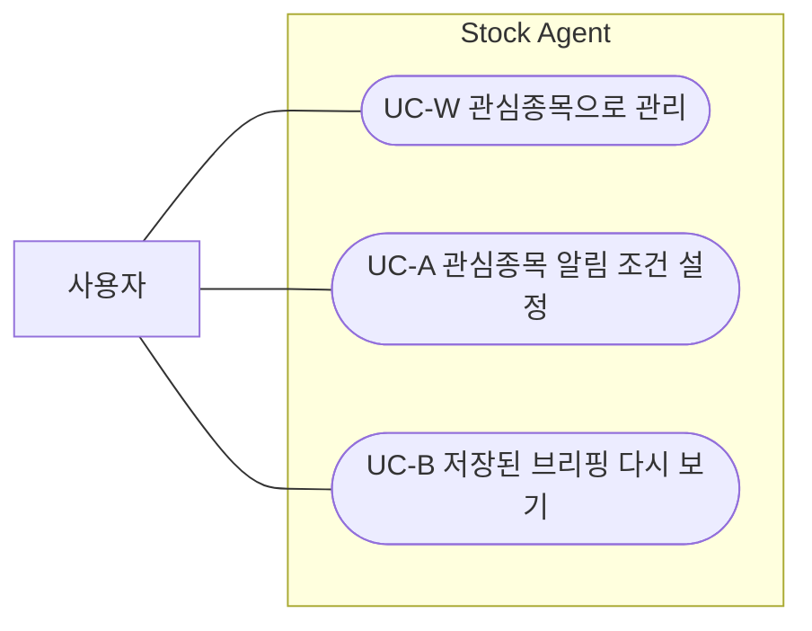
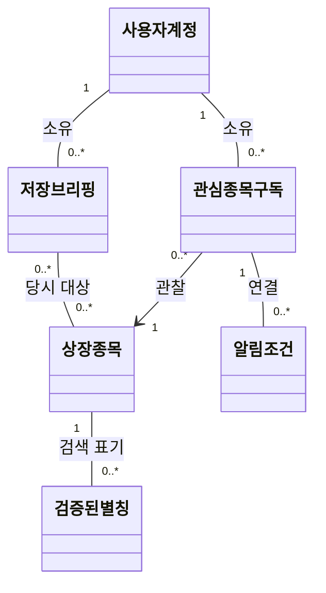
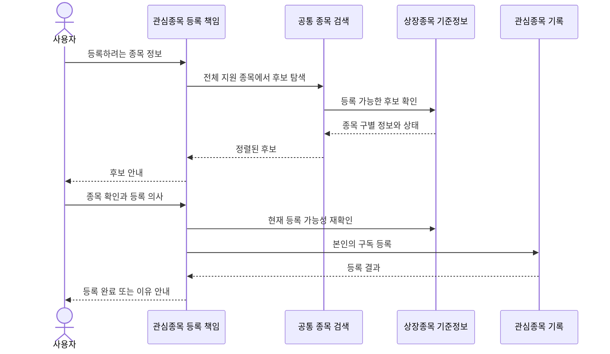
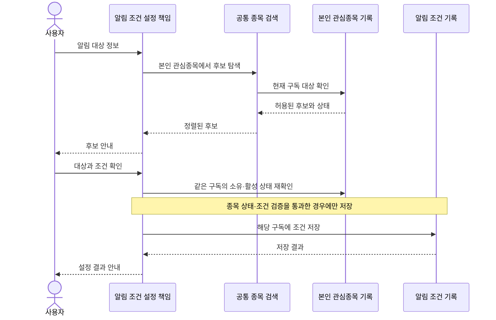
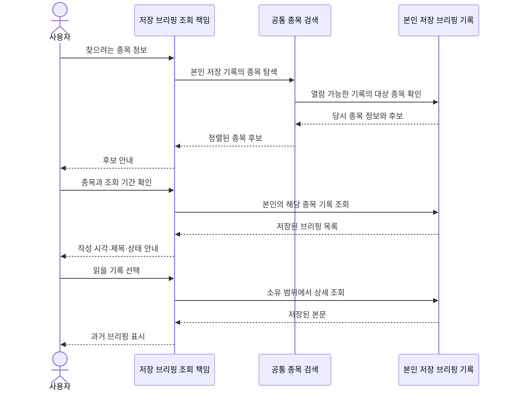
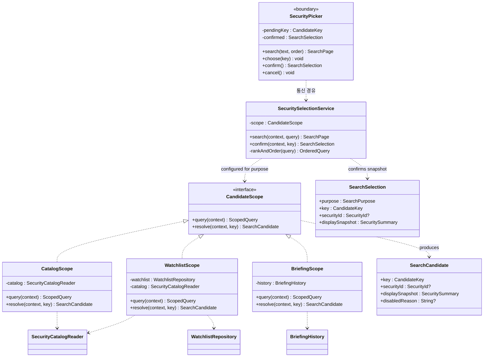
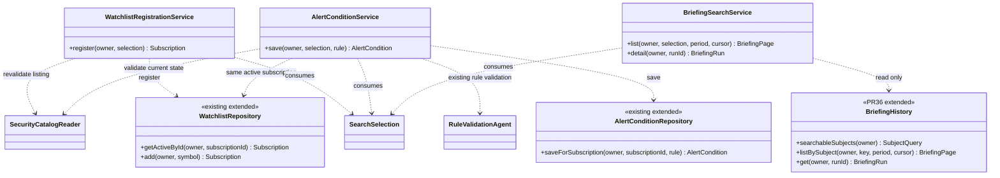
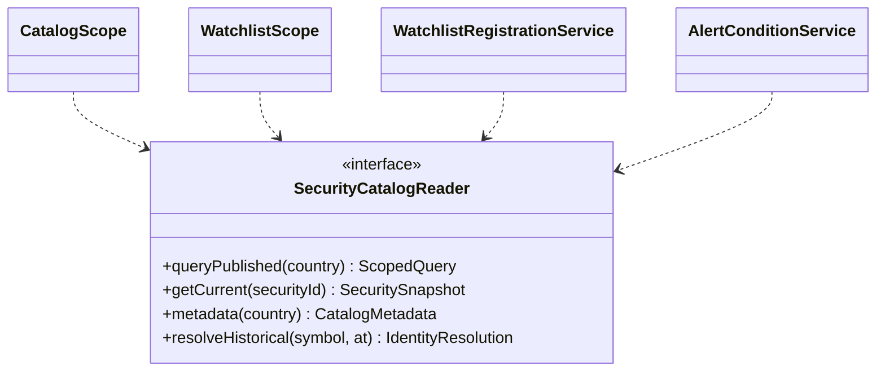
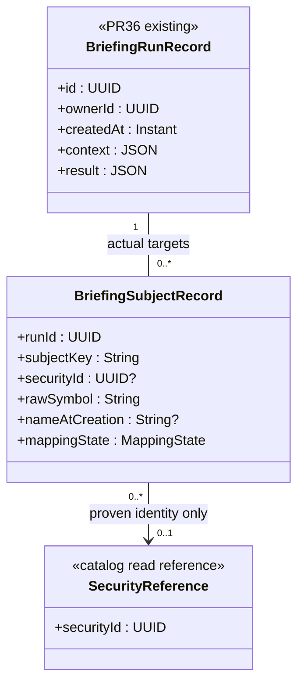

# 종목 검색의 세 사용처 설계

2026-10-12 · v3.2 · [쉬운 설명서·발표용 그림](stock_search_explainer.html) · [공통 검색 상세 설계](stock_search_recommendation_design.md)

## 1. 이번 설계의 결론과 기준

**검색 방법은 공유하되, 검색할 수 있는 범위와 선택 후 결과는 사용처가 결정한다.** 관심종목 등록은 전체 지원 종목, 알림 설정은 본인의 현재 관심종목, 과거 브리핑 열람은 본인에게 조회 권한이 있는 저장 브리핑의 종목을 대상으로 한다. 검색 요청은 검증된 로컬 기준정보를 사용하며, 외부 종목 원천 조회는 별도 갱신 작업이 담당한다.

한국·미국 주식, 보통주·우선주 구별, ETF·ETN 제외, 검증된 한글 별칭, 명시적 종목 확인은 기존 결정 그대로다. 이번 문서는 세 호출 기능의 검색·지정 협력에 집중한다. 주기적 기준정보 갱신은 별도 기능으로 분리한다. 브리핑 생성·카카오 전송·알림 평가 알고리즘은 설계 대상이 아니다.

| 사용처 | 검색 대상 | 사용자가 최종 받는 결과 |
| --- | --- | --- |
| 관심종목 등록 | 현재 신규 등록 가능한 전체 지원 상장종목 | 본인의 관심종목 등록 결과 |
| 알림 설정 | 본인의 종료되지 않은 관심종목 구독에 연결된 종목 | 해당 구독에 연결된 알림 조건 저장 결과 |
| 저장 브리핑 열람 | 본인의 저장 브리핑에 포함된 종목 | 해당 종목을 포함한 기존 브리핑 목록과 본문 |

**확정한 브리핑 검색 정책:** 관심종목 삭제·상장폐지 후에도 본인의 과거 기록을 모두 검색·열람한다. 2026-10-05 사용자 선택을 반영했다. 이 선택은 `BriefingHistory`의 소유자 검증을 완화하지 않는다.

### 실제 코드와 아직 구현되지 않은 것

2026-10-05 원격 확인: main `12ba6a4`, 설계 PR [#38](https://github.com/PhilPark-geosr/stock-agent/pull/38) 열림, 브리핑 PR [#36](https://github.com/PhilPark-geosr/stock-agent/pull/36) `a97f1ce` 열림. 아래는 책임 모델이다. codex/stock-search-implementation에서 세 검색 범위·정렬·대상 색인·UI를 구체화했으며 [실제 클래스/함수 대응과 API](https://github.com/PhilPark-geosr/stock-agent/blob/codex/stock-search-implementation/docs/stock_search_operations.md)를 함께 읽는다. 운영 정책과 공급자 실계정 검증은 대기 중이다.

| 확인한 코드 | 현재 동작 | 이번 설계의 연결 |
| --- | --- | --- |
| main `app/api/routes.py`, `WatchlistRepository` | 인증 계정의 symbol 등록·조회·종료 | 등록 서비스가 검증된 종목 결과를 기존 저장 책임에 전달 |
| main `AlertConditionRepository.save_validated()` | 본인의 활성 구독을 찾아 조건 저장 | 검색 단계도 같은 구독 범위 사용, 저장 직전 재검증 강화 |
| main `AnalysisService.list_analysis_history()` | 공유 종목 분석 이력, API에서 현재 구독 확인 | 개인 브리핑 기록과 구별. 이번 브리핑 검색에 대체 사용하지 않음 |
| PR #36 `BriefingHistory.list/get(owner, ...)` | 소유자별 저장 브리핑 조회 | 종목별 색인·검색 계약 추가. 한 브리핑에 여러 종목 가능 |
| PR #36 `BriefingRunRecord.context` | 당시 대상 symbol들을 JSON으로 보존 | 원문을 유지하고 별도 종목 연결 색인 추가 |

기존 `get_latest_analysis()`는 저장 결과가 없으면 새 분석을 생성한다. **저장 브리핑 검색에서는 호출하지 않는다.** 목록·상세 조회만 사용한다.

## 2. OOA — 사용자 목표와 시스템 경계

사용자가 주 액터다. 검색기·저장소·기준정보 조회기는 내부 책임이며 유스케이스 액터가 아니다. 종목 원천과의 교환은 별도 갱신 기능에서 다룬다. 이 그림은 사용자 목표만 나타낸다.

공통 검색은 각 목표의 수행 수단이다. 별도의 사용자 목표나 `include` 실행 단계로 만들지 않는다.

| 항목 | 명세 |
| --- | --- |
| ID | UC-W |
| 이름 | 관심종목으로 관리 |
| 목적 | 원하는 종목을 지속적으로 관찰할 대상으로 등록한다. |
| 주 액터 | 사용자 |
| 트리거 | 새 종목을 관심종목으로 관리하려 한다. |
| 사전조건 | 본인의 서비스를 이용할 수 있다. |
| 기본 흐름 | ① 원하는 종목 정보를 제공한다. ② 시스템이 등록 가능한 후보와 구별 정보를 제시한다. ③ 사용자가 하나를 확인한다. ④ 시스템이 관심종목 등록 결과를 알린다. |
| 대안·예외 | 일치 없음, 정보 확인 불가, 이미 등록됨, 확인 중 등록 불가로 변경됨을 구분한다. 취소하면 기존 관심종목을 유지한다. |
| 성공 보장 | 사용자가 확인한 유효한 종목이 본인의 관심종목에 등록된다. |

| 항목 | 명세 |
| --- | --- |
| ID | UC-A |
| 이름 | 관심종목 알림 조건 설정 |
| 목적 | 본인이 관찰하는 종목의 원하는 상황을 알림받도록 정한다. |
| 주 액터 | 사용자 |
| 트리거 | 관심종목에 알림 조건을 설정하려 한다. |
| 사전조건 | 본인의 서비스를 이용할 수 있고 관심종목이 있다. |
| 기본 흐름 | ① 원하는 대상 정보를 제공한다. ② 시스템이 본인의 관심종목 후보를 제시한다. ③ 사용자가 대상과 알림 조건을 확인한다. ④ 시스템이 조건 설정 결과를 알린다. |
| 대안·예외 | 관심종목 없음, 일치 없음, 잘못된 조건, 설정 중 관심종목 해제·대상 상태 변경을 안내한다. 취소·실패 시 새 조건은 설정하지 않는다. |
| 성공 보장 | 확인한 본인의 관심종목에만 알림 조건이 설정된다. 조건 저장은 즉시 알림 발송을 뜻하지 않는다. |

| 항목 | 명세 |
| --- | --- |
| ID | UC-B |
| 이름 | 저장된 브리핑 다시 보기 |
| 목적 | 원하는 종목이 포함된 이전 브리핑을 다시 읽는다. |
| 주 액터 | 사용자 |
| 트리거 | 종목과 관련된 과거 브리핑을 찾으려 한다. |
| 사전조건 | 본인의 서비스를 이용할 수 있다. 저장 기록이 없어도 조회할 수 있다. |
| 기본 흐름 | ① 원하는 종목 정보를 제공한다. ② 시스템이 열람 가능한 저장 기록의 종목 후보를 제시한다. ③ 사용자가 종목을 확인한다. ④ 시스템이 해당 종목의 과거 브리핑 목록을 제시한다. ⑤ 사용자가 하나를 열면 시스템이 저장된 내용을 보여준다. |
| 대안·예외 | 후보 없음과 해당 기간 기록 없음을 구별한다. 접근 권한이 없거나 기록을 찾을 수 없으면 내용을 제공하지 않는다. 삭제한 관심종목·상장폐지 종목의 과거 기록도 열람한다. |
| 성공 보장 | 허용된 저장 내용만 제공하며 새 브리핑을 생성하거나 알림을 보내지 않는다. |

## 3. 기능 요구와 도메인

| ID | 요구사항·근거 |
| --- | --- |
| FR-C01 | 이름·코드·검증된 별칭 매칭, 관련도·이름 오름/내림·코드 오름 정렬을 공통 제공. UC-W/A/B |
| FR-C02 | 요청 목적과 인증된 사용자에 맞는 범위를 서버가 적용한 뒤 매칭·정렬·페이지 처리를 수행. UC-W/A/B |
| FR-C03 | 하나여도 자동 확정하지 않음. 선택 결과는 후속 작업 성공·권한 증명이 아니며 실행 직전 재검증. UC-W/A/B |
| FR-C04 | 이름·코드·시장·주식 종류·상태·기준 시점으로 후보 구별. UC-W/A/B |
| FR-W01 | 전체 지원 주식 중 신규 지정 가능 종목으로 본인의 구독을 등록. UC-W |
| FR-A01 | 본인의 활성 구독만 후보화, 저장 직전 동일 구독의 소유·활성 상태 재확인. UC-A |
| FR-A02 | 상장폐지·확인 불가 종목에는 새 알림 조건을 저장하지 않고 이유 표시. 기존 조건의 자동 종료·복원은 수행하지 않음. UC-A, 구현 제안 |
| FR-B01 | 저장 브리핑의 대상 종목으로 검색하며 본문의 임의 문자열 검색과 구별. 종목·기간으로 기존 목록 조회. UC-B |
| FR-B02 | 후보·건수·목록·상세 모두 소유자 범위 적용. UC-B |
| FR-B03 | 관심종목 삭제·상장폐지 후에도 본인 과거 기록 유지·열람. UC-B, 2026-10-05 사용자 확정 |
| FR-B04 | 한 브리핑의 여러 대상 종목을 모두 검색 가능. 애매한 과거 심볼은 새 종목에 추정 연결하지 않음. UC-B |

도메인 용어: **상장종목**은 시장에 상장된 주식, **구독**은 사용자가 그 종목을 관찰하는 관계, **저장 브리핑**은 과거의 불변 기록이다. **검색 범위**는 이번 목적에서 허용되는 후보 집합이다. 한 브리핑에 여러 종목이 있고, 한 종목은 여러 브리핑에 등장한다.

이것은 도메인 관계다. 아직 해석하지 못한 과거 symbol의 저장 방식과 DB 키는 7절 OOD에서 다룬다.

## 4. 최초 시퀀스 — 관계 중심

메서드명·매개변수·SQL을 넣지 않는다. 사람은 사용자뿐이며 저장소는 내부 참여자다. 사용자 화면을 설명하기 위한 세 접점은 같은 검색 UI를 재사용할 수 있다.

### 4.1 관심종목 등록

### 4.2 본인 관심종목의 알림 조건 설정

후보를 본 뒤 구독이 끝나면 저장을 거절한다. 같은 종목을 재등록해 새 구독이 생긴 경우에도 이전 선택을 새 구독에 자동 연결하지 않고 다시 확인받는다.

### 4.3 저장된 브리핑 다시 보기

현재 상장 가능 여부 검사를 이 흐름에 적용하지 않는다. 상폐되어도 과거 문서는 존재할 수 있다. 검색 대상은 당시 브리핑의 대상 목록이며 본문에 우연히 언급된 종목은 자동 추가하지 않는다.

## 5. 상세 클래스 — 검색과 세 호출 기능

### 5.1 설계 선택

**확정 범위와 제안의 구분:** 세 검색 범위와 본인의 삭제·상폐 종목 과거 기록 열람은 사용자 결정이다. FR-A02의 신규 알림 제한 방식은 제안이며, 아래 상태 검사 분기도 이 제안을 전제로 한 OOD다. 공급자·갱신 간격·자료 이용 한도는 별도 갱신 설계의 제안이다. 도표를 작성했다는 이유로 이 정책들이 사용자 합의 완료가 되지는 않는다.

v2의 `SecuritySelectionService`를 **목적에 따른 검색 범위를 받는 공통 서비스**로 구체화한다. 서비스가 모든 후속 작업을 처리하지 않는다. `CandidateScope`는 범위별 데이터 조회 계약이며 세 구현을 둔다. 객체 수만큼 파일·서버를 만들 필요는 없고 기존 저장소와 모듈에 책임을 배치할 수 있다.

`ListedSecurity.isSelectable()`을 모든 검색에 일괄 적용하지 않는다. 등록·새 알림 설정의 제한과 과거 기록 열람을 분리한다. 기존 DTO `SelectedSecurity`는 등록용 결과로 해석하고, 세 목적 공통 반환 계약은 `SearchSelection`으로 확장한다.

위 그림의 통신 경유는 기존 bridge/HTTP를 이용하는 논리 의존성이다.

점선은 사용 의존, 빈 삼각형은 인터페이스 구현이다. 후속 서비스는 검색 서비스가 반환한 데이터를 소비할 뿐, UI가 먼저 검증했다는 이유로 서버 검증을 생략하지 않는다. `SearchSelection`은 인증 토큰이 아니다.

### 5.2 순서와 데이터 계약

1. 라우트가 인증 세션에서 owner를 구한다. 요청 본문의 owner는 신뢰하지 않는다. 서버의 등록·알림·브리핑 접점이 각각 올바른 scope를 선택한다.
2. scope가 허용 후보 질의를 만든다. 공통 서비스가 정규화·이름/코드/별칭 매칭·일치순위·정렬을 붙이고 마지막에 페이지를 자른다. **전체 시장에서 상위 20개를 뽑은 뒤 본인 관심종목만 거르는 방식은 금지**한다.
3. 정렬은 관련도, 이름 오름/내림, 코드 오름 중 하나다. 동점은 이름·시장·코드·후보키로 안정적으로 정한다. 코드 비교는 숫자 변환 없이 문자열 기준이다. 빈 입력도 해당 scope 안에서만 후보를 제공한다.
4. 후보 확인 시 `resolve()`가 같은 scope에서 다시 찾는다. 행 번호 대신 후보키를 사용하며 정렬이 바뀌어도 선택 종목이 달라지지 않는다. 요청 revision으로 늦은 응답을 무시한다.
5. 후속 서비스는 소유·상태를 다시 확인하고 작업한다. 알림 저장은 조건 검증 후 짧은 DB 트랜잭션 안에서 동일 구독의 활성 상태를 재검증한다. 구독 종료와 저장이 경쟁해도 종료된 구독에 활성 조건을 남기지 않도록 잠금 또는 조건부 쓰기를 사용한다.

`SearchContext={authenticatedOwner, purpose}`, `SearchQuery={text, country?, order, cursor?, limit}`. `SearchPage={items, nextCursor, dataState, sourceAsOf}`. 정렬·필터·scope·owner·기준정보 버전이 달라지면 cursor는 재사용하지 않는다. 질의 결과 전체에 정렬을 적용하고 동일 버전 안에서 페이지를 진행한다. 허용되지 않은 종목은 건수에도 포함하지 않는다.

| 목적 | 후보키의 의미 | 확정·실행 시 확인 |
| --- | --- | --- |
| 등록 | 안정적인 상장종목 식별값 | 현재 지원 범위·상장 상태·검증된 조회 symbol. 이미 구독 중이면 중복 생성 방지 |
| 알림 | 본인의 특정 구독 식별값 | 같은 소유자·같은 활성 구독·대상 종목 상태. 재구독은 새 키 |
| 과거 브리핑 | 해석된 종목 또는 과거 기록용 대상키 | 그 키를 포함하는 본인의 열람 가능한 기록 존재. 현재 상장 여부는 열람 제한이 아님 |

브리핑 종목 후보는 기록에서 출발하고, 현재 카탈로그 이름·검증된 별칭은 해석된 동일 종목에 한해 검색 보조로 사용할 수 있다. 상폐·현재 카탈로그 미수록을 이유로 기록 후보를 버리지 않는다. 기존 원문에 당시 이름이 없으면 raw symbol을 표시하며 이름을 지어내지 않는다.

## 6. 별도 기준정보 갱신 기능과의 계약

기준정보의 수집·신규상장/상폐 판정·DB 게시·정기 실행은 [종목 기준정보 갱신 설계](security_catalog_refresh_design.md)가 소유한다. 검색은 갱신 작업을 호출하거나 완료될 때까지 기다리지 않는다. **같은 DB를 사용할 수 있어도 기능의 책임과 읽기/쓰기 계약은 분리한다.** 별도 서버나 새 DB를 반드시 만든다는 뜻은 아니다.

| 검색이 읽는 것 | 계약과 검색의 반응 |
| --- | --- |
| `securityId`, 이름·코드·시장·종류·상장 상태·검증된 별칭 | 후보를 구별하고 사용처에 맞게 신규 지정 가능 여부를 판단한다. 과거 브리핑에 현재 상장 여부를 일괄 적용하지 않는다. |
| 국가별 `catalogVersion`, `sourceAsOf`, `dataState` | 완결된 게시 버전만 읽는다. 갱신 중에는 직전 유효본을 읽으며, 지연·이용 불가를 정상 0건과 구별한다. |
| `READY / STALE / UNAVAILABLE` | STALE은 마지막 검증본과 실제 시점을 안내한다. 현 구현 제안에서는 STALE과 UNAVAILABLE이면 신규 등록·새 알림 설정을 제한하되 저장 브리핑은 계속 열람한다. 상태 산정 기준은 갱신 기능이 소유한다. |
| 종목 식별·코드 유효기간 이력 | 과거 브리핑의 당시 symbol을 같은 종목에 연결할 근거로만 사용한다. 입증하지 못한 기록은 미해석 상태로 보존한다. |

`SecurityCatalogReader`는 검색 기능이 필요한 읽기 계약이다. 갱신 기능의 `SecurityCatalogWriter`는 게시와 실행 이력을 다룬다. 두 기능의 협력 지점은 게시된 기준정보와 메타데이터이며, 검색 클래스가 scheduler·lease·원천 공급자에 의존하지 않는다. 브리핑 색인의 초기 이관은 검색 기능의 자료 준비 작업이고 정기 종목 원천 갱신과 별개다.

## 7. DB 관계와 기존 자료 이관

### 7.1 논리적 저장 구조

위는 OOD의 논리 구조이며 유스케이스의 외부 결과가 아니다. `BriefingSubjectRecord`는 한 브리핑의 여러 대상 종목을 연결하는 검색 색인이다. FK 삭제 연쇄로 저장 브리핑을 지우지 않는다. `SecurityReference`는 별도 기능이 관리하는 기준정보의 읽기 참조이며, 검색이 상장 상태·별칭 원천·갱신 이력을 쓰지 않는다.

- 조회 인덱스: 구독의 owner/활성 상태, 브리핑의 owner/생성시각/id, 대상 색인의 subjectKey/runId. 후보 집계도 owner를 조인한 뒤 수행한다.
- 구독·알림의 기존 symbol 계약은 유지하되, 구독에 nullable `security_id`를 점진 도입하는 연결안을 둔다. 확실히 해석된 것만 채운다. 알림은 기존 `subscription_id`로 구독과 연결한다.

### 7.2 과거 브리핑 색인 채우기

1. PR #36 통합 이후 `context.symbols`의 **실제 대상 목록**을 읽어 브리핑마다 대상 색인을 생성한다. completed/partial로 저장 결과가 있는 브리핑을 기본 검색 대상으로 한다. 실패 실행 로그는 별도 실행 이력에서 유지한다.
2. 당시 시각·시장·원천 식별 이력으로 같은 종목임이 입증되면 `security_id`를 연결한다. 이름·현재 symbol 일치만으로 연결하지 않는다.
3. 입증하지 못하면 `security_id=NULL`, `mappingState=UNRESOLVED`, 과거 기록용 subjectKey와 raw symbol을 보존한다. 같은 티커의 미해석 기록을 하나의 회사라고 합치지 않는다. 사용자에게 “당시 종목 정보 확인 필요”와 기록 시점을 함께 표시한다.
4. 원문 context/result는 변경하지 않는다. 초기 Alembic 이관에서 `(runId, symbol)`을 중복 생성하지 않는다. 대규모 이관의 중간 체크포인트 배치는 현재 구현 범위 밖이다.
5. 신규 브리핑 저장 시 실제 대상과 종목 ID·당시 표시 정보를 함께 색인에 반영한다. 원문 저장과 색인 쓰기는 한 트랜잭션으로 처리한다. 초기 이관 중에는 준비된 국가/계정 범위를 표시하거나 기존 owner별 목록으로 열람할 수 있게 하여 미색인 데이터를 “기록 없음”으로 오해시키지 않는다.

구 main의 공통 `AnalysisResult`는 개인 소유 `BriefingRunRecord`로 자동 변환하지 않는다. 두 기록의 소유·권한 모델이 다르기 때문이다.

## 8. 확정 범위와 남은 결정

세 사용처의 범위와 삭제·상폐 종목의 본인 과거 브리핑 검색·열람은 사용자 요청대로 확정했다. 새 알림 설정에서 상폐·정지·확인 불가 대상을 제한하는 방식은 이유를 표시하는 기본안으로 둔다. 기존 알림의 자동 종료·평가 중단·복원 정책은 별도 알림 기능에서 정한다.

공급자·갱신 주기·재시도·지연 상태 산정·상시 실행 환경은 [기준정보 갱신 설계](security_catalog_refresh_design.md)의 미확정 운영 항목이다. 검색 기능에 같은 수치를 중복 정의하지 않는다.

## 9. 추적·검증 기준

| 클래스/구조 | 근거 |
| --- | --- |
| `SecurityPicker`, `SearchCandidate`, `SearchSelection`, `SecuritySelectionService` | FR-C01~04: 매칭·정렬·구별·명시 확인 |
| `CandidateScope`, 세 scope 구현 | FR-C02, W01, A01, B01~03: 허용된 집합을 먼저 조회 |
| `WatchlistRegistrationService` + 기존 구독 저장소 | FR-W01, C03: 현재 유효성·중복 재확인 |
| `AlertConditionService` + 조건 검증/저장소 | FR-A01/02, C03: 같은 활성 구독·조건 검증·저장 |
| `BriefingSearchService`, `BriefingHistory` 확장 | FR-B01~04: owner 범위·읽기 전용·과거 자료 |
| `BriefingSubjectRecord` | FR-B04, 기준정보 읽기 계약: 다종목 브리핑과 과거 심볼 식별 |
| `SecurityCatalogReader` | FR-C04, B04: 게시된 기준정보·시점·식별 이력을 읽는 경계 |
| `SearchContext`, `SearchQuery`, `ScopedQuery`, `OrderedQuery` | FR-C01/02: 인증 범위·검색 조건·정렬을 전달하는 값 계약 |
| `SearchPage`, `BriefingPage`, `SecuritySummary`, `CatalogMetadata` | FR-C01/04, B01/02: 후보·기록 목록과 구별 정보·자료 상태 |
| `CandidateKey`, `SecuritySnapshot`, `IdentityResolution`, `SecurityReference` | FR-C03/04, B04: 재확인 대상·검증된 읽기 참조·과거 식별의 확실성 |
| `Subscription`, `AlertCondition`, `BriefingRun`, `BriefingRunRecord` | FR-W01, A01, B01~03: 기존 소유 관계·조건·저장 기록의 반환/참조. 별도 중복 저장소를 추가하는 뜻이 아님 |

| 인수 사례 | 기대 |
| --- | --- |
| ‘삼성’ 전체 등록 검색 vs 내 알림 검색 | 전체 범위 후보와 본인 구독 범위 후보가 달라짐 |
| 본인 종목이 전체 관련도 상위 페이지 밖에 있음 | scope를 먼저 적용하므로 본인 검색에서 누락되지 않음 |
| 다른 사용자의 종목·브리핑 ID를 직접 전달 | 후보·건수·목록·상세·저장 단계 모두 허용되지 않음 |
| 후보 선택 뒤 정렬 변경 | 같은 후보키 유지, 첫 행 자동 지정 없음 |
| 알림 후보 선택 뒤 구독 삭제·재등록 | 옛 구독 선택으로 저장 불가, 새 구독 재확인 |
| 상폐 후 과거 브리핑 조회 | 새 등록은 차단, 본인의 과거 원문은 유지·열람 |
| 한 브리핑에 AAPL·MSFT 포함 | 두 종목 각각으로 같은 저장 기록을 찾음 |
| 과거 코드 재사용·식별 불확실 | 새 회사에 과거 기록 자동 연결 금지 |

AGENTS 자체 검토: (1) 세 UC는 사용자 목표, (2) Essential Style, (3) Black box, (4) UC 그림은 액터/목표만, (5) include 미사용, (6) 명세 필수 항목 분리, (7) FR·UI·DB는 OOA 밖, (8) 이번 요청의 범위 안에서 상세화하되 검색 기본안은 확정 사항과 구분, (9) 위 추적표로 OOD 근거 표시, (10) 사용자와 내부 컴포넌트 구별, (11) 목표의 UI 독립성·관찰 가능한 기본 흐름·UC 그림의 내부 정보 배제·include 오용 없음·요구 추적을 점검했다. 관계 중심 최초 시퀀스와 상세 클래스·DB 다이어그램은 별도 절로 유지한다.

2026-10-07 재검토: [절대규칙 적용 검토](design_rules_audit.md). 설명서의 시퀀스는 본 문서의 참여자·화살표와 동일하게 맞췄다.

## 11. 구현에서 확인한 정책

기존 구독의 종목 ID는 추정 연결하지 않아 NULL로 보존한다. 연결 확인 없이 새 알림을 만들 수 없으며, 단순 삭제/재등록은 기존 알림 종료를 수반하므로 이전 절차를 결정해야 한다. 기존 알림의 자동 중지·복원은 별도 미결이다. 검색은 외부 API를 호출하지 않고 저장 직전에 현재 DB 상태와 동일 구독을 재확인한다. 상세 API·지연/자료 범위 제약은 [구현·운영 문서](https://github.com/PhilPark-geosr/stock-agent/blob/codex/stock-search-implementation/docs/stock_search_operations.md)를 따른다.
