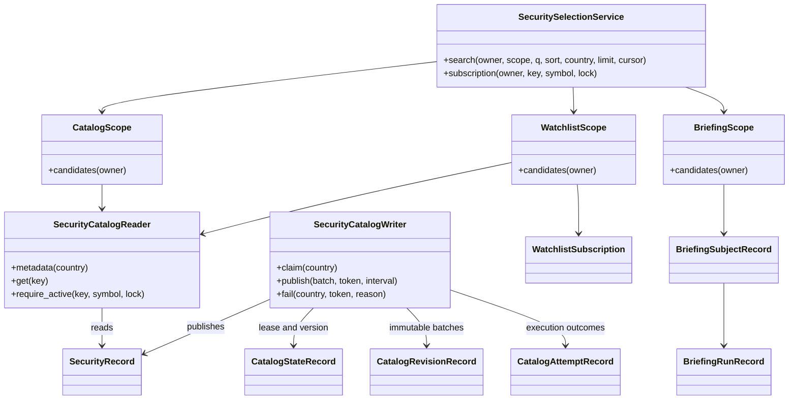

# 종목 검색 구현과 기준정보 운영

2026-10-12. 기준: 최신 main `12ba6a4`, 브리핑 PR #36 `a97f1ce`. 구현은 #36 위에 쌓인 별도 PR이다. 설계용 AGENTS.md는 [PR #39](https://github.com/PhilPark-geosr/stock-agent/pull/39), 사용자 목표·관계 시퀀스·클래스 설계와 쉬운 설명서는 [PR #38](https://github.com/PhilPark-geosr/stock-agent/pull/38)에 있다.

## 1. 사용자가 보는 흐름과 현재 상태

1. 관심종목 등록: 전체 지원 종목에서 이름·코드·제공자가 확인한 별칭으로 조회 → 시장·종류·기준일을 확인하고 하나 선택 → 등록.
2. 알림 조건 설정: 본인의 활성 관심종목만 조회 → 하나 선택하고 조건 작성 → 검증 후 같은 구독에 저장.
3. 저장 브리핑 열람: 본인의 완료·부분 완료 기록에 등장한 종목 조회 → 선택 → 거래일 기간으로 좁혀 저장 결과 열람. 삭제한 관심종목과 상폐 종목도 포함한다. 검색으로 새 분석을 생성하거나 메시지를 보내지 않는다.

네 정렬(관련도, 이름 오름/내림, 코드 오름), 결과 더 보기, 선택 상태와 검색 실패/미준비 안내를 공통 사용한다. 한 결과라도 자동 등록하지 않는다. 정렬은 선택을 유지하고 검색어·국가 변경은 선택을 해제한다. 범위·사용자·검색 조건·결과 집합이 달라진 커서는 409로 거절한다.

**운영 정책은 아직 사용자 응답을 기다리는 제안값이다.** 신규 등록/알림의 상태 제한과 공급자별 주기는 검증 가능한 구현 초안이며, 실제 서버의 자동 갱신을 활성화하지 않았다. 공급자 키도 설정되지 않았다. HTTP 계약은 공식 문서와 모의 HTTP 응답으로 검사했으며 실계정 호출 성공을 뜻하지 않는다.

## 2. 검색 API를 요청하는 방법

서비스 로그인으로 발급된 세션을 `Authorization: Bearer <service-session-token>` 헤더에 넣는다. owner는 서버가 인증 세션에서 결정한다. 공급자 API 키는 서버 환경설정에만 넣는다.

```http
GET /securities/search?scope=catalog&q=삼성&country=KR&sort=name_asc&limit=30
Authorization: Bearer <service-session-token>
```

| 인자 | 값 |
| --- | --- |
| scope | 필수: catalog / watchlist / briefings |
| q | 이름·코드·별칭. 최대 100자. 빈 값은 해당 범위 목록 |
| country | 생략 또는 KR / US |
| sort | relevance(기본), name_asc, name_desc, code_asc |
| limit | 1~100, 기본 30 |
| cursor | 이전 응답 next_cursor. 다른 조건에 재사용하지 않음 |

응답은 `items`, `total`, `next_cursor`, 국가별 `catalog` 메타데이터다. 각 후보의 `key`, `symbol`, `name`, `country`, `status`, `selectable`, `source_date`, `note`를 표시한다. 후보 키는 권한 토큰이 아니다.

```http
POST /watchlist
Authorization: Bearer <service-session-token>
Content-Type: application/json

{"symbol":"005930.KS","security_id":"<선택한 후보의 security_id>"}
```

```http
POST /alert-conditions
Authorization: Bearer <service-session-token>
Content-Type: application/json

{"symbol":"005930.KS","subscription_id":123,"user_rule":"전일 대비 5% 상승하면 알려줘"}
```

등록은 현재 카탈로그, 알림은 같은 구독의 소유·활성 상태와 카탈로그를 재확인한다. 느린 조건 검증 이후에도 동일 구독을 확인한다. 삭제 후 재등록된 새 구독으로 자동 전환하지 않는다. 기존 symbol-only API는 유일하게 해석되는 현재 종목/구독만 허용하는 호환 경로이며 새 UI는 위 식별자를 반드시 보낸다.

```http
GET /briefings?subject=<선택한 후보의 key>&date_from=2026-09-01&date_to=2026-10-12&limit=30&offset=0
Authorization: Bearer <service-session-token>

GET /briefings/<run_id>
Authorization: Bearer <service-session-token>
```

기간은 브리핑의 거래일 기준이며 양끝을 포함한다. 종목을 생략하면 본인의 기존 목록이다. 후보·건수·목록·상세에 소유자 검증을 적용한다. 401은 미인증, 404는 본인 대상 없음, 409는 선택/현재 상태 변경, 422는 입력 형식·기간·조건 검증 실패다. 외부 공급자 장애는 검색 요청이 공급자에 재접속하지 않으며 메타데이터로 안내한다.

## 3. 공급자에게 요청하는 방법

### 한국: KRX

`GET https://data-dbg.krx.co.kr/svc/apis/sto/stk_isu_base_info?basDd=YYYYMMDD`와 `ksq_isu_base_info`를 모두 받아 한 국가 배치로 처리한다. 헤더 `AUTH_KEY`에 승인받은 키를 넣는다. 두 시장 중 하나라도 빈 응답·오류이면 게시하지 않는다. 표준코드로 식별하고 보통주·우선주만 수용한다. 상장일 이후 자료만 활성화한다.

공식 페이지는 [유가증권 종목기본정보](https://openapi.krx.co.kr/contents/OPP/USES/service/OPPUSES002_S2.cmd?BO_ID=PiwgMdTwmsenXhmqqxuj)와 [코스닥 종목기본정보](https://openapi.krx.co.kr/contents/OPP/USES/service/OPPUSES002_S2.cmd?BO_ID=CifLHplnUFMgpHIMMPXs)다. API 이용 신청·승인과 실제 계정의 응답 스키마 검증이 필요하다. **이 기본정보 응답에 상폐일은 없다. 목록에서 빠지면 unknown으로 두며 국내 상폐 확정 자동화는 추가 근거 공급자가 필요하다.**

### 미국: Alpha Vantage

`GET https://www.alphavantage.co/query?function=LISTING_STATUS&state=active&date=YYYY-MM-DD&apikey=<key>`와 `state=delisted`를 요청한다. CSV로 제공되며 상폐 목록의 날짜를 사용한다. ETF와 명칭으로 확인되는 ETN·권리·워런트·유닛을 제외한다. 상장일이 없거나 지원 심볼 형식이 아닌 행은 포함하지 않는다. 자료 범위 밖의 미국 상품까지 전부 지원한다고 표시하지 않는다.

[공식 문서](https://www.alphavantage.co/documentation/#listing-status)는 최신 거래일/과거 날짜 기준 목록임을 설명한다. [공식 지원 안내](https://www.alphavantage.co/support/)의 기본 25회/일 한도에 맞춰 2회/배치 × 4회/일인 6시간 간격을 제안한다. 이 공급자의 데이터를 거래소의 공식 상폐 공시라고 표현하지 않는다. 티커+상장일+거래소를 공급자 내 관측 식별로 쓰며 티커 변경을 같은 회사로 추정 병합하지 않는다. 글로벌 영구 증권 ID나 완전한 코드 변경 이력은 제공하지 못하므로 그 수준의 정확성이 필요하면 추가 원천을 선정해야 한다.

두 공급자 모두 거래소 달력상 장 마감 2시간이 지난 가장 최근 거래일을 요청한다. 이는 안전한 요청 날짜를 정하는 구현 기본안이며 공급자 발표 SLA가 아니다. 휴장·발표 지연·예외 휴장을 실계정 검증해야 한다. 상장폐지는 발표를 미리 알더라도 효력일 전에는 상폐 상태로 바꾸지 않는다.

## 4. 주기 갱신과 상태 정책 — 사용자 확인 대기

| 정책 | 구현 제안과 영향 |
| --- | --- |
| 검색 때 외부 요청 | 없음. 게시된 DB를 조회하고 등록/알림 저장에서 재검증. 검색량과 외부 API 사용량을 분리 |
| 주기 | 한국 최소 60분, 미국 최소 360분. 환경값으로 더 느리게 설정 가능 |
| 상태 제한 | active와 READY일 때만 신규 등록/알림 허용. delisted/unknown/pending/STALE/UNAVAILABLE은 이유와 함께 제한 |
| 기존 기록 | 구독·조건·브리핑을 자동 삭제하지 않음. 기존 알림의 평가 중지/복원은 이번 기능에서 변경하지 않음 |
| 자료 지연 | 원천일 7일 초과 또는 마지막 정상 수집 48시간 초과면 STALE. 최초 정상 게시가 없으면 UNAVAILABLE |
| 재시도 | 국가별 5/15/30분, 이후 30분 간격. rate limit 응답은 24시간 유예. 다른 국가 작업은 계속 |
| 중복·재기동 | 국가별 10분 lease와 토큰, 게시 버전 확인. 만료 작업만 다시 확보. 놓친 모든 회차를 재실행하지 않음 |
| 감사 | 성공 판본 원문, 성공/실패/만료 실행 기록 보존. 현 단계 자동 정리 없음 |

**확인할 정책:** 위 운영 주기·지연 허용·신규 제한, 국내 상폐 근거 공급자, 미국 이름 변경/종류/한글 별칭 추가 원천, 기존 미연결 구독의 확인 절차, 기존 알림을 언제 중단·복원할지, 감사 데이터 보존 기간. 이미 확정된 “삭제·상폐 후 과거 브리핑 열람”은 재승인 대상이 아니다. 키 설정만으로 이 미결 정책이 승인된 것은 아니다.

## 5. 코드와 설계 책임의 연결

원래 설계의 클래스는 책임 단위다. 기존 저장소·라우트와 공통 함수를 활용해 얇은 클래스들을 중복 추가하지 않았다. 아래는 관계 시퀀스 이후 상세 구현 대응표다.

| 설계 책임 / 요구 | 구현 |
| --- | --- |
| SecurityPicker, SearchSelection / FR-C01/03/04 | 공통 createSecurityPicker, 선택 후보와 후속 요청의 security_id/subscription_id/subject |
| SecuritySelectionService, CandidateScope / FR-C01/02 | stock_search.py의 서비스와 CatalogScope/WatchlistScope/BriefingScope |
| WatchlistRegistrationService / FR-W01/C03 | 등록 라우트 + SecurityCatalogReader.require_active + 기존 WatchlistRepository |
| AlertConditionService / FR-A01/02 | 알림 라우트의 사전 확인 + 기존 검증기 + 저장소의 최종 동일 구독 검사 |
| BriefingSearchService / FR-B01~04 | briefing_subject_query, 기존 BriefingHistory와 라우트, BriefingSubjectRecord |
| CatalogRefreshScheduler / FR-U01/04 | catalog_loop, run_catalog_tick. 분석/브리핑 실행 시간과 독립 |
| CatalogRefresh, Writer, 실행 소유 / FR-U02~04 | SecurityCatalogWriter의 claim/publish/fail과 검증 |
| SecurityCatalogSource / FR-U01/03 | KrxCatalogSource, AlphaVantageCatalogSource, CatalogBatch |
| CatalogVersion/이력 / FR-U03~05 | SecurityRecord, CatalogStateRecord, CatalogRevisionRecord, CatalogAttemptRecord |



FR-C02의 범위 조건을 먼저 적용한다. 현재는 허용된 범위의 후보를 메모리에 읽어 정규화·정렬한 뒤 페이지를 나눈다. 규모가 커지면 같은 계약을 유지하며 SQL 검색으로 옮길 수 있다. 현재 구현은 대규모 검색 성능을 검증한 검색 엔진이 아니다.

## 6. 마이그레이션과 실행

2026-10-18 main 통합: `0012_merge_catalog_beta`에서 `0011_security_catalog`와 main의 `0011_merge_beta_briefing`을 하나의 head로 합친다. 이미 적용된 revision은 수정하지 않으며, 어느 기존 경로에서 시작해도 초대·베타 권한·브리핑·종목 기준정보가 함께 유지된다. 신규 검색 API도 main의 베타 권한 검증을 따른다. 웹의 코드 입력은 6자리 숫자만 `.KS`를 보완하고 미국 티커는 그대로 전달한다.

`0011_security_catalog`는 기준정보/게시/실행 이력과 과거 대상 색인을 추가한다. 기존 context/result를 변경하지 않고 completed/partial의 context.symbols만 색인한다. 과거 심볼은 임의 연결 없이 실행별 snapshot 키로 남긴다. 신규 브리핑은 생성 당시 구독의 확인된 ID·표시명을 저장하고 결과와 색인을 함께 커밋한다.

기존 구독은 security_id가 NULL인 채 보존된다. 새 알림을 만들려면 목록에서 다시 등록해 연결을 확인해야 한다. **삭제 후 재등록은 이전 알림 조건을 종료시키는 기존 동작이 있으므로, 기존 사용자가 있는 배포에서는 이 이전 절차를 먼저 결정해야 한다. 자동으로 삭제하거나 재등록하지 않는다.**

다음은 운영자가 검증된 별도 DB에서 실행할 명령이다. 이번 작업에서 사용자의 운영 DB를 마이그레이션하지 않았다.

```powershell
python -m alembic upgrade head
python -m app.cli.catalog --status
python -m app.cli.catalog
```

`--status`는 상태를 조회하며 시작 시 필요한 스키마 이관을 수행한다. 일반 실행은 due인 국가만 수집한다. 임의 사용자가 공급자 한도를 소모하게 하는 공개 갱신 HTTP 엔드포인트는 두지 않았다.

서버 설정은 `.env.example`의 CATALOG 항목을 참조한다. 실제 API 키를 채팅·PR·프런트엔드에 넣지 않는다. 정책과 공급자 연결을 검증한 뒤 `CATALOG_SCHEDULER_ENABLED=true`로 백엔드의 독립 루프를 켠다. PC/서버가 꺼지면 그동안 갱신하지 못하고 다음 시작에서 보충한다.

## 7. 자체 검토

유스케이스는 원 설계의 UC-W/A/B/M01을 유지하고 새 UI 동작을 별도 목표로 만들지 않았다. 위 API/DB/메서드는 OOD의 구현 계약이며 UC 액터나 외부 성공 보장으로 올리지 않았다. 모든 구현 책임은 표의 FR로 연결된다. 새 정책을 확정된 사용자 합의로 표현하지 않았다. 테스트는 권한·동일 구독 경합·불변 기록·상폐 효력·lease·실패 보존·HTTP 계약·UI 선택/응답 순서와 마이그레이션을 확인한다. 실계정 공급자 호출과 운영 규모의 성능은 별도 검증이 필요하다.
